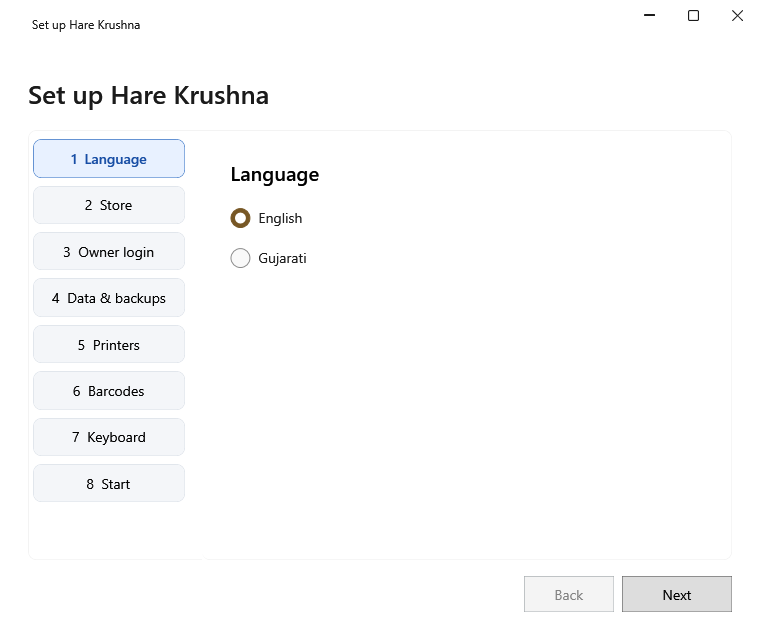

<!-- Screen help for first-run setup (topic "setup"). The app shows this file for the ⓘ button and F1. Each step is a tab; a section named as the tab opens with it. Bold names in a table's first column must match the labels on screen; see ../README.md. -->
# Set up Hare Krushna

Set the shop up the first time the app opens: language, store, owner login, data and backups, printers, barcodes and keyboard.

Go through the steps with **Next**. Each step is checked before the next one opens, and you can click back to any step you have already seen. **Finish** on the last step saves everything and takes the first backup.

## 1 Language

| Field | What it means |
|---|---|
| **English**, **Gujarati** | The language of the app's screens and help. Numbers always show in English digits. |

## 2 Store

| Field | What it means |
|---|---|
| **Store name** | The shop's name, as receipts print it. Required. |
| **Address**, **Phone** | The shop's address, which receipts print, and its phone number. |
| **GSTIN** | The shop's GST number, 15 characters, or blank. Typing it fills **State** from its first two digits. |
| **State** | The shop's state. |
| **Tax mode** | **Regular GST** shows the tax in each bill; **Composition** and **Not registered** bills show no tax. |

## 3 Owner login

There is no password recovery. Keep the password somewhere safe.

| Field | What it means |
|---|---|
| **Username** | The name to sign in with. |
| **Password (8+ characters)** | The password to sign in with. |
| **Confirm password** | The same password again. |

## 4 Data & backups

| Field | What it means |
|---|---|
| **Data folder** | Where the shop's data is kept. |
| **Choose an empty data folder** | Keeps the data in another, empty folder instead. |
| **Backup folder** | Where backups are saved. Required. A folder kept in step with the cloud, such as OneDrive, is refused. |
| **USB backup reminder** | How often the app reminds you to copy a backup to a USB drive. |

## 5 Printers

Install each printer's Windows driver first, and type the printer's name as Windows shows it. Leave a printer blank if the shop has none.

| Field | What it means |
|---|---|
| **Receipt printer** | The printer for bills and day-end summaries. |
| **Receipt width** | The receipt paper's width, 58 or 80 mm. |
| **Receipt mode** | **Raster (English and Gujarati)** prints Gujarati too; **Text (English only)** prints plain English text. |
| **Label printer** | The printer for price and barcode labels. |
| **Label size** | The size of one label. |
| **Print test** | Prints a test page on the printer beside it. |

## 6 Barcodes

Barcodes the app prints start with one of these two-digit prefixes, so a scan knows what it is. Use different prefixes.

| Field | What it means |
|---|---|
| **Lot prefix** | The start of the barcode on a lot's label. |
| **Product prefix** | The start of the barcode on a product's label. |
| **Scale label prefix (optional, 2 digits)** | The start of the barcode a weighing scale prints: prefix, 5-digit PLU, 5-digit weight in grams and a check digit. Leave it blank if your scale uses another format. |

## 7 Keyboard

To type in Gujarati, install the Gujarati Phonetic keyboard in Windows Settings → Time & language → Language & region. This step says whether it was found.

## 8 Start

**Finish** saves the setup and takes the first backup. The product list starts empty: add products on the Products page, one by one or with **Import Excel**. Opening stock can be entered later.

## Buttons

| Button | What it does |
|---|---|
| **Back** | Goes to the step before. |
| **Next** | Checks this step and goes to the next. |
| **Finish** | On the last step: saves the setup and takes the first backup. |
| **Retry backup** | Shown when the first backup failed: check the backup folder, then try again. |
