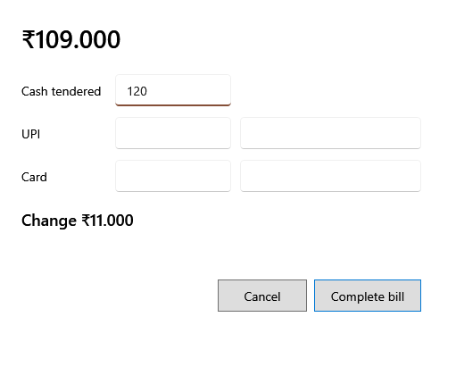

<!-- Screen help for Take payment (topic "split-payment"). The app shows this file for the ⓘ button and F1. Bold names in a table's first column must match the labels on screen; see ../README.md. -->
# Take payment

Take the bill's payment in cash, UPI, card or a mix, and complete the bill.

The amount at the top is what the bill comes to. **F9 Cash** opens this with all of it in cash, **F10 UPI** with all of it by UPI, and **F11 Split** with it in cash, to share out. Under the boxes, what is still to pay, or the change to give back, is shown as you type. Completing the bill takes the stock, gives the bill its date and number, and prints the receipt.

## Fields

| Field | What it means |
|---|---|
| **Cash tendered** | The cash the customer hands over. It can be more than is due; the change is shown. |
| **UPI** | The amount paid by UPI. |
| **UPI transaction reference (optional)** | The UPI transaction number, to find the payment later. |
| **Card** | The amount paid by card. |
| **Card last four digits (optional)** | The card's last four digits. |

## Buttons

| Button | What it does |
|---|---|
| **Complete bill** | Completes the bill when the amounts cover it. Only cash can be more than the bill. Enter does the same. |
| **Cancel** | Goes back to the bill without taking the payment. |
