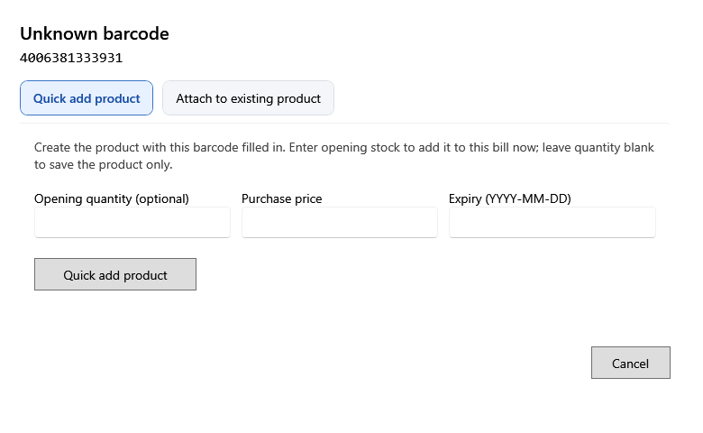

<!-- Screen help for Unknown barcode (topic "unknown-barcode"). The app shows this file for the ⓘ button and F1. Bold names in a table's first column must match the labels on screen; see ../README.md. Each tab has its own section, named as the tab. -->
# Unknown barcode

A scanned barcode, or a typed number of eight or more digits, matches no product. Add the product now, or attach the barcode to a product you already have.

A typed product name never opens this window, so a name is never saved as a barcode. **Cancel** closes it without a change.

## Quick add product

Creates the product with this barcode filled in. Enter opening stock to sell it on this bill now; leave the quantity empty to save the product only.

| Field | What it means |
|---|---|
| **Opening quantity (optional)** | Stock to add with the product, as a new lot. |
| **Purchase price** | One piece's cost before tax, for that lot. |
| **Expiry (YYYY-MM-DD)** | The lot's expiry date, if it has one. |
| **Quick add product** | Opens the short product form, then adds the product, and its stock if a quantity is given. |

## Attach to existing product

| Field | What it means |
|---|---|
| **Search by SKU, name, local name, alias, or brand** | Find the product the barcode belongs to. |
| **SKU**, **Name**, **Category**, **Stock** | The products that match. |
| **Attach to existing product** | Adds the barcode to the selected product, so the next scan finds it. |
| **Open barcode owner** | When the barcode already belongs to a product, opens that product. |
