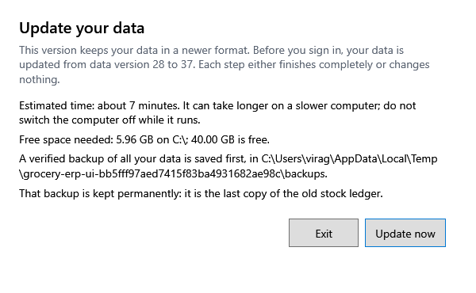

<!-- Screen help for Update your data (topic "upgrade"). The app shows this file for the ⓘ button and F1. Bold names in a table's first column must match the labels on screen; see ../README.md. -->
# Update your data

After the app is updated, bring the shop's data up to the new version before signing in.

Nothing changes until you press **Update now**. The window says how long it should take, how much free disk space it needs and where the backup goes. A verified backup of all the data is saved first; then each step either finishes completely or changes nothing. Do not switch the computer off while it runs. If there is not enough free space, free some and start the app again.

If the update stops, your data is safe: the window says where the backup is and where the log files are. Start the app again to retry. To go back to the previous version, install it and restore that backup in Settings.

## Buttons

| Button | What it does |
|---|---|
| **Update now** | Saves the backup, then updates the data. |
| **Exit** | Closes the app without changing anything. |
| **Open backup folder** | Shown when the update stopped: opens the folder with the backup taken before it. |
