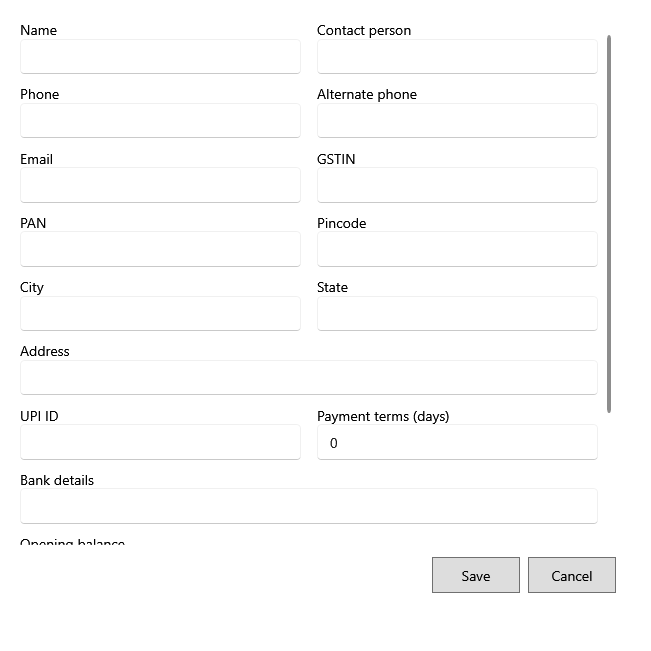

<!-- Screen help for the vendor form (topic "vendor-editor"). The app shows this file for the ⓘ button and F1. Bold names in a table's first column must match the labels on screen; see ../README.md. -->
# New vendor

Add a vendor or change one: contact, tax numbers, address and payment details.

Fields marked * are required. A problem is shown under its field and listed at the top when Save fails; what you typed is kept.

## Fields

| Field | What it means |
|---|---|
| **Name** | The vendor's name, as purchases and the ledger show it. |
| **Contact person** | Whom you deal with there. |
| **Phone**, **Alternate phone** | Numbers to reach the vendor. |
| **Email** | The vendor's email address. |
| **GSTIN** | The vendor's GST number, 15 characters. The GST summary groups purchase tax by it. |
| **PAN** | The vendor's PAN, 10 characters. |
| **Address**, **City**, **State** | Where the vendor is. |
| **Pincode** | 6 digits. |
| **UPI ID** | For paying the vendor by UPI. |
| **Payment terms (days)** | How many days the vendor gives to pay a bill. |
| **Opening balance** | What you owed this vendor before you started using the app. It starts the vendor's ledger. |
| **Bank details** | Account details for bank payments. |
| **Notes** | Anything else worth keeping. |

## Buttons

| Button | What it does |
|---|---|
| **Save** | Saves the vendor. |
| **Cancel** | Closes without saving. |
