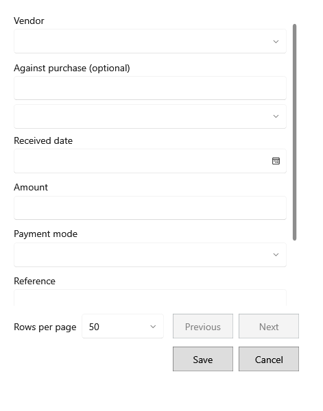

<!-- Screen help for Vendor payment (topic "vendor-payment"). The app shows this file for the ⓘ button and F1. Bold names in a table's first column must match the labels on screen; see ../README.md. -->
# Vendor payment

Record money paid to a vendor. It lowers the vendor's balance due.

Choose a bill to settle it, or leave the bill empty for an on-account payment.

## Fields

| Field | What it means |
|---|---|
| **Vendor** | Who was paid. |
| **Against purchase (optional)** | The bill this payment settles. Leave it empty to pay on account. |
| **GRN or vendor bill no.** | Finds the vendor's bill by its GRN or bill number. |
| **Next page**, **Previous page** | Step through the vendor's bills when there are more than fit. |
| **Payment date** | The day it was paid. |
| **Amount** | How much was paid. |
| **Payment mode** | **Cash**, **UPI**, **Bank**, **Cheque** or **Other**. |
| **Reference** | The cheque, UPI or bank reference. |
| **Notes** | Anything else worth keeping. |

## Buttons

| Button | What it does |
|---|---|
| **Save** | Records the payment. |
| **Cancel** | Closes without a change. |
