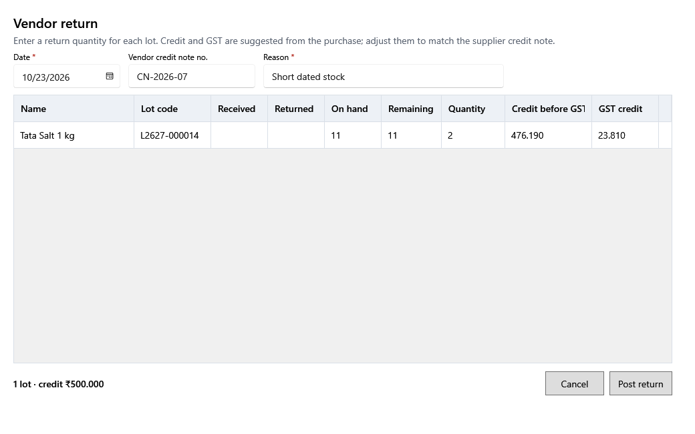

<!-- Screen help for Vendor return (topic "vendor-return"). The app shows this file for the ⓘ button and F1. Bold names in a table's first column must match the labels on screen; see ../README.md. -->
# Vendor return

Send part of a posted purchase back to the vendor and record the credit you get for it.

Enter a quantity for each lot going back. The credit and tax are suggested from the purchase; change them to match the vendor's credit note. Posting takes the stock out of the lots and lowers the vendor's balance; a return lowers the tax paid in the GST summary on its date. You confirm before anything changes.

## Fields

| Field | What it means |
|---|---|
| **Date** | The day of the return. It counts on this date. |
| **Vendor credit note no.** | The number on the vendor's credit note. |
| **Reason** | Why the goods go back. |
| **Name**, **Lot code** | The product and its lot from this purchase. |
| **Received** | How much the purchase brought into the lot. |
| **Returned** | How much has gone back already. |
| **On hand** | The lot's stock now. |
| **Remaining** | How much can still go back. |
| **Quantity** | How much goes back now, up to what remains and is on hand. |
| **Credit before tax** | The credit for these units, before tax. |
| **Tax credit** | The purchase tax credited back. |

## Buttons

| Button | What it does |
|---|---|
| **Post return** | Posts the return after you confirm. |
| **Cancel** | Closes without a change. |
