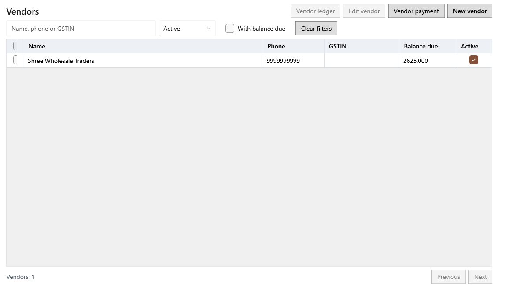

<!-- Screen help for Vendors (topic "vendors"). The app shows this file for the ⓘ button and F1. Bold names in a table's first column must match the labels on screen; see ../README.md. -->
# Vendors

Keep your vendors' details, see what you owe each one, record payments and read each vendor's ledger.

A vendor's balance due is the opening balance plus posted purchases, less payments and vendor returns. Voiding a purchase or cancelling a return changes it too.

## Filters

| Field | What it means |
|---|---|
| **Name, phone or GSTIN** | Type part of a vendor's name, phone number or GSTIN. Ctrl+F jumps here. |
| **Status** | **Active**, **Inactive** or **Any status**. Inactive vendors cannot be chosen for a new purchase; their history stays. |
| **With balance due** | Only vendors you still owe money to. |
| **Clear filters** | Puts every filter back to its default. |

## Table

| Column | What it means |
|---|---|
| **Select this page**, **Select vendor** | The tick boxes. Ticking rows opens the selection bar in the footer. |
| **Name** | The vendor's name. |
| **Phone** | The vendor's phone number. |
| **GSTIN** | The vendor's GST number. |
| **Balance due** | What you owe the vendor now. |
| **Active** | Whether the vendor can be chosen for new purchases. |

## Buttons

| Button | What it does |
|---|---|
| **New vendor** | Opens the vendor form (Ctrl+N): name, contact, phones, email, address, GSTIN, PAN, pincode, UPI or bank details, payment terms and opening balance. |
| **Vendor payment** | Records a payment to a vendor, optionally against one bill: date, amount, mode, reference and notes. It lowers the balance due. |
| **Edit vendor** | Opens the selected vendor's form. |
| **Vendor ledger** | Opens the selected vendor in the panel (Enter or a double-click). |

## Selected vendors

| Field | What it means |
|---|---|
| **Clear selection** | Unticks every vendor. |
| **Select all matching results** | Selects every vendor that matches the filters, on all pages. |
| **Bulk actions ▾** | Changes all selected vendors at once. |
| **Activate selected**, **Deactivate selected** | Makes the selected vendors active or inactive. Inactive vendors are hidden from new purchases; their history stays. |

## Vendor panel

The panel opens at full width until you choose otherwise. While it is open, **Edit vendor** and **Vendor payment** are in the panel. Each tab has its own page arrows in the panel's footer, newest first.

| Field | What it means |
|---|---|
| **Previous record**, **Next record** | Open the vendor above or below in the list. |
| **Use the full width**, **Show beside the list** | Switches the panel between the whole page and beside the list. The screen remembers the choice. |
| **Close** | Closes the panel (Esc). |

## Purchases

| Column | What it means |
|---|---|
| **Date** | The purchase's received date. |
| **Document** | The GRN number. |
| **Total** | The purchase total, which the vendor's balance owes. |
| **Balance due** | The vendor's balance after this entry. |

## Payments

| Column | What it means |
|---|---|
| **Date** | The payment date. |
| **Reference** | The payment's reference, such as a cheque or UPI number. |
| **Amount** | The amount paid. |
| **Balance due** | The vendor's balance after this entry. |

## Vendor returns

| Column | What it means |
|---|---|
| **Date** | The return date. |
| **Document** | The vendor return's number. |
| **Credit** | What the vendor credits you for the goods sent back. |
| **Balance due** | The vendor's balance after this entry. |

## Vendor ledger

Every entry together: purchases, voided purchases, payments, returns and cancelled returns.

| Column | What it means |
|---|---|
| **Date** | The entry's date. |
| **Entry type** | Purchase, Voided purchase, Payment, Vendor return or Cancelled return. |
| **Document** | The GRN, payment reference or return number. |
| **Debit** | What the entry adds to the balance: a purchase, or a cancelled return. |
| **Credit** | What the entry takes off: a payment, a return or a voided purchase. |
| **Balance due** | The vendor's balance after this entry. |

## Lots supplied

| Column | What it means |
|---|---|
| **Name** | The product. |
| **Lot code** | The shop's code for the lot. |
| **Batch** | The supplier's batch number. |
| **Received date** | The day the lot arrived. |
| **Expiry** | The lot's expiry date. |
| **On hand** | The quantity left in the lot. |

## How to use it

1. Add the vendor with **New vendor** before the first purchase.
2. Tick **With balance due** to see whom you owe.
3. Open a vendor's ledger to check purchases, payments and returns.
4. Record each payment with **Vendor payment**.
