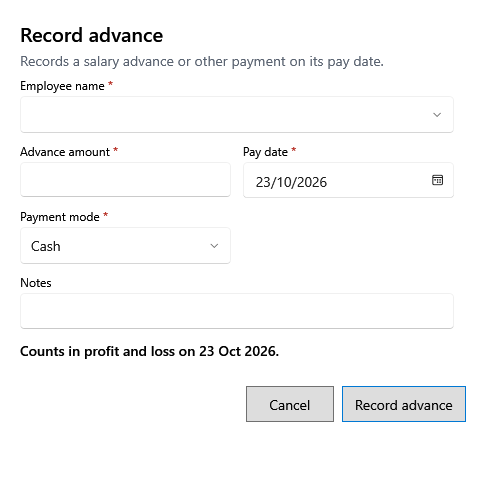

<!-- MT – needs review. Screen help for Record advance (topic "advance-form"); the English file is ../en/advance-form.md. Bold names in a table's first column must match the Gujarati labels on screen; see ../README.md. -->
# પેશગી નોંધો

કર્મચારીને પગાર પહેલાં આપેલા પૈસા, કે તેમને કરેલી બીજી ચુકવણી નોંધો.

જેની સાથે * હોય તે વિગતો જરૂરી છે. પેશગી તેની ચુકવણી તારીખે ગણાય છે; ખાનાં નીચેની લીટી ક્યાં તે કહે છે.

## ખાનાં

| ખાનું | અર્થ |
|---|---|
| **કર્મચારીનું નામ** | કોને ચૂકવ્યું. |
| **પેશગી રકમ** | કેટલું ચૂકવ્યું. |
| **ચુકવણી તારીખ** | ચૂકવ્યાનો દિવસ. અંતિમ થયેલા વર્ષની તારીખ સ્વીકારાતી નથી. |
| **ચુકવણી રીત** | રોકડ, UPI, બેંક કે અન્ય. |
| **નોંધ** | તે શેના માટે હતું. |

## બટન

| બટન | શું કરે છે |
|---|---|
| **પેશગી નોંધો** | ચુકવણી સાચવે છે. |
| **રદ કરો** | સાચવ્યા વગર બંધ કરે છે. |
