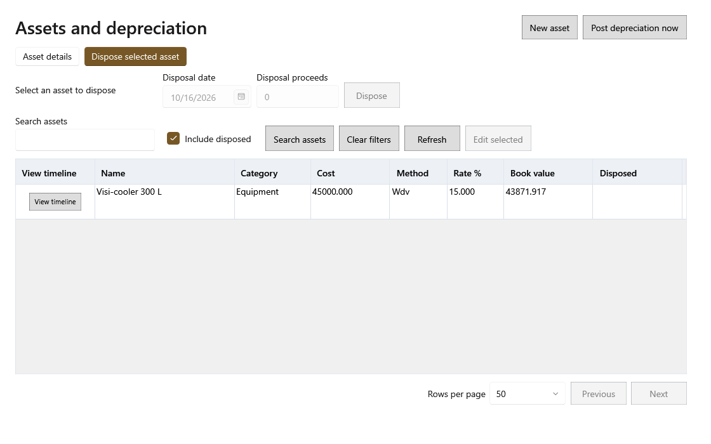

<!-- MT – needs review. Screen help for Dispose (topic "asset-disposal"); the English file is ../en/asset-disposal.md. Bold names in a table's first column must match the Gujarati labels on screen; see ../README.md. -->
# નિકાલ કરો

મિલકત વેચાઈ, ભંગારમાં ગઈ કે ફેંકી દેવાઈ તે નોંધો.

શીર્ષક નીચેની લીટી મિલકત અને તેનું પુસ્તક મૂલ્ય બતાવે છે. નિકાલ એ તારીખ સુધીનો બાકી ઘસારો પોસ્ટ કરે છે, પછી મળેલી રકમ અને પુસ્તક મૂલ્યનો તફાવત નફો કે નુકસાન તરીકે ગણાય છે. મિલકત નિકાલ થયેલી તરીકે યાદીમાં રહે છે. કંઈ બદલાય તે પહેલાં તમે પુષ્ટિ કરો છો.

## ખાનાં

| ખાનું | અર્થ |
|---|---|
| **નિકાલની તારીખ** | તે દુકાનમાંથી ગઈ તે દિવસ. |
| **નિકાલની રકમ** | તે કેટલામાં વેચાઈ; ફેંકી દેવાઈ હોય તો 0. |

## બટન

| બટન | શું કરે છે |
|---|---|
| **નિકાલ કરો** | તમે પુષ્ટિ કરો પછી મિલકતનો નિકાલ કરે છે. |
| **રદ કરો** | ફેરફાર વગર બંધ કરે છે. |
