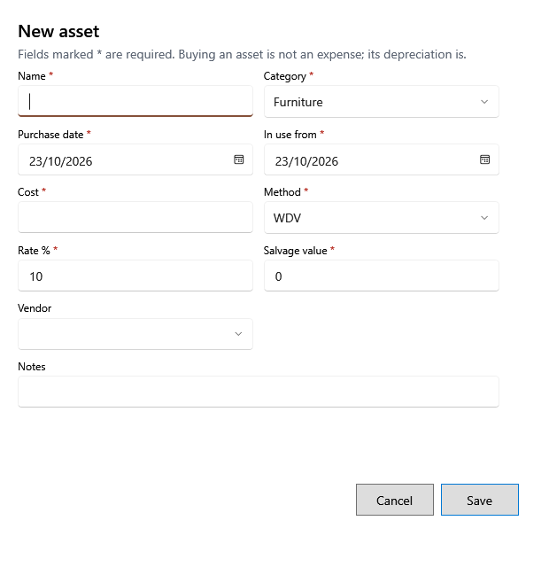

<!-- MT – needs review. Screen help for the asset form (topic "asset-form"); the English file is ../en/asset-form.md. Bold names in a table's first column must match the Gujarati labels on screen; see ../README.md. -->
# નવી મિલકત

દુકાનની માલિકીની અને વર્ષો સુધી વપરાતી વસ્તુ, જેમ કે ફ્રિજ કે કમ્પ્યુટર, ઉમેરો અથવા બદલો.

જેની સાથે * હોય તે વિગતો જરૂરી છે. મિલકત ખરીદવી ખર્ચ નથી: દર મહિનાનો ઘસારો ખર્ચ છે. પહેલેથી ઘસારો લાગતી મિલકતની શરતો બદલો ત્યારે, સાચવતાં પહેલાં ખાનાં નીચેની લીટી કેટલા પોસ્ટ થયેલા મહિના બદલાય છે અને નવું પુસ્તક મૂલ્ય બતાવે છે. નિકાલ થયેલી મિલકત તેની નાણાકીય શરતો રાખે છે; ફક્ત નામ, શ્રેણી, વિક્રેતા અને નોંધ બદલી શકાય.

## ખાનાં

| ખાનું | અર્થ |
|---|---|
| **નામ** | મિલકત શું છે. |
| **શ્રેણી** | ફર્નિચર, સાધનો, ઇલેક્ટ્રોનિક્સ, વાહન કે અન્ય. નવી મિલકત માટે તે દર સૂચવે છે: ફર્નિચર માટે 10%, ઇલેક્ટ્રોનિક્સ માટે 40%, બાકી માટે 15%. |
| **ખરીદી તારીખ** | ખરીદ્યાનો દિવસ. |
| **ઉપયોગ શરૂ** | વાપરવાનું શરૂ થયું તે દિવસ. ઘસારો એ મહિનાથી શરૂ થાય છે. તે ખરીદી તારીખ પહેલાંની ન હોઈ શકે. |
| **કિંમત** | તેની કિંમત. |
| **પદ્ધતિ** | **WDV** (ઘટતી કિંમત: દર બાકી રહેલી કિંમત પર લાગે છે, એટલે ખર્ચ ઘટતો જાય છે) અથવા **SLM** (સીધી રેખા: દર મહિને સરખો ખર્ચ). |
| **દર %** | વાર્ષિક ઘસારાનો દર. |
| **બચત કિંમત** | અંતે તેની જેટલી કિંમત રહેશે. ઘસારો ત્યાં અટકે છે. |
| **લાગુ થવાનો મહિનો** | પદ્ધતિ, દર કે બચત કિંમત બદલો ત્યારે દેખાય છે: નવી શરતો જે મહિનાથી લાગુ થાય, YYYY-MM રૂપે લખેલો. કિંમત અને ઉપયોગ શરૂ તારીખ ત્યારે જ બદલાય જ્યારે દરેક પોસ્ટ થયેલો મહિનો ખુલ્લા વર્ષમાં હોય. |
| **વિક્રેતા** | કોની પાસેથી ખરીદી. |
| **નોંધ** | રાખવા જેવી બીજી કોઈ વિગત. |

## બટન

| બટન | શું કરે છે |
|---|---|
| **સાચવો** | મિલકત સાચવે છે. શરતોના ફેરફાર માટે પહેલાં પુષ્ટિ પૂછે છે. |
| **રદ કરો** | સાચવ્યા વગર બંધ કરે છે. |
