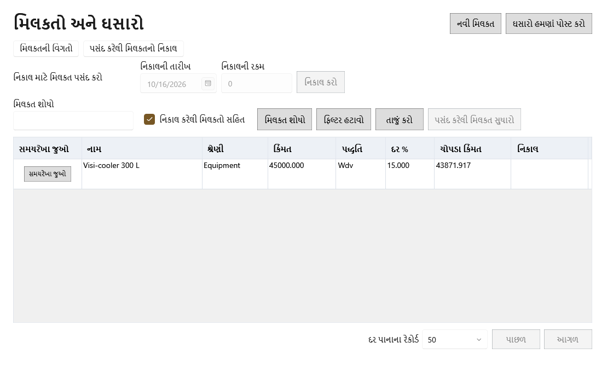

<!-- MT – needs review. Screen help for Assets (topic "assets"); the English file is ../en/assets.md. Bold names in a table's first column must match the Gujarati labels on screen; see ../README.md. -->
# મિલકતો અને ઘસારો

દુકાન વર્ષો સુધી રાખે એવી વસ્તુઓ, જેમ કે ફ્રિજ, વજનકાંટા અને કમ્પ્યુટર, નોંધો અને તેમની કિંમત વપરાશના મહિનાઓમાં વહેંચો.

મિલકત વપરાશમાં હોય તે દર મહિને તેની કિંમતનો ભાગ ઘસારા તરીકે નફા-નુકસાનમાં ગણાય છે, અને તેની ચોપડા કિંમત એટલી ઘટે છે. બાકી મહિના એપ દસ મિનિટ નિષ્ક્રિય રહે ત્યારે, અથવા **ઘસારો હમણાં પોસ્ટ કરો** વડે નોંધાય છે.

## ફિલ્ટર

| ખાનું | અર્થ |
|---|---|
| **મિલકત શોધો** | મિલકતના નામ કે શ્રેણીનો ભાગ લખો. Ctrl+F અહીં લાવે છે. |
| **નિકાલ કરેલી મિલકતો સહિત** | વેચેલી કે ફેંકી દીધેલી મિલકતો પણ બતાવે છે. મૂળ રીતે પસંદ કરેલું. |
| **ફિલ્ટર હટાવો** | દરેક ફિલ્ટર તેની મૂળ સ્થિતિમાં લાવે છે. |

## કોષ્ટક

| કૉલમ | અર્થ |
|---|---|
| **નામ** | મિલકતનું નામ. |
| **શ્રેણી** | મિલકતની શ્રેણી. |
| **કિંમત** | મિલકતની કિંમત. |
| **પદ્ધતિ** | **WDV** (ઘટતી કિંમત: દર દર વર્ષે બાકી રહેલી કિંમત પર લાગે છે, એટલે ખર્ચ ઘટતો જાય છે) અથવા **SLM** (સીધી રેખા: દર મહિને સરખો ખર્ચ). |
| **દર %** | ઘસારાનો વાર્ષિક દર. |
| **ચોપડા કિંમત** | કિંમત બાદ અત્યાર સુધી નોંધાયેલો ઘસારો. |
| **નિકાલ** | મિલકતનો નિકાલ થયો હોય તો તે દિવસ. |

## બટન

| બટન | શું કરે છે |
|---|---|
| **નવી મિલકત** | મિલકતનું ફોર્મ ખોલે છે (Ctrl+N): નામ, શ્રેણી, ખરીદી અને વપરાશ શરૂ થયાની તારીખ, કિંમત, પદ્ધતિ, દર, ભંગાર કિંમત, વિક્રેતા અને નોંધ. |
| **પસંદ કરેલી મિલકત સુધારો** | પસંદ કરેલી મિલકતનું ફોર્મ ખોલે છે. પદ્ધતિ, દર કે ભંગાર કિંમત બદલવાથી તે કયા મહિનાથી લાગુ થાય તે પૂછે છે અને સાચવતાં પહેલાં બદલાતા મહિના બતાવે છે. કિંમત અને વપરાશ શરૂ થયાની તારીખ ત્યારે જ બદલાય જ્યારે દરેક નોંધાયેલો મહિનો ખુલ્લા વર્ષમાં હોય. |
| **સમયરેખા જુઓ** | પસંદ કરેલી મિલકત પૅનલમાં ખોલે છે (Enter કે ડબલ-ક્લિક). |
| **ઘસારો હમણાં પોસ્ટ કરો** | દરેક મિલકત માટે બાકી દરેક મહિનો નોંધે છે. બંધ થયેલા વર્ષનો ન નોંધાયેલો મહિનો પણ નોંધાય છે, પણ તેનો ખર્ચ આજે ગણાય છે. |
| **નિકાલ કરો** | મિલકત વેચાઈ કે ફેંકી દેવાઈ તે નોંધે છે: તારીખ અને તેના કેટલા મળ્યા. નફો કે નુકસાન એ દિવસની ચોપડા કિંમત સામે મપાય છે. |
| **વધુ ▾** | વિન્ડો સાંકડી હોય ત્યારે ન સમાતી ક્રિયાઓ રાખે છે. |

## મિલકતની પૅનલ

પૅનલ યાદીની બાજુમાં ખૂલે છે અને પસંદગી સાથે બદલાય છે. એ ખુલ્લી હોય ત્યારે **પસંદ કરેલી મિલકત સુધારો** અને **નિકાલ કરો** પૅનલમાં હોય છે.

| ખાનું | અર્થ |
|---|---|
| **પાછલી નોંધ**, **આગળની નોંધ** | યાદીમાં ઉપરની કે નીચેની મિલકત ખોલે છે. |
| **પૂરી પહોળાઈ વાપરો**, **યાદીની બાજુમાં બતાવો** | પૅનલને યાદીની બાજુ અને આખા પાના વચ્ચે બદલે છે. સ્ક્રીન આ પસંદગી યાદ રાખે છે. |
| **બંધ કરો** | પૅનલ બંધ કરે છે (Esc). |
| **ઘસારાની શરતો** | મિલકતની દરેક શરતો: શરૂ થતો મહિનો, પદ્ધતિ અને દર, ભંગાર કિંમત, કિંમત અને ક્યારે નોંધાઈ. |
| **સમયગાળો** | મહિનો. |
| **શરૂઆત** | મહિનાની શરૂઆતની ચોપડા કિંમત. |
| **ઘસારો** | મહિનાનો ખર્ચ. |
| **બંધ** | મહિનાના અંતની ચોપડા કિંમત. |
| **ખર્ચ તારીખ** | વર્ષ બંધ થયા પછી નોંધાયેલા મહિના માટે, તેનો ખર્ચ જે દિવસે ગણાયો. |

## કેવી રીતે વાપરવું

1. દરેક મિલકત **નવી મિલકત** વડે ઉમેરો.
2. તેની સમયરેખા તપાસો.
3. બાકી ઘસારો નોંધાવા દો, અથવા **ઘસારો હમણાં પોસ્ટ કરો** પર ક્લિક કરો.
4. નિયમો મંજૂરી આપે ત્યારે જ શરતો બદલો.
5. મિલકત વેચાય કે ફેંકી દેવાય ત્યારે તેનો નિકાલ કરો.
