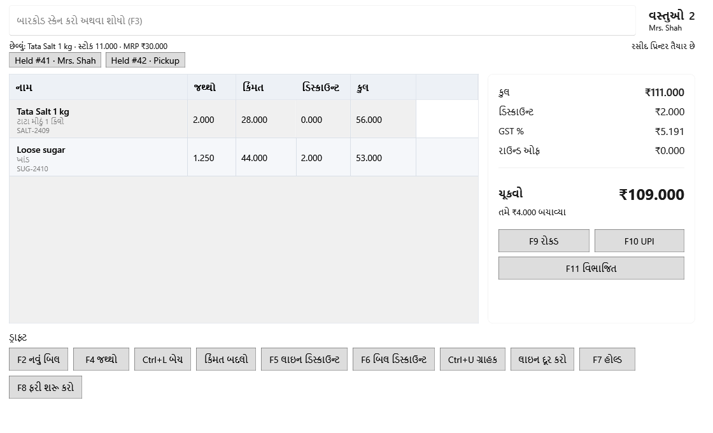

<!-- MT – needs review. Screen help for Billing (topic "billing"); the English file is ../en/billing.md. Bold names in a table's first column must match the Gujarati labels on screen; see ../README.md. -->
# બિલિંગ

બિલ બનાવો: વસ્તુઓ સ્કેન કરો કે શોધો, જથ્થો, બેચ, કિંમત અને ડિસ્કાઉન્ટ તપાસો, અને ચુકવણી લો.

દરેક લાઇન બિલ હવે પછી જે બેચમાંથી લેશે તેમાંથી સ્ટોક લે છે: પહેલાં સૌથી વહેલી મુદત, પછી સૌથી વહેલી મળેલી. કિંમતોમાં કર સામેલ છે. બિલને તારીખ અને નંબર ચુકવણી વખતે મળે છે, એટલે અગાઉના દિવસથી ખુલ્લું રહેલું બિલ જે દિવસે પૂરું થાય તે દિવસમાં ગણાય છે. બિલિંગ એક જ અધૂરું બિલ રાખે છે: બિલ ચૂકવાય તે પહેલાં બિલિંગ છોડો કે એપ બંધ કરો તો બિલ સચવાય છે, અને બિલિંગ ફરી ખૂલે ત્યારે તેને ચાલુ રાખવું કે કાઢી નાખવું તે પૂછે છે.

## વસ્તુ ઉમેરવી

| ખાનું | અર્થ |
|---|---|
| **બારકોડ સ્કેન કરો અથવા શોધો (F3)** | બારકોડ સ્કેન કરો, અથવા બારકોડ, SKU કે નામનો ભાગ લખો. નામ લખો તેમ તેની મળતી વસ્તુઓ ખાના નીચે દેખાય છે (નીચે જુઓ); Enter ચોક્કસ બારકોડ કે SKU, અથવા એકમાત્ર મેળ બિલમાં ઉમેરે છે. એટલો જથ્થો ઉમેરવા પહેલાં જથ્થો અને * લખો, જેમ કે 2*મીઠું અથવા 2*8901234567890. આઠ કે વધુ અંકનો નંબર કશા સાથે ન મળે તો અજાણ્યો બારકોડ ખૂલે છે, જ્યાં વસ્તુ ઉમેરી શકાય કે બારકોડ કોઈ વસ્તુ સાથે જોડી શકાય. સ્ક્રીન પર ગમે ત્યાંથી F3 અહીં લાવે છે. |
| **મળતી વસ્તુઓ** | લખો તેમ, તેની સાથે મળતી વસ્તુઓ ખાના નીચે SKU, ગુજરાતી નામ, કિંમત અને સ્ટોક સાથે દેખાય છે: ગુજરાતીમાં એક અક્ષરથી, નહીં તો બે અક્ષરથી, લખવાનું અટકો ત્યારે. ઘણી વસ્તુઓ મળે ત્યારે Enter પણ તેમને બતાવે છે. કિંમત બિલ હવે પછી જે બેચમાંથી લેશે તેની છે. નીચેની તીર કી યાદીમાં લઈ જાય છે; તીર કી અને Enter વડે, અથવા ક્લિક કરીને એક પસંદ કરો; Esc યાદી બંધ કરે છે. |
| **વસ્તુઓ** | બિલમાં કેટલી લાઇન છે. તેની નીચે ગ્રાહક: ગ્રાહક પસંદ ન કરો ત્યાં સુધી **સીધા આવેલા ગ્રાહક**. |
| છેલ્લું: … | છેલ્લે ઉમેરેલી વસ્તુ, તેના સ્ટોક અને MRP સાથે. |
| રસીદ પ્રિન્ટર | રસીદ પ્રિન્ટર તૈયાર છે કે નહીં. રસીદ ન છપાઈ હોય તો તે જણાવે છે; ફરી પ્રયાસ કરવા Ctrl+P દબાવો. એપ બંધ થાય ત્યારે પણ ન છપાયેલું કામ પછીની શરૂઆતે એક વાર જણાવાય છે, પછી કાઢી નખાય છે. |

## બિલની લાઇન

| કૉલમ | અર્થ |
|---|---|
| **નામ** | વસ્તુ, તેનું ગુજરાતી નામ અને જે બેચમાંથી લાઇન વેચાય છે તે. |
| **જથ્થો** | વેચાતો જથ્થો. **F4 જથ્થો** વડે બદલો. |
| **કિંમત** | એક એકમની કિંમત, કર સહિત. |
| **ડિસ્કાઉન્ટ** | લાઇનનું ડિસ્કાઉન્ટ, **F5 લાઇન ડિસ્કાઉન્ટ** માંથી અથવા બિલ ડિસ્કાઉન્ટમાંથી તેનો ભાગ. |
| **કુલ** | જથ્થો × કિંમત, ડિસ્કાઉન્ટ બાદ. |

## કુલ અને ચુકવણી

| ખાનું | અર્થ |
|---|---|
| **મૂળ રકમ** | લાઇનોના જથ્થો × કિંમત, ડિસ્કાઉન્ટ પહેલાં. |
| **ડિસ્કાઉન્ટ** | બધાં લાઇન અને બિલ ડિસ્કાઉન્ટ. |
| **કર** | બિલમાં સામેલ કર, રસીદ માટે બતાવેલો. તે ઉપરથી ઉમેરાતો નથી. |
| **રાઉન્ડ ઓફ** | બિલ પૂરી રકમનું થાય એ માટે ઉમેરેલા કે બાદ કરેલા પૈસા. |
| **ચૂકવો** | ગ્રાહકે ચૂકવવાની રકમ. તેની નીચે, MRP સામે ગ્રાહકે કેટલું બચાવ્યું. |
| **F9 રોકડ** | આખું બિલ રોકડમાં રાખીને ચુકવણી લો ખોલે છે: પાછા આપવાના પૈસા જોવા ગ્રાહકે આપેલી રોકડ લખો, પછી બિલ પૂર્ણ કરો. F12 પણ એ જ કરે છે. |
| **F10 UPI** | આખું બિલ UPI માં રાખીને ચુકવણી લો ખોલે છે, UPI સંદર્ભના ખાના સાથે. |
| **F11 વિભાજિત** | બિલ રોકડ, UPI અને કાર્ડ વચ્ચે વહેંચવા ચુકવણી લો ખોલે છે, UPI અને કાર્ડના સંદર્ભ સાથે. |

## બટન

મોટાભાગનાં બટન કોષ્ટકમાં પસંદ કરેલી લાઇન પર કામ કરે છે.

| બટન | શું કરે છે |
|---|---|
| **F2 નવું બિલ** | ખાલી બિલ શરૂ કરે છે. બિલિંગ એક જ અધૂરું બિલ રાખે છે, એટલે લાઇન કે ગ્રાહકવાળું સ્ક્રીન પરનું બિલ તમે ખાતરી કરો પછી કાઢી નખાય છે. |
| **F4 જથ્થો** | પસંદ કરેલી લાઇનનો જથ્થો બદલે છે. |
| **Ctrl+L બેચ** | પસંદ કરેલી લાઇન કઈ બેચમાંથી વેચાય તે પસંદ કરે છે. |
| **કિંમત બદલો** | આ બિલ માટે પસંદ કરેલી લાઇનની કિંમત બદલે છે. તે શૂન્યથી વધુ હોવી જોઈએ અને MRP થી વધુ ન હોઈ શકે. |
| **F5 લાઇન ડિસ્કાઉન્ટ** | પસંદ કરેલી લાઇનને રકમ કે ટકામાં ડિસ્કાઉન્ટ આપે છે. |
| **F6 બિલ ડિસ્કાઉન્ટ** | આખા બિલને ડિસ્કાઉન્ટ આપે છે, જે લાઇનોમાં વહેંચાય છે. |
| **Ctrl+U ગ્રાહક** | આ બિલ માટે નામ, ફોન અને GSTIN સાથે ગ્રાહક શોધે છે કે ઉમેરે છે. |
| **લાઇન દૂર કરો** | પસંદ કરેલી લાઇન કાઢે છે. Delete કી પણ એ જ કરે છે. |

Ctrl+P છેલ્લી રસીદ DUPLICATE લખીને ફરી છાપે છે, અથવા ન છપાયેલી રસીદ ફરી છાપવાનો પ્રયાસ કરે છે.

## કેવી રીતે વાપરવું

1. દરેક વસ્તુ સ્કેન કરો કે શોધો.
2. દરેક લાઇનનો જથ્થો, બેચ, કિંમત અને ડિસ્કાઉન્ટ તપાસો.
3. બિલને ગ્રાહકની જરૂર હોય તો ગ્રાહક પસંદ કરો.
4. **ચૂકવો** નીચેની રકમ તપાસો અને **F9 રોકડ**, **F10 UPI** અથવા **F11 વિભાજિત** વડે ચુકવણી લો.
5. રસીદ આપો. ગ્રાહકને થોડી વાર જવું પડે ત્યારે બિલ સ્ક્રીન પર રાહ જુએ છે; એ દરમિયાન બિલિંગ છોડો તો પાછા આવો ત્યારે તે ફરી પૂછાય છે.
