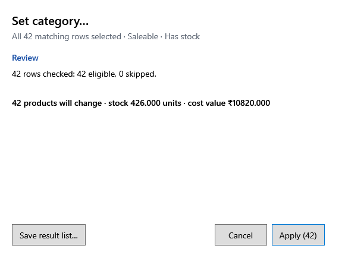

<!-- MT – needs review. Screen help for a bulk action's review (topic "bulk-action"); the English file is ../en/bulk-action.md. Bold names in a table's first column must match the Gujarati labels on screen; see ../README.md. -->
# સમૂહ ક્રિયા

કંઈ સચવાય તે પહેલાં સમૂહ ક્રિયા શું બદલશે તે તપાસો, તેને નાના ભાગમાં ચલાવો, અને દરેક હરોળનું શું થયું તેની યાદી રાખો.

શીર્ષક ક્રિયાનું નામ આપે છે, જેમ કે પસંદ કરેલા દૂર કરો કે પસંદ કરેલી ખરીદીઓ રદ કરો. હરોળ પહેલાં ડેટાબેઝમાં ફરી તપાસાય છે, એટલે સમીક્ષા અત્યારે ખરેખર શું બદલી શકાય તે ગણે છે.

## તબક્કા

| તબક્કો | શું બતાવે છે |
|---|---|
| **સમીક્ષા** | કેટલી હરોળ તપાસાઈ, કેટલી યોગ્ય છે અને કેટલી છોડાશે, દરેક છોડવાના કારણ સાથે, અને અસર પામતો જથ્થો અને મૂલ્ય. હજી કંઈ બદલાયું નથી. |
| **પ્રગતિ** | કયો ભાગ સચવાઈ રહ્યો છે અને કેટલી હરોળ પૂરી થઈ. દરેક ભાગ અલગ સચવાય છે, એટલે કાઉન્ટર પરનું બિલ લાંબું રાહ જોતું નથી. |
| **પરિણામ** | કેટલી હરોળ બદલાઈ, છોડાઈ, સમીક્ષા પછી બદલાઈ (વચ્ચે કોઈએ બદલી) કે બાકી રહી. |

## બટન

| બટન | શું કરે છે |
|---|---|
| લાગુ કરો (સંખ્યા) | યોગ્ય હરોળ પર ક્રિયા ચલાવે છે; બટન ક્રિયા અને સંખ્યા બતાવે છે, જેમ કે લાગુ કરો (42). |
| **આ ભાગ પછી રોકો** | ચાલુ ભાગ સચવાઈ જાય પછી રોકે છે. સચવાયેલા ભાગ રહે છે. |
| **ફરી ચાલુ કરો** | બાકી હરોળ સાથે આગળ વધે છે, અથવા નિષ્ફળ ભાગ ફરી પ્રયત્ન કરે છે. |
| **પરિણામ યાદી સાચવો…** | દરેક હરોળનું પરિણામ અને કારણ CSV ફાઇલમાં સાચવે છે. |
| **રદ કરો**, **બંધ કરો** | વિન્ડો બંધ કરે છે. લાગુ કરતાં પહેલાં કંઈ બદલાયું નથી; પછી, સચવાયેલા ભાગ સચવાયેલા જ રહે છે. |
