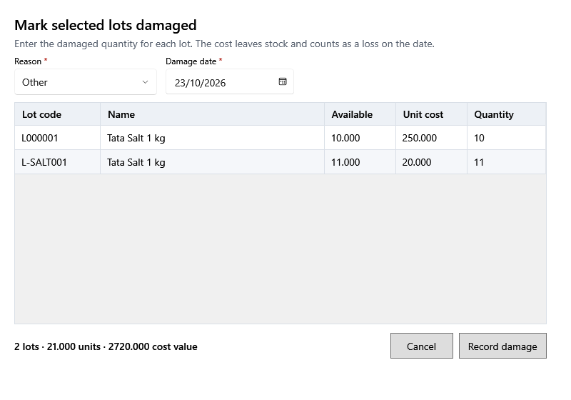

<!-- MT – needs review. Screen help for Mark selected lots damaged (topic "bulk-damage"); the English file is ../en/bulk-damage.md. Bold names in a table's first column must match the Gujarati labels on screen; see ../README.md. -->
# પસંદ કરેલી બેચ નુકસાનમાં નોંધો

ઉત્પાદનની ઘણી બેચનું નુકસાન એક સાથે નોંધો, દરેક બેચના જથ્થા સાથે.

જથ્થાવાળી દરેક બેચ નીચેના કારણ અને તારીખ સાથે ખર્ચ → નુકસાનમાં પોતાનું નુકસાન બને છે. તેની કિંમત સ્ટોકમાંથી ઘટે છે અને એ તારીખે નુકસાન તરીકે ગણાય છે. એક સાથે 50 બેચ સુધી; કોષ્ટક નીચેની લીટી બેચ, એકમ અને કિંમતનો સરવાળો બતાવે છે.

## ખાનાં

| ખાનું | અર્થ |
|---|---|
| **કારણ** | દરેક બેચ માટેનું કારણ: **સમાપ્ત**, **તૂટેલું**, **બગડેલું**, **જીવાતથી નુકસાન**, **ગુમ** અથવા **અન્ય**. |
| **નુકસાનની તારીખ** | જે દિવસે થયું, દરેક બેચ માટે. |
| **બેચ કોડ** | બેચ માટે દુકાનનો કોડ. |
| **નામ** | ઉત્પાદન. |
| **ઉપલબ્ધ** | બેચનો સ્ટોક. |
| **ખરીદ કિંમત** | એક નંગની કર પહેલાંની કિંમત. |
| **જથ્થો** | આ બેચમાં કેટલું નુકસાન થયું, તેના ઉપલબ્ધ સ્ટોક સુધી. બેચ છોડવા ખાલી કે 0 રાખો. |

## બટન

| બટન | શું કરે છે |
|---|---|
| **નુકસાન નોંધો** | જથ્થાવાળી દરેક બેચ માટે નુકસાન નોંધે છે. |
| **રદ કરો** | ફેરફાર વગર બંધ કરે છે. |
