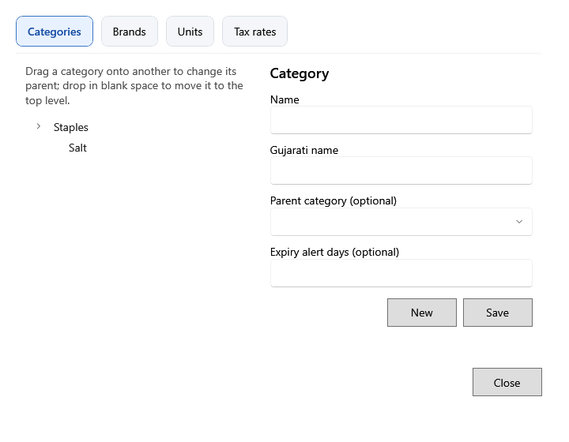

<!-- MT – needs review. Screen help for Categories & brands (topic "catalog-masters"); the English file is ../en/catalog-masters.md. Bold names in a table's first column must match the Gujarati labels on screen; see ../README.md. Each tab has its own section, named as the tab. -->
# શ્રેણીઓ અને બ્રાન્ડ

ઉત્પાદનો જેનાથી ગોઠવાય અને ગણાય તે યાદીઓ રાખો: શ્રેણીઓ, બ્રાન્ડ, એકમો અને કર દરો.

દરેક ટૅબ ડાબી બાજુ તેની વસ્તુઓ બતાવે છે. બદલવા માટે એક પસંદ કરો અને જમણી બાજુ ફેરફાર કરો, અથવા ઉમેરવા **નવું** પર ક્લિક કરો, પછી **સાચવો**. **બંધ કરો** (Esc) વિન્ડો બંધ કરે છે.

## શ્રેણીઓ

ઉપ-શ્રેણી બનાવવા શ્રેણીને બીજી શ્રેણી પર ખેંચો; મુખ્ય સ્તરે પાછી લાવવા ખાલી જગ્યામાં છોડો.

| ખાનું | અર્થ |
|---|---|
| **નામ** | શ્રેણીનું નામ. |
| **ગુજરાતી નામ** | ગુજરાતી સ્ક્રીન પર દેખાતું નામ. |
| **મૂળ શ્રેણી (વૈકલ્પિક)** | આ શ્રેણી જેની નીચે આવે છે તે શ્રેણી. ખાલી હોય તો મુખ્ય સ્તરે રહે છે. |
| **સમાપ્તિ ચેતવણી દિવસો (વૈકલ્પિક)** | મુદતના કેટલા દિવસ પહેલાં તેનાં ઉત્પાદનોની બેચ સમાપ્તિ નજીક ગણાય, જો ઉત્પાદનના પોતાના દિવસો ન હોય. ખાલી હોય તો મૂળ શ્રેણીના, નહીં તો 30 દિવસ. |
| **નવું** | શ્રેણી ઉમેરવા ખાનાં ખાલી કરે છે. |
| **સાચવો** | શ્રેણી સાચવે છે. |

## બ્રાન્ડ

| ખાનું | અર્થ |
|---|---|
| **નામ** | બ્રાન્ડનું નામ. |
| **નવું** | બ્રાન્ડ ઉમેરવા ખાનું ખાલી કરે છે. |
| **સાચવો** | બ્રાન્ડ સાચવે છે. |

## એકમો

| ખાનું | અર્થ |
|---|---|
| **એકમ કોડ** | બિલ અને લેબલ પર છપાતો ટૂંકો કોડ, જેમ કે KG કે PCS. |
| **નામ**, **ગુજરાતી નામ** | દરેક ભાષામાં એકમનું નામ. |
| **અપૂર્ણાંક જથ્થો મંજૂર કરો** | જથ્થામાં દશાંશ હોઈ શકે, જેમ કે 1.250 kg. છૂટક ઉત્પાદનને આવો એકમ જોઈએ. |
| **નવું** | એકમ ઉમેરવા ખાનાં ખાલી કરે છે. |
| **સાચવો** | એકમ સાચવે છે. |

## કર દરો

| ખાનું | અર્થ |
|---|---|
| **નામ** | દરનું નામ, જેમ કે "GST 5%". ખરીદીની લાઇન, બેચ અને બિલની લાઇન બને ત્યારે આ નામ સાચવે છે. |
| **કર ટકાવારી** | કરના ટકા. ફેરફાર ઉત્પાદનો અને નવી નોંધને જ લાગુ પડે છે; સચવાયેલી નોંધ તેમના ટકા રાખે છે. |
| **સક્રિય** | નવાં ઉત્પાદનો અને લાઇન માટે દર પસંદ ન થાય તે માટે પસંદગી કાઢો. તે વાપરતી નોંધ તેને રાખે છે. |
| **નવું** | દર ઉમેરવા ખાનાં ખાલી કરે છે. |
| **સાચવો** | દર સાચવે છે. |
