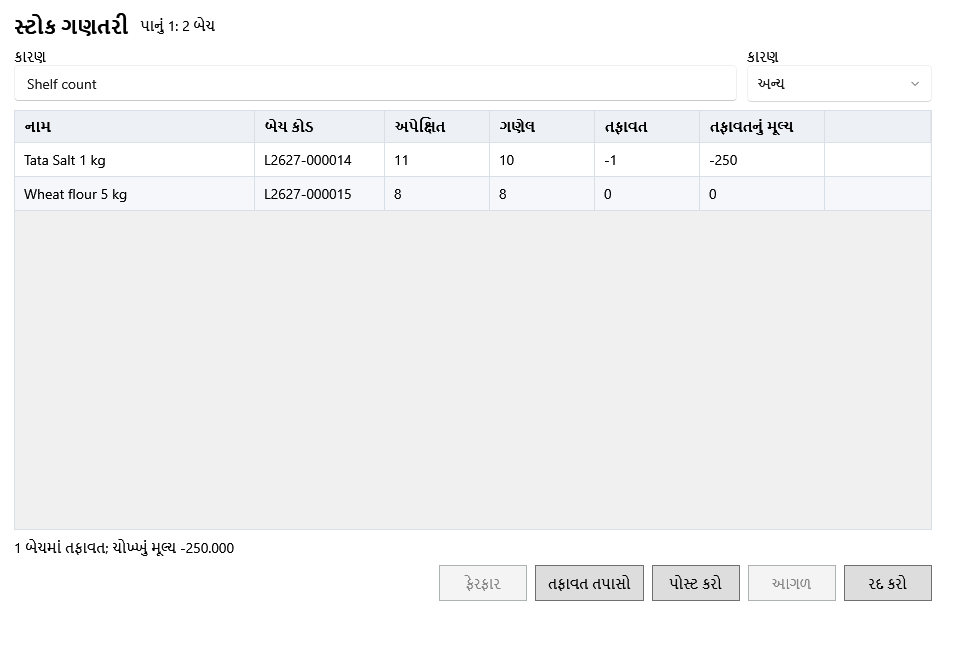

<!-- MT – needs review. Screen help for Stock count (topic "count-review"); the English file is ../en/count-review.md. Bold names in a table's first column must match the Gujarati labels on screen; see ../README.md. -->
# સ્ટોક ગણતરી

પસંદ કરેલાં ઉત્પાદનોની દરેક બેચ માટે છાજલી પર ગણેલું લખો, તફાવત તપાસો અને નોંધો.

બેચ 50 સુધીનાં પાનાંમાં આવે છે. ઘટ ઘટના કારણ હેઠળ ખર્ચ → નુકસાનમાં પોતાના નંબર સાથે નુકસાન બને છે. વધારો ગણેલી બેચની ખરીદ કિંમત અને કર સાથે નવી સીધી બેચ બને છે. સ્ટોક સાથે મળતી બેચ એમ જ રહે છે.

## ખાનાં

| ખાનું | અર્થ |
|---|---|
| **કારણ** | સ્ટોક કેમ ગણ્યો, જેમ કે "માસિક છાજલી ગણતરી". દરેક ફેરફાર સાથે સચવાય છે. |
| **ઘટનું કારણ** | સ્ટોક કરતાં ઓછી બેચ માટે નુકસાનનું કારણ. |
| **નામ** | ઉત્પાદન. |
| **બેચ કોડ** | બેચ માટે દુકાનનો કોડ. |
| **અપેક્ષિત** | બેચનો હાલનો સ્ટોક. |
| **ગણેલ** | તમે ગણેલું. દરેક બેચ માટે લખો. |
| **તફાવત** | ગણેલ બાદ અપેક્ષિત: ઋણ એટલે ઘટ, ધન એટલે વધારો. |
| **તફાવતનું મૂલ્ય** | બેચની ખરીદ કિંમતે તફાવત. |

## બટન

| બટન | શું કરે છે |
|---|---|
| **તફાવત તપાસો** | ગણતરી તપાસે છે અને કેટલી બેચમાં તફાવત છે અને તેનું ચોખ્ખું મૂલ્ય બતાવે છે. |
| **ફેરફાર** | તપાસ પછી ગણતરી બદલવા પાછું જાય છે. |
| **પોસ્ટ કરો** | પાનાની ઘટ અને વધારો નોંધે છે. |
| **આગળ** | પાનું નોંધાયા પછી બેચનું આગળનું પાનું લાવે છે. |
| **રદ કરો** | બંધ કરે છે. નોંધાયેલાં પાનાં નોંધાયેલાં જ રહે છે. |
