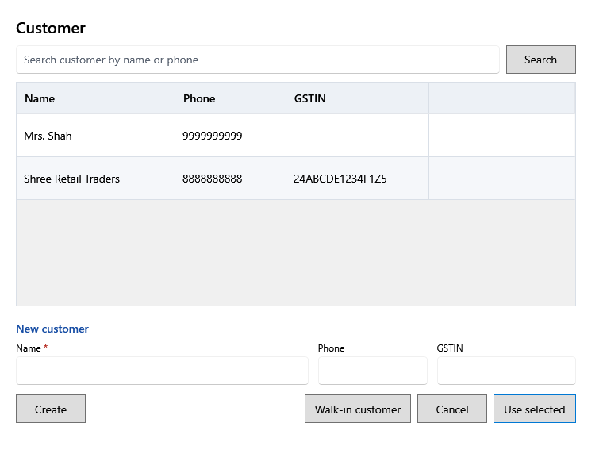

<!-- MT – needs review. Screen help for Customer (topic "customer"); the English file is ../en/customer.md. Bold names in a table's first column must match the Gujarati labels on screen; see ../README.md. -->
# ગ્રાહક

બિલ કોના માટે છે તે પસંદ કરો, અથવા નવો ગ્રાહક ઉમેરો.

ગ્રાહક વગરનું બિલ સીધા આવેલા ગ્રાહક માટે હોય છે. ગ્રાહકનું નામ રસીદ પર છપાય છે.

## ગ્રાહકો

| ખાનું | અર્થ |
|---|---|
| **નામ અથવા ફોનથી ગ્રાહક શોધો** | યાદી ટૂંકી કરવા નામ કે ફોન નંબરનો ભાગ લખો. |
| **નામ** | ગ્રાહકનું નામ. |
| **ફોન** | ગ્રાહકનો ફોન નંબર. |
| **GSTIN** | વ્યવસાયી ગ્રાહકનો GST નંબર. |

## નવો ગ્રાહક

| ખાનું | અર્થ |
|---|---|
| **નામ** | જરૂરી. |
| **ફોન** | વૈકલ્પિક. |
| **GSTIN** | વૈકલ્પિક; 15 અક્ષર. |

## બટન

| બટન | શું કરે છે |
|---|---|
| **શોધો** | મળતા ગ્રાહકો બતાવે છે. |
| **બનાવો** | નવો ગ્રાહક ઉમેરે છે અને તેને બિલ પર મૂકે છે. |
| **સીધા આવેલા ગ્રાહક** | બિલ પરથી ગ્રાહક કાઢે છે. |
| **પસંદ કરેલો વાપરો** | પસંદ કરેલા ગ્રાહકને બિલ પર મૂકે છે. ડબલ-ક્લિક પણ એ જ કરે છે. |
| **રદ કરો** | ફેરફાર વગર બંધ કરે છે. |
