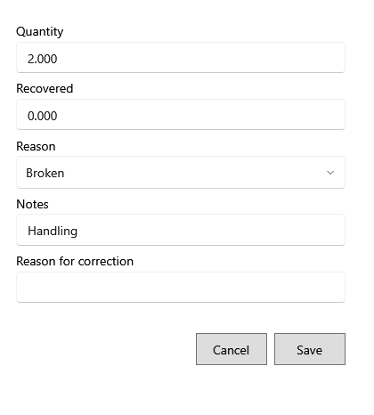

<!-- MT – needs review. Screen help for Correct damage write-off and Void damage (topic "damage-correction"); the English file is ../en/damage-correction.md. Bold names in a table's first column must match the Gujarati labels on screen; see ../README.md. -->
# નુકસાનની નોંધ સુધારો

ખોટું નોંધાયેલું નુકસાન કારણ સાથે સુધારો, અથવા રદ કરો.

પોસ્ટ થયેલું નુકસાન ક્યારેય ફરી લખાતું નથી: ફેરફાર તેના કારણ સાથે સુધારા તરીકે સચવાય છે. શીર્ષક નીચેની લીટી કહે છે કે ફેરફાર ક્યાં ગણાશે. ઓછો જથ્થો તફાવત બેચમાં પાછો મૂકે છે; વધુ જથ્થો વધુ કાઢે છે. બેચ પછી કાઢી નખાઈ હોય તો એકમો નુકસાનની કિંમતે નવી બેચમાં જાય છે, અને તેની પ્રોડક્ટ પણ કાઢી નખાઈ હોય તો કઈ પ્રોડક્ટ તે લેશે તે પૂછાય છે. **નોંધ રદ કરો** બધું પાછું મૂકે છે અને પાછું કરી શકાતું નથી.

## ખાનાં

| ખાનું | અર્થ |
|---|---|
| **જથ્થો** | ખરેખર કેટલા એકમ નુકસાનવાળા છે. 0 બધા પાછા મૂકે છે. |
| **વસૂલ** | નુકસાનવાળા એકમો માટે પાછા મળેલા પૈસા, જેમ કે વિક્રેતા પાસેથી. કોઈ એકમ નુકસાનમાં ન રહે ત્યારે તે 0 હોવું જોઈએ. |
| **કારણ** | સમાપ્ત, તૂટેલું, બગડેલું, જીવાતથી નુકસાન, ગુમ, ગ્રાહક પરત કે અન્ય. |
| **નોંધ** | રાખવા જેવી બીજી કોઈ વિગત. |
| **સુધારાનું કારણ** | કેમ બદલાય છે. જરૂરી; તે સુધારા સાથે રહે છે. |

## બટન

| બટન | શું કરે છે |
|---|---|
| **સાચવો** | સુધારો સાચવે છે. |
| **નોંધ રદ કરો** | રદ કરતી વખતે દેખાય છે: નુકસાનવાળા બધા એકમો પાછા મૂકે છે. |
| **રદ કરો** | ફેરફાર વગર બંધ કરે છે. |
