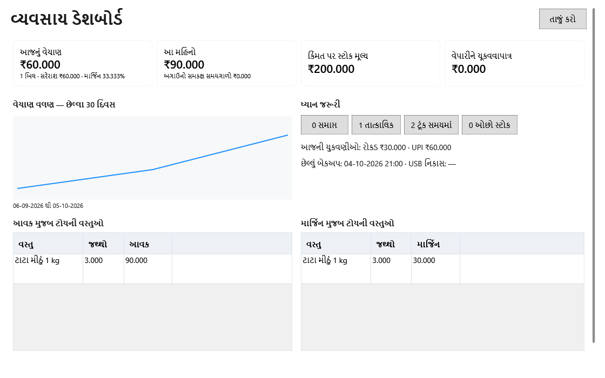

<!-- MT – needs review. Screen help for the dashboard (topic "dashboard"); the English file is ../en/dashboard.md. Bold names in a table's first column must match the Gujarati labels on screen; see ../README.md. -->
# વ્યવસાય ડેશબોર્ડ

આજનું અને આ મહિનાનું વેચાણ, સ્ટોકની કિંમત, વિક્રેતાઓને કેટલું ચૂકવવાનું છે અને શેના પર ધ્યાન આપવાનું છે તે જુઓ, અને દરેક માટેની સ્ક્રીન ખોલો.

આંકડા સ્ક્રીન ખૂલે ત્યારે, દરેક પૂરા થયેલા બિલ પછી અને **તાજું કરો** પર ક્લિક કરો ત્યારે ગણાય છે. દરેક ખાનું, ગણતરી અને લીટી તેની પાછળના રેકોર્ડ ખોલે છે.

## કુલ

| ખાનું | અર્થ |
|---|---|
| **આજનું વેચાણ** | આજનાં પૂરાં થયેલાં બિલનો કુલ, કર સહિત; રદ કરેલાં બિલ ગણાતાં નથી અને પરત બાદ થતાં નથી. નીચે: બિલની સંખ્યા, સરેરાશ બિલ, અને કર પહેલાંના આજના વેચાણ પરનું માર્જિન. આજનું વેચાણ રજિસ્ટર ખોલે છે. |
| **આ મહિનો** | આ મહિનાની 1 તારીખથી આજ સુધીનાં પૂરાં થયેલાં બિલ. નીચે: સરખામણી માટે ગયા મહિનાના એ જ દિવસો. આ મહિનાનું વેચાણ રજિસ્ટર ખોલે છે. |
| **કિંમત પર સ્ટોક મૂલ્ય** | સ્ટોકમાં રહેલી દરેક બેચની કિંમત, આર્કાઇવ ઉત્પાદનો સહિત. હાલનો ન વેચાયેલો સ્ટોક રિપોર્ટ ખોલે છે, જેનો કુલ આ જ આવે છે. |
| **વેપારીને ચૂકવવાપાત્ર** | બધા વિક્રેતાઓને ચૂકવવાની રકમ, નિષ્ક્રિય સહિત. **બાકી રકમ સાથે** પસંદ કરીને વિક્રેતાઓ ખોલે છે, એટલે દેખાતી બાકી રકમોનો સરવાળો આ જ આવે છે. |

## વેચાણ અને ધ્યાન

| ભાગ | અર્થ |
|---|---|
| **વેચાણ વલણ — છેલ્લા 30 દિવસ** | છેલ્લા 30 દિવસનું દરરોજનું વેચાણ, ચાર્ટ નીચે તારીખો સાથે. ક્લિક કરવાથી એ દિવસોનું વેચાણ રજિસ્ટર ખૂલે છે. |
| **ધ્યાન જરૂરી** | નીચેની ગણતરીઓવાળાં બટન. દરેક એ રેકોર્ડ બતાવતા ફિલ્ટર સાથે ઉત્પાદનો ખોલે છે. |
| સમાપ્ત | મુદત વીતી ગઈ હોય અને સ્ટોક હોય એવી બેચ, અવરોધિત સહિત. કોઈપણ સ્થિતિના સમાપ્ત સ્ટોક ફિલ્ટર સાથે ઉત્પાદનો ખોલે છે, જેથી સ્ટોક માંડી વાળી શકાય. |
| તાત્કાલિક | સક્રિય ઉત્પાદનોની સક્રિય બેચ જે આવતા સાત દિવસમાં સમાપ્ત થાય છે. **સમાપ્તિ નજીક** ફિલ્ટર સાથે ઉત્પાદનો ખોલે છે. |
| ટૂંક સમયમાં | સક્રિય ઉત્પાદનોની સક્રિય બેચ જે પછીથી, પણ પોતાના ચેતવણીના દિવસોમાં સમાપ્ત થાય છે: ઉત્પાદનના પોતાના, નહીં તો તેની શ્રેણીના, નહીં તો મૂળ શ્રેણીના, નહીં તો 30 દિવસ. **સમાપ્તિ નજીક** ફિલ્ટર સાથે ઉત્પાદનો ખોલે છે. |
| ઓછો સ્ટોક | ફરી ઓર્ડર સ્તર જેટલો કે તેથી ઓછો સ્ટોક ધરાવતાં સક્રિય ઉત્પાદનો. **ઓછો સ્ટોક** ફિલ્ટર સાથે ઉત્પાદનો ખોલે છે, જે આ જ ઉત્પાદનો બતાવે છે. |
| **આજની ચુકવણીઓ:** | આજની ચુકવણીઓ પ્રકાર મુજબ: રોકડ, UPI, કાર્ડ અને અન્ય. રોકડ એટલે રાખેલી રકમ: ગ્રાહકોએ આપેલી રોકડમાંથી પાછા આપેલા છુટ્ટા બાદ, તેથી બધા પ્રકારનો સરવાળો આજના વેચાણ જેટલો થાય છે. ક્લિક કરવાથી આજનું વેચાણ રજિસ્ટર ખૂલે છે. |
| છેલ્લું બેકઅપ, USB નિકાસ | છેલ્લું બેકઅપ ક્યારે લેવાયું અને છેલ્લી નકલ USB ડ્રાઇવ પર ક્યારે સચવાઈ. ક્લિક કરવાથી સેટિંગ્સ ખૂલે છે. |

## ટોચની વસ્તુઓ

બંને કોષ્ટક છેલ્લા 30 દિવસના છે, પરત બાદ કરીને, અને વધુમાં વધુ દસ વસ્તુઓ બતાવે છે. એ દિવસોનું વસ્તુ મુજબ વેચાણ ખોલવા વસ્તુ પર ડબલ-ક્લિક કરો.

| કૉલમ | અર્થ |
|---|---|
| **આવક મુજબ ટોચની વસ્તુઓ** | કર પહેલાં સૌથી વધુ વેચાયેલી વસ્તુઓ. |
| **માર્જિન મુજબ ટોચની વસ્તુઓ** | સૌથી વધુ કમાણી કરાવતી વસ્તુઓ: કર પહેલાંનું વેચાણ બાદ સ્ટોકની કિંમત. |
| **વસ્તુ** | વસ્તુનું નામ, સ્ક્રીન ગુજરાતીમાં હોય અને વસ્તુનું ગુજરાતી નામ હોય તો ગુજરાતીમાં. |
| **જથ્થો** | કેટલું વેચાયું, પરત આવેલું બાદ કરીને. |
| **આવક** | કર પહેલાંનું વેચાણ. |
| **માર્જિન** | કર પહેલાંનું વેચાણ બાદ વેચાયેલા સ્ટોકની કિંમત. |

## બટન

| બટન | શું કરે છે |
|---|---|
| **તાજું કરો** | આંકડા ફરી ગણે છે. |

## કેવી રીતે વાપરવું

1. ચાર કુલ આંકડા તપાસો.
2. **ધ્યાન જરૂરી** નીચેની કોઈપણ ગણતરી ખોલો.
3. ખૂલેલી સ્ક્રીન પર રેકોર્ડ સંભાળો, પછી પાછા આવીને **તાજું કરો** પર ક્લિક કરો.
