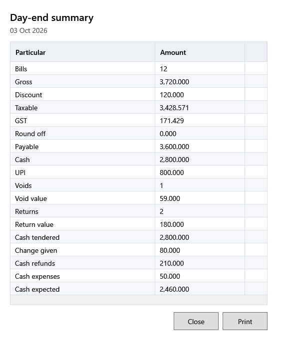

<!-- MT – needs review. Screen help for Day-end summary (topic "day-end"); the English file is ../en/day-end.md. Bold names in a table's first column must match the Gujarati labels on screen; see ../README.md. -->
# દિવસના અંતનો સારાંશ

દિવસનું વેચાણ, રિફંડ, કર અને ચુકવણી, અને ખાનામાં હોવી જોઈએ તેટલી રોકડ.

તે શીર્ષક નીચે બતાવેલી વ્યવસાય તારીખનો છે. ખર્ચ જેવા હાલમાં છે તેવા ગણાય છે: રદ થયેલો ખર્ચ હવે ગણાતો નથી, અને બદલેલો ખર્ચ તેની નવી રકમ, રીત અને તારીખ સાથે ગણાય છે. એટલે પાછલા દિવસનો કોઈ ખર્ચ પછી રદ થાય કે બદલાય ત્યારે એ દિવસની અપેક્ષિત રોકડ બદલાય છે.

## કોષ્ટક

| કૉલમ | અર્થ |
|---|---|
| **વિગત** | પંક્તિ શું ગણે છે. |
| **રકમ** | તેની કિંમત, અથવા **બિલ**, **રદ થયેલા** અને **પરત** માટે, કેટલાં. |

## પંક્તિઓ

| પંક્તિ | અર્થ |
|---|---|
| **બિલ** | એ દિવસે પૂર્ણ થયેલાં બિલ. |
| **મૂળ રકમ** | તેમનો જથ્થો × કિંમત, ડિસ્કાઉન્ટ પહેલાં. |
| **ડિસ્કાઉન્ટ** | તેમનાં લાઇન અને બિલ ડિસ્કાઉન્ટ. |
| **કરપાત્ર** | કર પહેલાંની તેમની કિંમત. |
| **GST** | તેમાં રહેલો કર. |
| **રાઉન્ડ ઓફ** | તેમને પૂરી રકમનાં કરવા ઉમેરેલા કે બાદ કરેલા પૈસા. |
| **ચૂકવવાની રકમ** | તેમની કુલ રકમ. |
| **રોકડ**, **UPI**, **કાર્ડ**, **અન્ય** | દરેક રીતે કેટલું ચૂકવાયું; એ દિવસે વપરાયેલી રીતો જ દેખાય છે. રોકડ એટલે ગ્રાહકોએ આપેલી રોકડ, પાછા આપેલા પૈસા પહેલાં. |
| **રદ થયેલા**, **રદ રકમ** | એ દિવસનાં રદ થયેલાં બિલ, અને તેમની રકમ. |
| **પરત**, **પરત રકમ** | એ દિવસે થયેલા પરત, અને તેમનાં રિફંડ. |
| **મળેલી રોકડ** | ગ્રાહકોએ આપેલી રોકડ. |
| **પાછા આપેલા પૈસા** | પાછા આપેલા છૂટા પૈસા. |
| **રોકડ પરત** | રોકડમાં આપેલાં રિફંડ. |
| **રોકડ ખર્ચ** | એ દિવસે રોકડમાં ચૂકવેલા ખર્ચ. |
| **અપેક્ષિત રોકડ** | મળેલી રોકડ, બાદ પાછા આપેલા પૈસા, રોકડ પરત અને રોકડ ખર્ચ: દિવસના વ્યવહારથી ખાનામાં હોવી જોઈએ તેટલી રોકડ. |

## બટન

| બટન | શું કરે છે |
|---|---|
| **છાપો** | સારાંશ રસીદ પ્રિન્ટર પર છાપે છે. |
| **બંધ કરો** | વિન્ડો બંધ કરે છે. |
