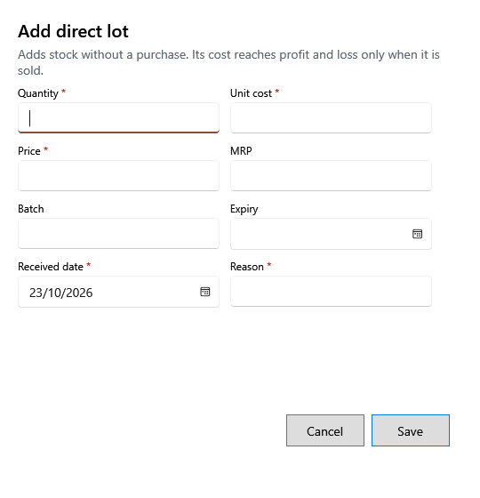

<!-- MT – needs review. Screen help for Add direct lot (topic "direct-lot"); the English file is ../en/direct-lot.md. Bold names in a table's first column must match the Gujarati labels on screen; see ../README.md. -->
# સીધી બેચ ઉમેરો

ખરીદી વગર ઉત્પાદનનો સ્ટોક ઉમેરો, જેમ કે શરૂઆતનો સ્ટોક કે ગણતરીમાં મળેલો માલ.

બેચની કિંમત તેનો સ્ટોક વેચાય ત્યારે જ નફા-નુકસાનમાં જાય છે. બેચ સચવાયા પછી તેની કિંમત અને કર ક્યારેય બદલાતાં નથી.

## ખાનાં

| ખાનું | અર્થ |
|---|---|
| **જથ્થો** | બેચ જે સ્ટોકથી શરૂ થાય. |
| **ખરીદ કિંમત** | એક નંગની કર પહેલાંની કિંમત. |
| **કર દર** | બેચનો કર દર; તે ઉત્પાદનના દરથી શરૂ થાય છે. |
| **કર/એકમ**, **કર સહિત ખરીદ કિંમત** | લખતાં જ ગણાય છે: ખરીદ કિંમત + કર/એકમ = કર સહિત ખરીદ કિંમત. |
| **વેચાણ કિંમત**, **MRP** | બેચની કિંમતો, કર સહિત. વેચાણ કિંમત MRP થી વધુ ન હોઈ શકે. |
| **બેચ નંબર**, **સમાપ્તિ** | સપ્લાયરનો બેચ નંબર અને મુદતની તારીખ. મુદત ટ્રૅક કરતા ઉત્પાદન માટે મુદત જરૂરી છે અને તે માલ મળ્યાની તારીખ પહેલાંની ન હોઈ શકે. |
| **માલ મળ્યાની તારીખ** | સ્ટોક આવ્યો તે દિવસ. |
| **કારણ** | ખરીદી વગર સ્ટોક કેમ ઉમેરાય છે. |

## બટન

| બટન | શું કરે છે |
|---|---|
| **સાચવો** | બેચ ઉમેરે છે. |
| **રદ કરો** | સ્ટોક ઉમેર્યા વગર બંધ કરે છે. |
