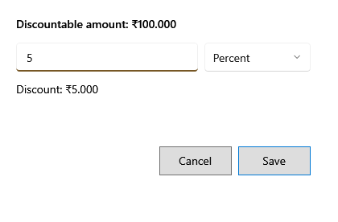

<!-- MT – needs review. Screen help for Discount (topic "discount"); the English file is ../en/discount.md. Bold names in a table's first column must match the Gujarati labels on screen; see ../README.md. -->
# છૂટ

પસંદ કરેલી લાઇન કે આખા બિલને છૂટ આપો.

**F5 લાઇન ડિસ્કાઉન્ટ** આ પસંદ કરેલી લાઇન માટે ખોલે છે, અને **F6 બિલ ડિસ્કાઉન્ટ** આખા બિલ માટે. ઉપરની લીટી બતાવે છે કે છૂટ કઈ રકમમાંથી બાદ થઈ શકે: લાઇનનો જથ્થો × કિંમત, અથવા લાઇન ડિસ્કાઉન્ટ પછીનું બિલ. બિલની છૂટ લાઇનોમાં તેમની કિંમત પ્રમાણે વહેંચાય છે. ખાના નીચે, તમે લખો તેમ છૂટ કેટલી થાય તે દેખાય છે.

## ખાનાં

| ખાનું | અર્થ |
|---|---|
| **છૂટ** | કેટલું બાદ કરવું. 0 છૂટ કાઢી નાખે છે. |
| **રકમ**, **ટકા** | આંકડો રૂપિયા છે કે ઉપરની રકમના 0 થી 100 ટકા. છૂટ એ રકમથી વધુ ન હોઈ શકે. |

## બટન

| બટન | શું કરે છે |
|---|---|
| **સાચવો** | છૂટ લાગુ કરે છે. Enter પણ એ જ કરે છે. |
| **રદ કરો** | ફેરફાર વગર બંધ કરે છે. Esc પણ એ જ કરે છે. |
