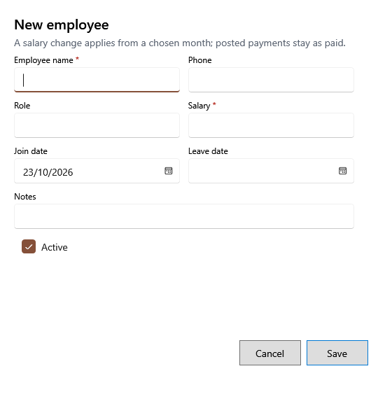

<!-- MT – needs review. Screen help for the employee form (topic "employee-form"); the English file is ../en/employee-form.md. Bold names in a table's first column must match the Gujarati labels on screen; see ../README.md. -->
# નવો કર્મચારી

કર્મચારી ઉમેરો, અથવા કોઈની વિગતો અને પગાર બદલો.

જેની સાથે * હોય તે વિગતો જરૂરી છે. પગાર ફેરફાર તમે પસંદ કરો તે મહિનાથી લાગુ થાય છે; પોસ્ટ થયેલો પગાર ચૂકવ્યા પ્રમાણે રહે છે.

## ખાનાં

| ખાનું | અર્થ |
|---|---|
| **કર્મચારીનું નામ** | કર્મચારીનું નામ. |
| **ફોન** | સંપર્ક માટેનો નંબર. |
| **ભૂમિકા** | તે શું કામ કરે છે, જેમ કે મદદનીશ કે કેશિયર. |
| **પગાર** | માસિક પગાર. દરેક પગાર તૈયારી તેનાથી શરૂ થાય છે. |
| **જોડાવાની તારીખ** | ક્યારે જોડાયા. પગાર તૈયારીમાં તે એ મહિનાથી આવે છે. |
| **છોડવાની તારીખ** | ક્યારે છોડ્યું. એ મહિના પછીની પગાર તૈયારીમાં તે આવતા નથી. તે જોડાવાની તારીખ પહેલાંની ન હોઈ શકે. |
| **પગાર લાગુ મહિનો** | કર્મચારીનો પગાર બદલો ત્યારે દેખાય છે: નવો પગાર જે મહિનાથી લાગુ થાય, YYYY-MM રૂપે લખેલો. તે અંતિમ થયેલા વર્ષમાં ન હોઈ શકે. તેની નીચેની લીટી કહે છે કે કેટલા પોસ્ટ થયેલા પગાર મહિના ચૂકવ્યા પ્રમાણે રહે છે; જરૂર હોય તો પોસ્ટ થયેલી ચુકવણીમાં સુધારો. |
| **નોંધ** | રાખવા જેવી બીજી કોઈ વિગત. |
| **સક્રિય** | હવે અહીં કામ ન કરતી વ્યક્તિ માટે પસંદ કાઢો; પગાર તૈયારીમાં તે આવતા નથી. |

## બટન

| બટન | શું કરે છે |
|---|---|
| **સાચવો** | કર્મચારી સાચવે છે. |
| **રદ કરો** | સાચવ્યા વગર બંધ કરે છે. |
