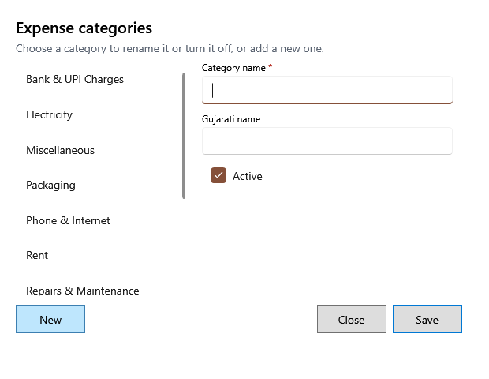

<!-- MT – needs review. Screen help for Expense categories (topic "expense-categories"); the English file is ../en/expense-categories.md. Bold names in a table's first column must match the Gujarati labels on screen; see ../README.md. -->
# ખર્ચના વર્ગો

ખર્ચ જે શ્રેણીઓમાં નોંધાય તે ઉમેરો, તેનું નામ બદલો, અથવા હવે ન વપરાતી બંધ કરો.

બદલવા માટે યાદીમાં શ્રેણી પસંદ કરો, અથવા ઉમેરવા **નવું** દબાવો. પહેલેથી સાચવેલા ખર્ચ તેમની શ્રેણી રાખે છે, ભલે તે બંધ કરી હોય.

## ખાનાં

| ખાનું | અર્થ |
|---|---|
| **શ્રેણીઓ** | શ્રેણીઓ. બદલવા માટે એક પસંદ કરો. |
| **વર્ગનું નામ** | ખર્ચ અને અહેવાલોમાં દેખાતું નામ. જરૂરી. |
| **ગુજરાતી નામ** | એપ ગુજરાતીમાં હોય ત્યારે દેખાતું નામ. |
| **સક્રિય** | નવા ખર્ચ અને દોહરાવવા માટે શ્રેણી બતાવવાનું બંધ કરવા પસંદ કાઢો. |

## બટન

| બટન | શું કરે છે |
|---|---|
| **નવું** | નવી શ્રેણી માટે ખાનાં ખાલી કરે છે. |
| **સાચવો** | નવી કે બદલેલી શ્રેણી સાચવે છે. |
| **બંધ કરો** | વિન્ડો બંધ કરે છે. |
