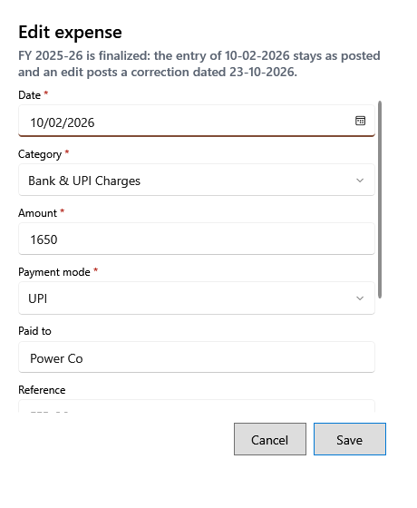

<!-- MT – needs review. Screen help for Edit expense and Void expense (topic "expense-correction"); the English file is ../en/expense-correction.md. Bold names in a table's first column must match the Gujarati labels on screen; see ../README.md. -->
# ખર્ચમાં ફેરફાર

ખોટો નોંધાયેલો ખર્ચ કારણ સાથે સુધારો, અથવા રદ કરો.

પોસ્ટ થયેલો ખર્ચ ક્યારેય ફરી લખાતો નથી: ફેરફાર તેના કારણ સાથે સુધારા તરીકે સચવાય છે, અને ખર્ચ સુધારેલ કે રદ તરીકે દેખાય છે. શીર્ષક નીચેની લીટી કહે છે કે ફેરફાર ક્યાં ગણાશે. ખર્ચની તારીખનાં કેલેન્ડર અને નાણાકીય વર્ષ બંને ખુલ્લાં હોય ત્યારે તે એ તારીખનું નફો-નુકસાન બદલે છે; નહીં તો મૂળ નોંધ જેમ છે તેમ રહે છે અને સુધારો બતાવેલી તારીખે ગણાય છે. **નોંધ રદ કરો** ખર્ચને શૂન્ય કરે છે અને પાછું કરી શકાતું નથી. તે ફક્ત ભૂલ માટે વાપરો: પછીના દિવસે ચૂકવેલી રોકડ એ દિવસનો નવો ખર્ચ છે.

## ખાનાં

| ખાનું | અર્થ |
|---|---|
| **તારીખ**, **શ્રેણી**, **રકમ**, **ચુકવણી રીત** | સુધારેલી કિંમતો. બદલાયેલી રોકડ રકમ કે તારીખ દિવસના અંતની અપેક્ષિત રોકડ પણ બદલે છે. |
| **ચૂકવ્યું**, **સંદર્ભ**, **નોંધ** | સુધારેલી વિગતો. |
| **સુધારાનું કારણ** | કેમ બદલાય છે. જરૂરી; તે સુધારા સાથે રહે છે. |

## બટન

| બટન | શું કરે છે |
|---|---|
| **સાચવો** | સુધારો સાચવે છે. |
| **નોંધ રદ કરો** | રદ કરતી વખતે દેખાય છે: ખર્ચને શૂન્ય કરે છે. |
| **રદ કરો** | ફેરફાર વગર બંધ કરે છે. |
