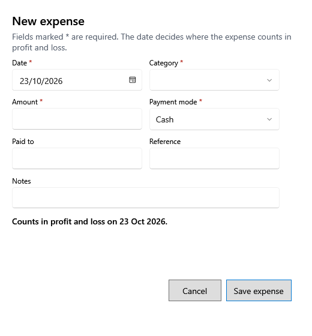

<!-- MT – needs review. Screen help for New expense (topic "expense-form"); the English file is ../en/expense-form.md. Bold names in a table's first column must match the Gujarati labels on screen; see ../README.md. -->
# નવો ખર્ચ

દુકાન ચલાવવાના ખર્ચ માટે ચૂકવેલા પૈસા નોંધો, જેમ કે ભાડું, વીજળી કે ચા.

જેની સાથે * હોય તે વિગતો જરૂરી છે. ખાનાં નીચેની લીટી કહે છે કે ખર્ચ નફા-નુકસાનમાં કઈ તારીખે ગણાશે. દુકાન રાખે એવી વસ્તુ ખરીદવી, જેમ કે સાધનો કે ફર્નિચર, ખર્ચ નહીં પણ મિલકત છે: તેને મિલકતોમાં નોંધો.

## ખાનાં

| ખાનું | અર્થ |
|---|---|
| **તારીખ** | પૈસા ચૂકવ્યાનો દિવસ. ખર્ચ આ તારીખે ગણાય છે; અંતિમ થયેલા વર્ષની તારીખ સ્વીકારાતી નથી. |
| **શ્રેણી** | ખર્ચ શેના માટે હતો. સાધનો, ફર્નિચર, કમ્પ્યુટર, વાહન કે મિલકત જેવી લાગતી શ્રેણી સ્વીકારાતી નથી: તે મિલકતોમાં નોંધો. |
| **રકમ** | કેટલું ચૂકવ્યું. |
| **ચુકવણી રીત** | રોકડ, UPI, બેંક, કાર્ડ કે અન્ય. રોકડ ખર્ચ દિવસના અંતે અપેક્ષિત રોકડ ઘટાડે છે. |
| **ચૂકવ્યું** | કોને ચૂકવ્યું. |
| **સંદર્ભ** | પછી શોધવા માટે બિલ કે રસીદ નંબર. |
| **નોંધ** | રાખવા જેવી બીજી કોઈ વિગત. |

## બટન

| બટન | શું કરે છે |
|---|---|
| **ખર્ચ સાચવો** | ખર્ચ સાચવે છે. |
| **રદ કરો** | સાચવ્યા વગર બંધ કરે છે. |
