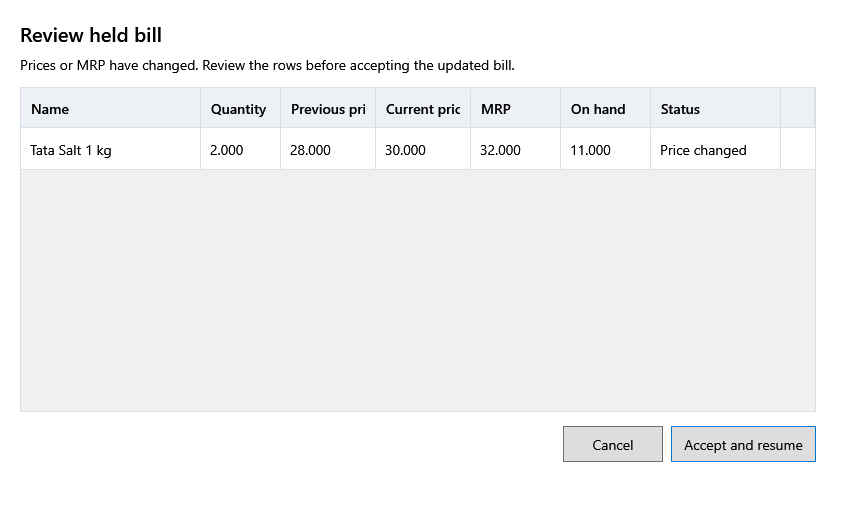

<!-- MT – needs review. Screen help for Review held bill (topic "held-review"); the English file is ../en/held-review.md. Bold names in a table's first column must match the Gujarati labels on screen; see ../README.md. -->
# રોકેલું બિલ તપાસો

બિલ પર આગળ વધતાં પહેલાં, તે રોક્યા પછી શું બદલાયું તે તપાસો.

કોષ્ટક ઉપરની લીટી કહે છે કે કંઈ બદલાયું છે કે નહીં. બિલ આજની કિંમતે આગળ વધે છે. કોઈ લાઇનનો સ્ટોક ઓછો, અવરોધિત કે મુદત વીતેલો હોય ત્યારે, તે સુધરે નહીં ત્યાં સુધી **સ્વીકારીને ચાલુ કરો** બંધ રહે છે.

## કોષ્ટક

| કૉલમ | અર્થ |
|---|---|
| **નામ** | વસ્તુ. |
| **જથ્થો** | બિલ કેટલું વેચે છે. |
| **જૂની કિંમત** | બિલ રોક્યું ત્યારની કિંમત. |
| **હાલની કિંમત** | બિલ હવે લેશે તે કિંમત, કર સહિત. |
| **MRP** | હાલની MRP. |
| **હાલનો જથ્થો** | હવે વેચી શકાય તેટલો સ્ટોક. |
| **સ્થિતિ** | **તૈયાર**, **કિંમત બદલાઈ**, અથવા વસ્તુ નિષ્ક્રિય હોય, તેની બેચની મુદત વીતી હોય કે પૂરતો સ્ટોક ન હોય ત્યારે **સ્ટોકની સમસ્યા**. |

## બટન

| બટન | શું કરે છે |
|---|---|
| **સ્વીકારીને ચાલુ કરો** | બિલને હાલની કિંમતો પર લાવીને ખોલે છે. |
| **રદ કરો** | બિલ રોકેલું જ રાખે છે. |
