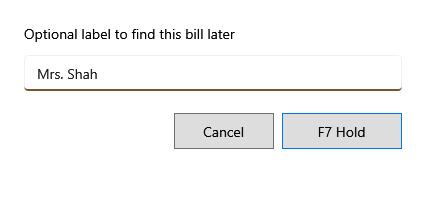

<!-- MT – needs review. Screen help for Hold bill (topic "hold-bill"); the English file is ../en/hold-bill.md. Bold names in a table's first column must match the Gujarati labels on screen; see ../README.md. -->
# બિલ રોકો

બિલને બાજુએ મૂકો, જેમ કે ગ્રાહક કંઈક લેવા જાય ત્યારે, અને ખાલી બિલ શરૂ કરો.

રોકેલું બિલ તેની લાઇનો રાખે છે, પણ ચૂકવાય નહીં ત્યાં સુધી સ્ટોક કે બિલ નંબર લેતું નથી. **F8 ફરી શરૂ કરો** રોકેલાં બિલ બતાવે છે; કોઈ બિલ આગળ વધે તે પહેલાં, વચ્ચે બદલાયેલી કિંમત કે સ્ટોક તપાસ બતાવે છે.

## ખાનાં

| ખાનું | અર્થ |
|---|---|
| **લેબલ** | વૈકલ્પિક: પછી બિલ શોધવા માટેનો શબ્દ, જેમ કે ગ્રાહકનું નામ. તે વગર, બિલ તેના નંબરથી દેખાય છે. |

## બટન

| બટન | શું કરે છે |
|---|---|
| **F7 હોલ્ડ** | બિલ રોકે છે. Enter પણ એ જ કરે છે. |
| **રદ કરો** | બિલ રોક્યા વગર તેના પર પાછા જાય છે. |
