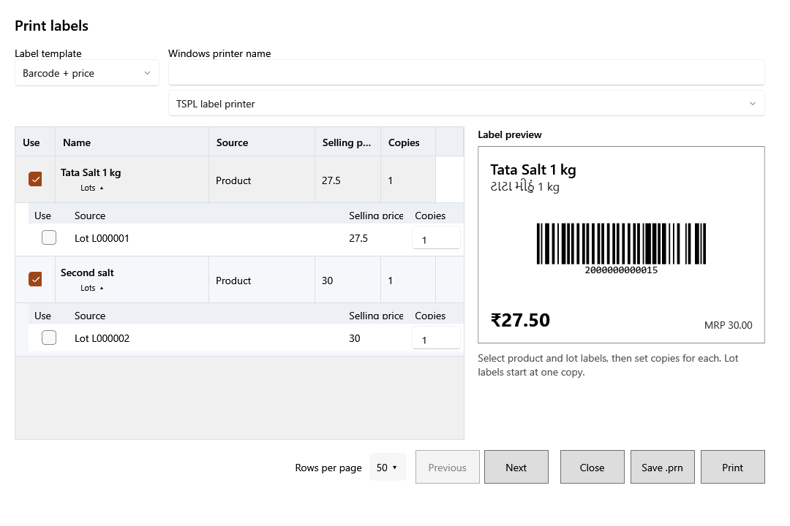

<!-- MT – needs review. Screen help for Print labels (topic "label-batch"); the English file is ../en/label-batch.md. Bold names in a table's first column must match the Gujarati labels on screen; see ../README.md. -->
# લેબલ છાપો

ઉત્પાદનો અને તેમની બેચ માટે બારકોડ અને કિંમતનાં લેબલ છાપો, દરેકની જોઈએ એટલી નકલો સાથે.

છાપવાનાં લેબલ પસંદ કરો અને દરેકની નકલો નક્કી કરો. ઉત્પાદનના લેબલ પર ઉત્પાદનની મૂળ કિંમત હોય છે; બેચના લેબલ પર બેચની પોતાની કિંમત અને કોડ હોય છે. બેચ લેબલ એક નકલથી શરૂ થાય છે.

## પ્રિન્ટર

| ખાનું | અર્થ |
|---|---|
| **લેબલ નમૂનો** | **બારકોડ અને કિંમત**, **કિંમત લેબલ** અથવા **શેલ્ફ લેબલ**: દરેક લેબલ પર શું દેખાય. |
| **Windows પ્રિન્ટર નામ** | લેબલ પ્રિન્ટર, Windows તેને જે નામ આપે છે તે જ. |
| **પ્રિન્ટરનો પ્રકાર** | **TSPL લેબલ પ્રિન્ટર** લેબલ પ્રિન્ટરના પોતાના આદેશો મોકલે છે; **Windows પ્રિન્ટર ડ્રાઇવર** પ્રિન્ટરના Windows ડ્રાઇવરથી છાપે છે. |

## લેબલ

| કૉલમ | અર્થ |
|---|---|
| **ઉપયોગ કરો** | છાપવાનાં લેબલ પસંદ કરો. |
| **નામ** | ઉત્પાદન. તેની નીચે **બેચ** ઉત્પાદનની બેચ બતાવે કે છુપાવે છે, દરેકનું પોતાનું લેબલ. |
| **સ્રોત** | **ઉત્પાદન**, અથવા બેચ લેબલ માટે બેચનો કોડ. |
| **વેચાણ કિંમત** | લેબલ પર છપાતી કિંમત, કર સહિત. |
| **નકલો** | આ લેબલની કેટલી નકલો છાપવી, 1 થી 100,000. |
| **લેબલ પૂર્વદર્શન** | પસંદ કરેલું લેબલ કેવું દેખાશે. |

## બટન

| બટન | શું કરે છે |
|---|---|
| **દર પાનાના રેકોર્ડ** | એક સાથે કેટલી બેચ બતાવવી. |
| **પાછળ**, **આગળ** | સમાય તેના કરતાં વધુ બેચ હોય ત્યારે તેમાં આગળ-પાછળ જાય છે. |
| **.prn સાચવો** | લેબલને છાપવાની ફાઇલ તરીકે સાચવે છે, પછી કે બીજા કમ્પ્યુટર પર છાપવા. |
| **છાપો** | પસંદ કરેલાં લેબલ છાપે છે. |
| **બંધ કરો** | વિન્ડો બંધ કરે છે. |
