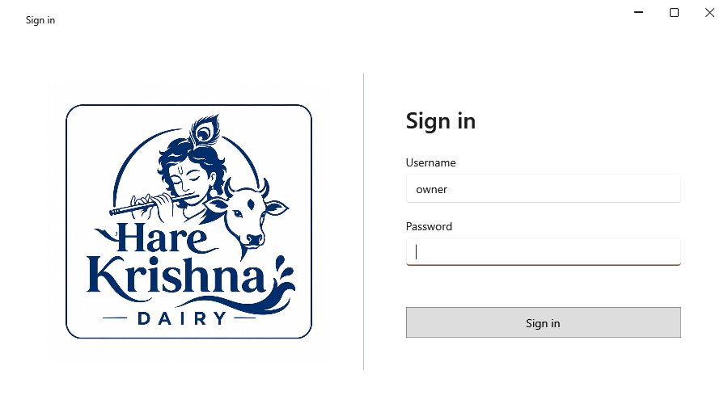

<!-- MT – needs review. Screen help for Sign in (topic "login"); the English file is ../en/login.md. Bold names in a table's first column must match the Gujarati labels on screen; see ../README.md. -->
# સાઇન ઇન કરો

એપ ખોલવા માલિકના વપરાશકર્તા નામ અને પાસવર્ડથી સાઇન ઇન કરો.

વપરાશકર્તા નામ અને પાસવર્ડ સેટઅપ વખતે નક્કી થયા હતા; પાસવર્ડ સેટિંગ્સમાં બદલી શકાય છે. પાસવર્ડ પુનઃપ્રાપ્ત કરવાની સુવિધા નથી, એટલે તેને સુરક્ષિત જગ્યાએ રાખો. થોડા ખોટા પ્રયાસ પછી, દરેક નવો પ્રયાસ થોડો વધુ રાહ જુએ છે.

## ખાનાં

| ખાનું | અર્થ |
|---|---|
| **વપરાશકર્તા નામ** | સેટઅપ વખતે નક્કી કરેલું નામ, તમે બદલ્યું ન હોય તો owner. |
| **પાસવર્ડ** | માલિકનો પાસવર્ડ. Enter સાઇન ઇન કરે છે. |

## બટન

| બટન | શું કરે છે |
|---|---|
| **સાઇન ઇન** | વપરાશકર્તા નામ અને પાસવર્ડ તપાસીને એપ ખોલે છે. |
