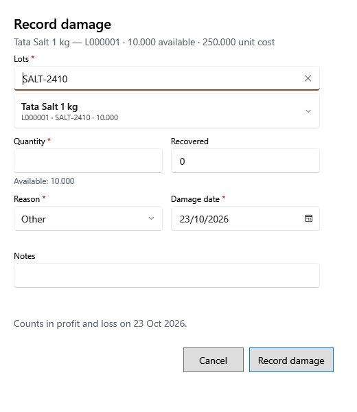

<!-- MT – needs review. Screen help for Record damage (topic "lot-damage"); the English file is ../en/lot-damage.md. Bold names in a table's first column must match the Gujarati labels on screen; see ../README.md. -->
# નુકસાન નોંધો

નુકસાન પામેલો, બગડેલો, સમાપ્ત કે ગુમ થયેલો સ્ટોક બેચમાંથી કાઢો અને નુકસાન નોંધો.

જથ્થો બેચમાંથી ઘટે છે અને નુકસાન ખર્ચ → નુકસાનમાં દેખાય છે. તેની કિંમત, વસૂલ થયેલું બાદ કરીને, નુકસાનની તારીખે નફા-નુકસાનમાં નુકસાન તરીકે ગણાય છે; આંતરિક ઉપયોગના સ્ટોકના નુકસાનની નફા-નુકસાન પર અસર નથી. સાચવતાં પહેલાં પૂર્વદર્શન કિંમત અને ચોખ્ખું નુકસાન બતાવે છે, અને સ્ટોક બદલાય તે પહેલાં તમે પુષ્ટિ કરો છો.

## ખાનાં

| ખાનું | અર્થ |
|---|---|
| **ઉત્પાદન, બેચ કોડ અથવા બેચ નંબર** | ખર્ચ સ્ક્રીનમાંથી: બેચ શોધવા ઉત્પાદનના નામ, બેચ કોડ કે બેચ નંબરનો ભાગ લખો. ઉત્પાદનની બેચમાંથી ખોલો તો બેચ પહેલેથી પસંદ હોય છે. |
| **બેચ** | જે બેચમાંથી નુકસાન ઘટે છે, તેના સ્ટોક અને ખરીદ કિંમત સાથે. |
| **જથ્થો** | કેટલું નુકસાન થયું, બેચના ઉપલબ્ધ સ્ટોક સુધી. |
| **વસૂલ** | તેના બદલામાં પાછા મળેલા પૈસા, જેમ કે વિક્રેતા કે વીમા કંપની પાસેથી. |
| **કારણ** | **સમાપ્ત**, **તૂટેલું**, **બગડેલું**, **જીવાતથી નુકસાન**, **ગુમ** અથવા **અન્ય**. |
| **નુકસાનની તારીખ** | જે દિવસે થયું. નુકસાન આ તારીખે ગણાય છે. |
| **નોંધ** | નુકસાન સાથે રાખવા જેવી બીજી કોઈ વાત. |

## બટન

| બટન | શું કરે છે |
|---|---|
| **નુકસાન નોંધો** | તમે પુષ્ટિ કરો પછી નુકસાન નોંધે છે. |
| **રદ કરો** | ફેરફાર વગર બંધ કરે છે. |
