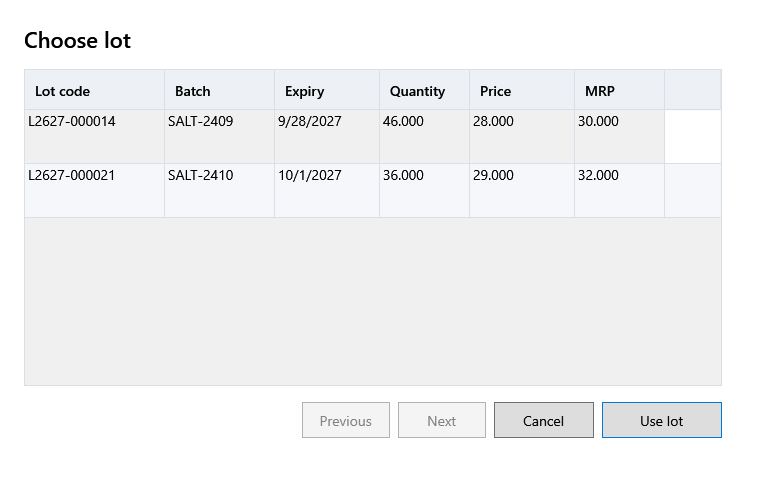

<!-- MT – needs review. Screen help for Choose lot (topic "lot-picker"); the English file is ../en/lot-picker.md. Bold names in a table's first column must match the Gujarati labels on screen; see ../README.md. -->
# બેચ પસંદ કરો

બિલની પસંદ કરેલી લાઇન વસ્તુની કઈ બેચમાંથી વેચાય તે પસંદ કરો.

યાદી વસ્તુની સ્ટોકવાળી સક્રિય બેચ બતાવે છે, લાઇનની હાલની બેચ પસંદ કરેલી હોય છે. લાઇન પસંદ કરેલી બેચની કિંમત અને MRP લે છે. બિલની બીજી લાઇન એ જ બેચમાંથી વેચાતી હોય તો બંને લાઇન એક થઈ જાય છે.

## ખાનાં

| ખાનું | અર્થ |
|---|---|
| **બેચ નં. કે બેચ કોડ** | યાદી ટૂંકી કરવા બેચ નંબર કે બેચ કોડનો ભાગ લખો. |

## કોષ્ટક

| કૉલમ | અર્થ |
|---|---|
| **બેચ કોડ** | બેચ માટે એપનો નંબર. |
| **બેચ નંબર** | ઉત્પાદકે છાપેલો બેચ નંબર. |
| **સમાપ્તિ** | બેચની મુદત ક્યારે પૂરી થાય છે. |
| **હાલનો જથ્થો** | બેચનો હાલનો સ્ટોક. |
| **કિંમત** | બેચની વેચાણ કિંમત, કર સહિત. |
| **MRP** | બેચની MRP. |

## બટન

| બટન | શું કરે છે |
|---|---|
| **બેચ વાપરો** | લાઇનને પસંદ કરેલી બેચમાંથી વેચે છે. ડબલ-ક્લિક પણ એ જ કરે છે. |
| **દર પાનાના રેકોર્ડ**, **પાછળ**, **આગળ** | સમાય તેના કરતાં વધુ બેચ હોય ત્યારે તેમાં આગળ-પાછળ જાય છે. |
| **રદ કરો** | ફેરફાર વગર બંધ કરે છે. |
