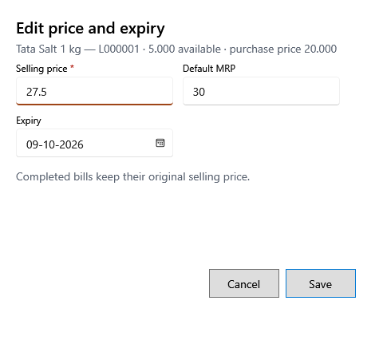

<!-- MT – needs review. Screen help for Edit price and expiry (topic "lot-price"); the English file is ../en/lot-price.md. Bold names in a table's first column must match the Gujarati labels on screen; see ../README.md. -->
# કિંમત અને સમાપ્તિ તારીખ બદલો

હવે પછીના વેચાણ માટે બેચની વેચાણ કિંમત, MRP કે મુદત બદલો.

પૂર્ણ થયેલાં બિલ જે કિંમતે વેચાયાં તે જ રાખે છે. બેચની કિંમત અને કર બદલાતાં નથી.

## ખાનાં

| ખાનું | અર્થ |
|---|---|
| **વેચાણ કિંમત** | બેચની નવી વેચાણ કિંમત, કર સહિત. તે MRP થી વધુ ન હોઈ શકે. |
| **MRP** | બેચની MRP, કર સહિત. |
| **સમાપ્તિ** | બેચની મુદતની તારીખ. તે બેચ મળ્યાના દિવસ પહેલાંની ન હોઈ શકે. |

## બટન

| બટન | શું કરે છે |
|---|---|
| **સાચવો** | નવી કિંમત અને મુદત સાચવે છે. |
| **રદ કરો** | ફેરફાર વગર બંધ કરે છે. |
