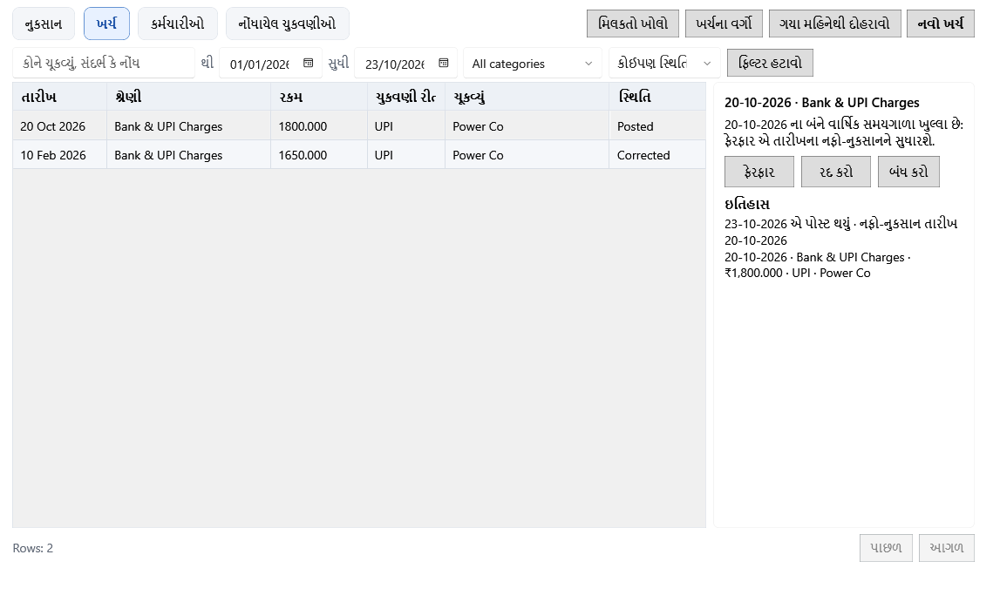

<!-- MT – needs review. Screen help for Money out (topic "money-out"); the English file is ../en/money-out.md. Bold names in a table's first column must match the Gujarati labels on screen; see ../README.md. Each tab has its own section, named as the tab. -->
# ખર્ચ

નુકસાન, ખર્ચ, કર્મચારીઓ અને પગારની ચુકવણી નોંધો અને સુધારો: બિલ અને ખરીદી સિવાય દુકાનમાંથી જતા પૈસા અને સ્ટોક.

દરેક ટૅબનાં પોતાનાં ફિલ્ટર, કોષ્ટક અને ક્રિયાઓ છે, અને પસંદ કરેલી નોંધની વિગતો જમણી બાજુની સાંકડી પૅનલમાં દેખાય છે. નોંધાયેલી નોંધ ક્યારેય ફરી લખાતી નથી: **ફેરફાર** અને **નોંધ રદ કરો** કારણ સાથે સુધારો નોંધે છે. નોંધની તારીખનું કેલેન્ડર વર્ષ અને નાણાકીય વર્ષ બંને હજી ખુલ્લાં હોય તો સુધારો મૂળ તારીખે ગણાય છે; નહીં તો મૂળ નોંધ એમ જ રહે છે અને સુધારો આજે ગણાય છે. વર્ષ પૂરું થયા પછીના સાતમા દિવસ સુધી ખુલ્લું રહે છે.

## નુકસાન

મુદત વીતી જવાથી, તૂટવાથી, બગડવાથી કે ગુમ થવાથી માંડી વાળેલો સ્ટોક. ઉત્પાદનોમાંથી નોંધેલું નુકસાન પણ અહીં દેખાય છે. આંતરિક ઉપયોગના સ્ટોકના નુકસાનની નફા-નુકસાન પર અસર નથી.

| ખાનું | અર્થ |
|---|---|
| **દસ્તાવેજ, ઉત્પાદન કે બેચ** | નુકસાન નંબર, ઉત્પાદનના નામ કે બેચ કોડનો ભાગ લખો. |
| **થી**, **સુધી** | આ દિવસો વચ્ચેનું નુકસાન. |
| **સ્થિતિ** | **કોઈપણ સ્થિતિ**, **પોસ્ટ થયેલ**, **સુધારેલ** (ફેરફારથી બદલાયેલ) અથવા **રદ**. |
| **કારણ** | **કોઈપણ કારણ**, અથવા એક કારણ: **સમાપ્ત**, **તૂટેલું**, **બગડેલું**, **જીવાતથી નુકસાન**, **ગુમ**, **ગ્રાહક પરત** અથવા **અન્ય**. |
| **ફિલ્ટર હટાવો** | દરેક ફિલ્ટર તેની મૂળ સ્થિતિમાં લાવે છે. |

| કૉલમ | અર્થ |
|---|---|
| **દસ્તાવેજ** | નુકસાન નંબર. |
| **તારીખ** | નુકસાનની તારીખ. નુકસાન આ તારીખે નફા-નુકસાનમાં ગણાય છે. |
| **નામ** | નુકસાન પામેલું ઉત્પાદન. |
| **જથ્થો** | કેટલું માંડી વાળ્યું. |
| **કિંમત** | એ સ્ટોકની કિંમત: કંઈ વસૂલ થાય તે પહેલાંનું નુકસાન. |
| **વસૂલ** | તેના બદલામાં પાછા મળેલા પૈસા, જેમ કે વિક્રેતા પાસેથી. |
| **કારણ** | સ્ટોક કેમ માંડી વાળ્યો. |
| **સ્થિતિ** | પોસ્ટ થયેલ, સુધારેલ અથવા રદ. |

| બટન | શું કરે છે |
|---|---|
| **નુકસાન નોંધો** | નુકસાનનું ફોર્મ ખોલે છે: બેચ શોધો, પછી જથ્થો (સ્ટોક સુધી), વસૂલ રકમ, કારણ, તારીખ અને નોંધ લખો. પૂર્વદર્શન નુકસાન અને તે કઈ તારીખે ગણાશે તે બતાવે છે. |
| **ફેરફાર** | પસંદ કરેલું નુકસાન કારણ સાથે સુધારે છે. જથ્થો બદલવાથી સ્ટોક બેચમાં પાછો જાય છે કે વધુ નીકળે છે. બેચ કાઢી નાખી હોય તો પાછા આવતા એકમો નુકસાનની કિંમતે નવી બેચ બનાવે છે. |
| **નોંધ રદ કરો** | કારણ સાથે જથ્થો શૂન્ય કરે છે અને સ્ટોક પાછો મૂકે છે. |
| **ઇતિહાસ** | મૂળ નુકસાન અને દરેક સુધારો, દરેક કઈ તારીખે ગણાય છે તે સાથે. |

## ખર્ચ

ભાડું, પગાર પત્રક સિવાય ચૂકવેલી મજૂરી, વીજળી અને દુકાન ચલાવવાનો બીજો દરેક ખર્ચ. ખરીદીની ખર્ચ લાઇન પણ અહીં દેખાય છે.

| ખાનું | અર્થ |
|---|---|
| **કોને ચૂકવ્યું, સંદર્ભ કે નોંધ** | કોને ચૂકવ્યું, સંદર્ભ કે નોંધનો ભાગ લખો. |
| **થી**, **સુધી** | આ દિવસો વચ્ચેના ખર્ચ. |
| **શ્રેણી** | ખર્ચની એક શ્રેણી, અથવા **બધી શ્રેણીઓ**. |
| **સ્થિતિ** | **કોઈપણ સ્થિતિ**, **પોસ્ટ થયેલ**, **સુધારેલ**, **રદ** અથવા **ખરીદીમાંથી** (ખરીદીની ખર્ચ લાઇન, જે એ ખરીદી રદ થાય ત્યારે જ બદલાય છે). |
| **ફિલ્ટર હટાવો** | દરેક ફિલ્ટર તેની મૂળ સ્થિતિમાં લાવે છે. |

| કૉલમ | અર્થ |
|---|---|
| **તારીખ** | ખર્ચની તારીખ. તે આ તારીખે નફા-નુકસાનમાં ગણાય છે. |
| **શ્રેણી** | ખર્ચની શ્રેણી. |
| **રકમ** | ચૂકવેલી રકમ. |
| **ચુકવણી રીત** | રોકડ, UPI, બેંક અથવા અન્ય. |
| **ચૂકવ્યું** | કોને ચૂકવ્યું. |
| **સ્થિતિ** | પોસ્ટ થયેલ, સુધારેલ, રદ અથવા ખરીદીમાંથી. |

| બટન | શું કરે છે |
|---|---|
| **નવો ખર્ચ** | ખર્ચનું ફોર્મ ખોલે છે: તારીખ, શ્રેણી, રકમ, રીત, કોને ચૂકવ્યું, સંદર્ભ અને નોંધ, ખર્ચ કઈ તારીખે ગણાશે તે સાથે. |
| **ગયા મહિનેથી દોહરાવો** | તમે પસંદ કરો તે શ્રેણીઓ માટે ગયા મહિનાના ખર્ચનો ડ્રાફ્ટ તૈયાર કરે છે. સાચવતાં પહેલાં તપાસો. |
| **ખર્ચના વર્ગો** | ખર્ચની શ્રેણીઓની યાદી ખોલે છે. |
| **મિલકતો ખોલો** | મિલકતો પર જાય છે, સાધનો અને દુકાન વર્ષો સુધી રાખે એવી બીજી વસ્તુઓ માટે. |
| **વધુ ▾** | વિન્ડો સાંકડી હોય ત્યારે ન સમાતી ક્રિયાઓ રાખે છે. |
| **ફેરફાર** | પસંદ કરેલો ખર્ચ કારણ સાથે સુધારે છે. |
| **નોંધ રદ કરો** | પસંદ કરેલો ખર્ચ કારણ સાથે, સુધારા દ્વારા શૂન્ય કરે છે. |
| **ઇતિહાસ** | મૂળ ખર્ચ અને દરેક સુધારો. |

## કર્મચારીઓ

| ખાનું | અર્થ |
|---|---|
| **નામ, હોદ્દો કે ફોન** | કર્મચારીના નામ, હોદ્દા કે ફોન નંબરનો ભાગ લખો. |
| **સ્થિતિ** | **કાર્યરત**, **છૂટા થયેલ** (છોડી ગયેલ) અથવા **બધી સ્થિતિ**. |
| **ફિલ્ટર હટાવો** | દરેક ફિલ્ટર તેની મૂળ સ્થિતિમાં લાવે છે. |

| કૉલમ | અર્થ |
|---|---|
| **નામ** | કર્મચારીનું નામ. |
| **ભૂમિકા** | કર્મચારીનું કામ. |
| **પગાર** | હાલનો માસિક પગાર. |
| **જોડાવાની તારીખ**, **છોડવાની તારીખ** | કર્મચારી ક્યારે જોડાયા અને ક્યારે છોડ્યું. |
| **સ્થિતિ** | કાર્યરત અથવા છૂટા થયેલ. |

| બટન | શું કરે છે |
|---|---|
| **નવો કર્મચારી** | કર્મચારીનું ફોર્મ ખોલે છે. |
| **ફેરફાર** | પસંદ કરેલા કર્મચારીનું ફોર્મ ખોલે છે (અથવા હરોળ પર ડબલ-ક્લિક કરો). નવો માસિક પગાર કયા મહિનાથી (YYYY-MM) તે પૂછે છે: તે એ મહિનાથી લાગુ થાય છે, જેનાં કેલેન્ડર અને નાણાકીય વર્ષ બંને ખુલ્લાં હોય એવા પહેલા મહિનાથી વહેલો ક્યારેય નહીં. નોંધાયેલી ચુકવણીઓ ચૂકવી તેમ જ રહે છે. |
| **ઇતિહાસ** | કર્મચારીની પગારની શરતો: દરેક કયા મહિનાથી શરૂ થાય, રકમ અને ક્યારે નોંધાઈ. |

## નોંધાયેલ ચુકવણીઓ

કર્મચારીઓને ચૂકવેલો પગાર, ઓવરટાઇમ, બોનસ અને પેશગી.

| ખાનું | અર્થ |
|---|---|
| **થી**, **સુધી** | કામ કરેલા મહિના, YYYY-MM રૂપે લખેલા, જેમ કે 2026-10. |
| **કર્મચારીનું નામ** | એક કર્મચારી, અથવા **બધા કર્મચારીઓ**. |
| **સ્થિતિ** | **કોઈપણ સ્થિતિ**, **પોસ્ટ થયેલ**, **સુધારેલ** અથવા **રદ**. |
| **ફિલ્ટર હટાવો** | દરેક ફિલ્ટર તેની મૂળ સ્થિતિમાં લાવે છે. |

| કૉલમ | અર્થ |
|---|---|
| **કર્મચારીનું નામ** | કોને ચૂકવ્યું. |
| **સમયગાળો** | કામ કરેલો મહિનો. ચુકવણી એ મહિનામાં ગણાય છે. |
| **ચુકવણી તારીખ** | ચૂકવ્યું તે દિવસ. |
| **પ્રકાર** | પગાર, બોનસ, વધારાનું કામ અથવા અન્ય. પેશગી અન્ય તરીકે દેખાય છે. |
| **રકમ** | ચૂકવેલી રકમ. |
| **ચુકવણી રીત** | રોકડ, UPI, બેંક અથવા અન્ય. |
| **સ્થિતિ** | પોસ્ટ થયેલ, સુધારેલ અથવા રદ. |
| **નોંધ** | ચુકવણી સાથે સાચવેલી નોંધ. |

| બટન | શું કરે છે |
|---|---|
| **પગાર તૈયાર કરો** | પગાર ચલાવવાનું ખોલે છે: મહિનો, ચુકવણી તારીખ અને રીત પસંદ કરો, લાઇન તૈયાર કરો (દરેક કાર્યરત કર્મચારી માટે પગાર, રજા કપાત, ઓવરટાઇમ અને બોનસ), તપાસો અને નોંધો. |
| **પેશગી નોંધો** | પગાર ચલાવતાં પહેલાં કર્મચારીને ચૂકવેલી રકમ નોંધે છે. |
| **ફેરફાર** | પસંદ કરેલી ચુકવણી કારણ સાથે સુધારે છે. |
| **નોંધ રદ કરો** | ભૂલથી નોંધાયેલી ચુકવણી કારણ સાથે શૂન્ય કરે છે. |
| **ઇતિહાસ** | મૂળ ચુકવણી અને દરેક સુધારો. |

## કેવી રીતે વાપરવું

1. નુકસાન થાય ત્યારે જ નોંધો.
2. દરેક ખર્ચ ચૂકવો તે દિવસે દાખલ કરો.
3. કર્મચારીઓની યાદી અદ્યતન રાખો.
4. દર મહિને પગાર તૈયાર કરીને નોંધો.
5. નોંધાયેલી નોંધ ફક્ત **ફેરફાર** કે **નોંધ રદ કરો** અને કારણ સાથે બદલો.
