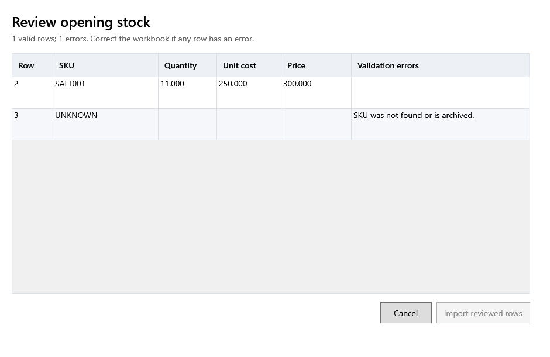

<!-- MT – needs review. Screen help for Review opening stock (topic "opening-stock"); the English file is ../en/opening-stock.md. Bold names in a table's first column must match the Gujarati labels on screen; see ../README.md. -->
# શરૂઆતનો સ્ટોક તપાસો

ભરેલા શરૂઆતના સ્ટોકના ટેમ્પલેટની પંક્તિઓ સ્ટોક બને તે પહેલાં તપાસો.

દરેક માન્ય પંક્તિ તેના ઉત્પાદનની બેચ બને છે, તેની પાછળ કોઈ ખરીદી વગર. કોષ્ટક ઉપરની લીટી માન્ય પંક્તિઓ અને ભૂલો ગણે છે; કોઈ પંક્તિમાં ભૂલ હોય તો વર્કબુક સુધારીને ફરી આયાત કરો.

## કોષ્ટક

| કૉલમ | અર્થ |
|---|---|
| **પંક્તિ** | વર્કબુકમાં પંક્તિનો નંબર. |
| **SKU** | સ્ટોક જે ઉત્પાદનનો છે. |
| **જથ્થો** | બેચ જે સ્ટોકથી શરૂ થાય. |
| **ખરીદ કિંમત** | એક નંગની કર પહેલાંની કિંમત; બેચ તેના ઉત્પાદનનો કર દર લે છે. |
| **વેચાણ કિંમત** | બેચની વેચાણ કિંમત, કર સહિત. |
| **ચકાસણી ભૂલો** | પંક્તિમાં શું ખોટું છે. ભૂલવાળી પંક્તિ આયાત થતી નથી. |

## બટન

| બટન | શું કરે છે |
|---|---|
| **તપાસેલી પંક્તિઓ આયાત કરો** | માન્ય પંક્તિઓ શરૂઆતની બેચ તરીકે ઉમેરે છે. |
| **રદ કરો** | સ્ટોક ઉમેર્યા વગર બંધ કરે છે. |
