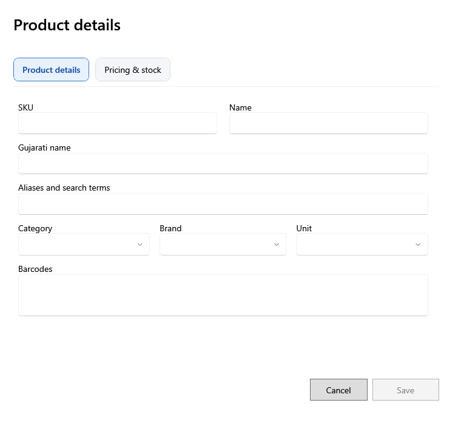

<!-- MT – needs review. Screen help for the product form (topic "product-form"); the English file is ../en/product-form.md. Bold names in a table's first column must match the Gujarati labels on screen; see ../README.md. -->
# ઉત્પાદનની વિગતો

ઉત્પાદન ઉમેરો કે બદલો: તેનાં નામ અને કોડ, શ્રેણી અને એકમ, કર અને મૂળ કિંમતો, અને સ્ટોકના નિયમો. નવું ઉત્પાદન એ જ વખતે તેની પહેલી બેચ ઉમેરી શકે છે.

જેની સાથે * હોય તે વિગતો જરૂરી છે. બેચની પોતાની કિંમતો, પડતર અને મુદત બેચ પર નક્કી થાય છે; અહીંની કિંમતો નવી બેચ જેનાથી શરૂ થાય તે મૂળ કિંમતો છે, અને સ્ટોક વગરનું ઉત્પાદન તે બતાવે છે.

## ઓળખ

| ખાનું | અર્થ |
|---|---|
| **SKU** | ઉત્પાદન માટે દુકાનનો પોતાનો કોડ. બે ઉત્પાદનોનો એક જ ન હોઈ શકે. |
| **નામ** | અંગ્રેજી નામ, બિલ અને લેબલ પર છપાય છે. |
| **ગુજરાતી નામ** | સ્ક્રીન કે રસીદ ગુજરાતીમાં હોય ત્યારે દેખાતું નામ. |
| **ઉપનામ અને શોધ શબ્દો** | બીજા શબ્દો જેનાથી શોધમાં ઉત્પાદન મળવું જોઈએ, જેમ કે સ્થાનિક કે ટૂંકું નામ. |
| **બારકોડ** | દરેક લીટીમાં એક બારકોડ; પહેલો મુખ્ય છે અને લેબલ પર છપાય છે. તેમાંથી કોઈપણ સ્કેન કરવાથી ઉત્પાદન મળે છે. |

## વર્ગીકરણ

| ખાનું | અર્થ |
|---|---|
| **શ્રેણી** | ઉત્પાદનની શ્રેણી. ઉત્પાદનના પોતાના ચેતવણીના દિવસો ન હોય ત્યારે તેના દિવસો લાગુ પડે છે. |
| **બ્રાન્ડ** | ઉત્પાદનની બ્રાન્ડ, હોય તો. |
| **એકમ** | ઉત્પાદન કેવી રીતે ગણાય, જેમ કે PCS કે KG. ઉત્પાદનની બેચ બન્યા પછી તે બદલાતું નથી. |
| **ઉત્પાદન પ્રકાર** | **વેચાણ માટે** (બિલમાં વેચાય) અથવા **આંતરિક ઉપયોગ** (દુકાનમાં વપરાય અને બિલ તથા નફા-નુકસાનથી બહાર). સ્ટોકવાળા ઉત્પાદનનો પ્રકાર બદલાતો નથી. |

## કર અને ભાવ

વેચાણ કિંમત અને MRP માં કર સામેલ છે.

| ખાનું | અર્થ |
|---|---|
| **HSN કોડ** | GST માટે ઉત્પાદનનો HSN કોડ: 4, 6 કે 8 અંક. |
| **કર દર** | ઉત્પાદન જે GST દરે વેચાય અને ખરીદાય છે. ફેરફાર નવી બેચ અને બિલને લાગુ પડે છે; સચવાયેલાં તેમનો દર રાખે છે. |
| **મૂળ વેચાણ કિંમત** | નવી બેચ જે કિંમતથી શરૂ થાય. તે મૂળ MRP થી વધુ ન હોઈ શકે. |
| **મૂળ MRP** | નવી બેચ જે MRP થી શરૂ થાય. |

## સ્ટોકના નિયમો

| ખાનું | અર્થ |
|---|---|
| **ફરી ઓર્ડર સ્તર** | સ્ટોક આ સ્તર કે તેથી નીચે જાય ત્યારે ઉત્પાદન ડૅશબોર્ડ અને ઉત્પાદનોમાં ઓછો સ્ટોક ગણાય છે. |
| **શેલ્ફ લાઇફ (દિવસ)** | ઉત્પાદન સામાન્ય રીતે કેટલા દિવસ ટકે, તમારી જાણ માટે. દરેક બેચની મુદત બેચ પર લખાય છે. |
| **સમાપ્તિ ચેતવણી દિવસો (વૈકલ્પિક)** | મુદતના કેટલા દિવસ પહેલાં તેની બેચ સમાપ્તિ નજીક ગણાય. ખાલી હોય તો શ્રેણીના, નહીં તો મૂળ શ્રેણીના, નહીં તો 30 દિવસ. |
| **સ્કેલ PLU કોડ** | વજનકાંટો તેના બારકોડમાં છાપે તે વસ્તુ કોડ, જેથી સ્કેન કરેલા કાંટાના લેબલથી ઉત્પાદન મળે. |
| **સમાપ્તિ ટ્રૅક કરો** | ઉત્પાદનની દરેક બેચની મુદત હોવી જોઈએ. |
| **છૂટક ઉત્પાદન** | વજનથી છૂટક વેચાય છે. તેને KG જેવો અપૂર્ણાંક લેતો એકમ અને સ્કેલ PLU કોડ જોઈએ. |

## પ્રથમ બેચ

ફક્ત નવા ઉત્પાદન માટે દેખાય છે.

| ખાનું | અર્થ |
|---|---|
| **આ ઉત્પાદન સાથે પ્રથમ બેચ ઉમેરો** | ખરીદી વગર એ જ વખતે સ્ટોક ઉમેરવા પસંદ કરો. |
| **જથ્થો** | બેચ જે સ્ટોકથી શરૂ થાય. |
| **ખરીદ કિંમત** | એક નંગની કર પહેલાંની કિંમત. |
| **કર દર** | બેચનો કર દર. તમે બીજો પસંદ ન કરો ત્યાં સુધી તે ઉત્પાદનનો રહે છે. |
| **કર/એકમ**, **કર સહિત ખરીદ કિંમત** | ખરીદ કિંમત અને બેચના કર દર પરથી ગણાય છે. બેચ સચવાયા પછી તેની કિંમત અને કર ક્યારેય બદલાતાં નથી. |
| **વેચાણ કિંમત**, **MRP** | બેચની કિંમતો, કર સહિત. |
| **બેચ નંબર**, **સમાપ્તિ** | સપ્લાયરનો બેચ નંબર અને મુદતની તારીખ. |
| **માલ મળ્યાની તારીખ** | સ્ટોક આવ્યો તે દિવસ. |
| **કારણ** | ખરીદી વગર સ્ટોક કેમ ઉમેરાય છે, જેમ કે શરૂઆતનો સ્ટોક. |

## બટન

| બટન | શું કરે છે |
|---|---|
| **સાચવો** | ઉત્પાદન, અને પસંદ કર્યું હોય તો તેની પહેલી બેચ, સાચવે છે. ઉત્પાદનની પૅનલમાં સાચવો ફેરફાર રાખે છે અને **પાછું લાવો** તે રદ કરે છે. |
| **રદ કરો** | સાચવ્યા વગર બંધ કરે છે. |
