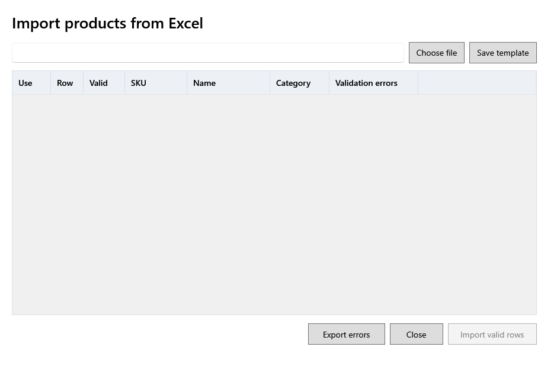

<!-- MT – needs review. Screen help for Import products from Excel (topic "product-import"); the English file is ../en/product-import.md. Bold names in a table's first column must match the Gujarati labels on screen; see ../README.md. -->
# Excelમાંથી ઉત્પાદનો આયાત કરો

દરેક પંક્તિ તપાસ્યા પછી, Excel વર્કબુકમાંથી એક સાથે ઘણાં ઉત્પાદનો ઉમેરો કે બદલો.

જે પંક્તિનો SKU પહેલેથી હોય તે એ ઉત્પાદન બદલે છે; બીજી દરેક પંક્તિ નવું ઉત્પાદન ઉમેરે છે. **માન્ય પંક્તિઓ આયાત કરો** પર ક્લિક ન કરો ત્યાં સુધી કંઈ સચવાતું નથી.

## કોષ્ટક

| કૉલમ | અર્થ |
|---|---|
| **ઉપયોગ કરો** | આયાત કરવાની પંક્તિઓ પસંદ કરો. માન્ય પંક્તિઓ પહેલેથી પસંદ હોય છે. |
| **પંક્તિ** | વર્કબુકમાં પંક્તિનો નંબર. |
| **માન્ય** | પંક્તિ આયાત થઈ શકે ત્યારે પસંદ થયેલું. |
| **SKU**, **નામ**, **શ્રેણી** | પંક્તિ જે ઉત્પાદન વર્ણવે છે. |
| **ચકાસણી ભૂલો** | પંક્તિમાં શું ખોટું છે, જેમ કે નામ ખૂટે છે, અજાણી શ્રેણી કે MRP થી વધુ વેચાણ કિંમત. વર્કબુક સુધારીને ફરી પસંદ કરો. |

## બટન

| બટન | શું કરે છે |
|---|---|
| **ફાઇલ પસંદ કરો** | ભરેલી વર્કબુક ખોલે છે અને દરેક પંક્તિ તપાસે છે. |
| **ટેમ્પલેટ સાચવો** | ભરવા માટે યોગ્ય કૉલમવાળી ખાલી વર્કબુક સાચવે છે. |
| **ભૂલો નિકાસ કરો** | સુધારવાની પંક્તિઓ, તેમની ભૂલો સાથે, વર્કબુકમાં સાચવે છે. |
| **માન્ય પંક્તિઓ આયાત કરો** | પસંદ કરેલી માન્ય પંક્તિઓ આયાત કરે છે અને કેટલાં બન્યાં, બદલાયાં અને છોડાયાં તે કહે છે. |
| **બંધ કરો** | વિન્ડો બંધ કરે છે. |
