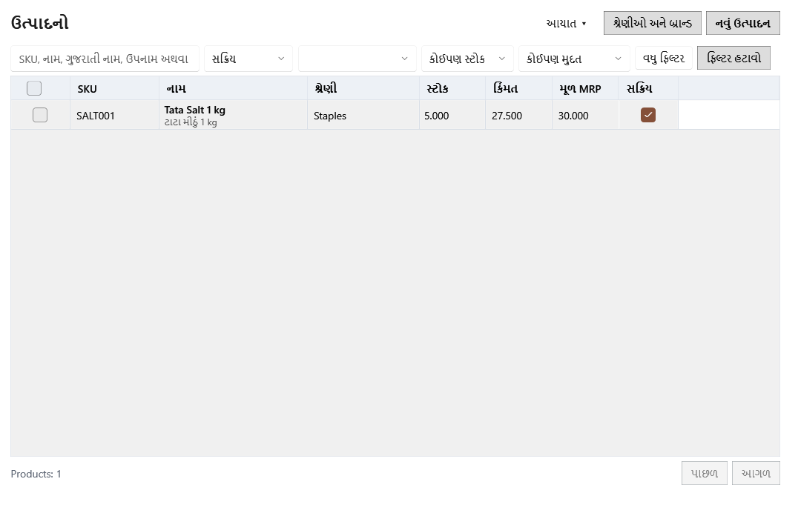

<!-- MT – needs review. Screen help for Products (topic "products"); the English file is ../en/products.md. Bold names in a table's first column must match the Gujarati labels on screen; see ../README.md. -->
# ઉત્પાદનો

ઉત્પાદનો શોધો, ઉમેરો અને બદલો, અને દરેક ઉત્પાદનની બેચ સંભાળો: તેની કિંમતો, મુદત, નુકસાન અને સ્ટોકની ગણતરી.

દરેક હરોળની વેચાણ કિંમત, MRP અને ખરીદ કિંમત બિલ હવે પછી જે બેચમાંથી લેશે તેમાંથી આવે છે: પહેલાં સૌથી વહેલી મુદત, પછી સૌથી વહેલી મળેલી, મુદત વગરની બેચ છેલ્લે, અને સમાપ્ત બેચનું વેચાણ રોકેલું હોય (મૂળ સેટિંગ) ત્યાં સુધી સમાપ્ત બેચ ક્યારેય નહીં. વેચી શકાય એવો સ્ટોક ન હોય તો ઉત્પાદનની પોતાની મૂળ કિંમતો અને ખરીદ કિંમતમાં "—" દેખાય છે.

## ફિલ્ટર

ફિલ્ટર લખતાં કે પસંદ કરતાં જ લાગુ થાય છે, અને પ્રોગ્રામ બંધ ન થાય ત્યાં સુધી આ સ્ક્રીન તેમને યાદ રાખે છે.

| ખાનું | અર્થ |
|---|---|
| **SKU, નામ, ગુજરાતી નામ, ઉપનામ અથવા બ્રાન્ડથી શોધો** | SKU, બારકોડ, નામ, ગુજરાતી નામ, ઉપનામ અથવા બ્રાન્ડનો ભાગ લખો. ચોક્કસ SKU કે બારકોડ પહેલાં આવે છે, અને શબ્દો સાથે લખી શકાય છે, જેમ કે "બાસમતી 5 kg". શોધ વધુમાં વધુ આઠ પરિણામ બતાવે છે. Ctrl+F અહીં લાવે છે. |
| **ઉત્પાદન પ્રકાર** | **બધા પ્રકાર**, **વેચાણ માટે** (બિલમાં વેચાય) અથવા **આંતરિક ઉપયોગ** (દુકાનમાં વપરાય; બિલ અને નફા-નુકસાનથી બહાર). |
| **ઉત્પાદનની સ્થિતિ** | **સક્રિય**, **આર્કાઇવ** (દૂર કરેલાં, પણ હજી વપરાશમાં કે સ્ટોકવાળાં હોવાથી રાખેલાં) અથવા **બધી સ્થિતિ**. |
| **શ્રેણી** | એક શ્રેણીનાં ઉત્પાદનો બતાવે છે. |
| **સ્ટોક** | **કોઈપણ સ્ટોક**, **સ્ટોક છે**, અથવા **ઓછો સ્ટોક**: ફરી ઓર્ડર સ્તર જેટલો કે તેથી ઓછો સ્ટોક ધરાવતાં સક્રિય ઉત્પાદનો, એ જ જે ડૅશબોર્ડનું ઓછો સ્ટોક ખાનું ગણે છે. |
| **મુદત** | **સમાપ્ત સ્ટોક**: મુદત વીતી ગઈ હોય અને હજી સ્ટોક હોય એવી બેચવાળાં ઉત્પાદનો, અવરોધિત બેચ સહિત. **સમાપ્તિ નજીક**: પોતાના ચેતવણીના દિવસોમાં સમાપ્ત થતી સક્રિય બેચવાળાં ઉત્પાદનો, ડૅશબોર્ડ ગણે તેમ. |
| **વધુ ફિલ્ટર** | બ્રાન્ડ, વિક્રેતા, **બારકોડ નથી**, **ગુજરાતી નામ બાકી** અને **છૂટક ઉત્પાદન** સાથે બીજી લીટી બતાવે છે. વિન્ડો સાંકડી હોય ત્યારે કેટલાક ફિલ્ટર એ લીટીમાં જાય છે અને બટન તેમાંથી કેટલા લાગુ છે તે બતાવે છે. |
| **બ્રાન્ડ**, **વિક્રેતા** | એક બ્રાન્ડનાં ઉત્પાદનો, અથવા એક વિક્રેતા પાસેથી ખરીદેલાં ઉત્પાદનો. |
| **બારકોડ નથી**, **ગુજરાતી નામ બાકી**, **છૂટક ઉત્પાદન** | બારકોડ વગરનાં, ગુજરાતી નામ વગરનાં, અથવા વજનથી છૂટક વેચાતાં ઉત્પાદનો. |
| **ફિલ્ટર હટાવો** | દરેક ફિલ્ટર તેની મૂળ સ્થિતિમાં લાવે છે. |

## કોષ્ટક

એક પાનામાં વિન્ડોમાં સમાય એટલી હરોળ દેખાય છે. નીચેની પટ્ટી સંખ્યા અને, વધુ પાનાં હોય ત્યારે, પાનાનાં તીર બતાવે છે.

| કૉલમ | અર્થ |
|---|---|
| **આ પાનું પસંદ કરો**, **ઉત્પાદન પસંદ કરો** | પસંદગીનાં બૉક્સ. હરોળ પસંદ કરતાં નીચેની પટ્ટીમાં પસંદગી પટ્ટી ખૂલે છે. Space પ્રકાશિત હરોળ પસંદ કરે છે. |
| **SKU** | ઉત્પાદનનો પોતાનો કોડ. |
| **નામ** | અંગ્રેજી નામ, અને તેની નીચે ગુજરાતી નામ. |
| **શ્રેણી** | ઉત્પાદનની શ્રેણી. |
| **સ્ટોક** | ઉત્પાદનના એકમમાં હાલનો સ્ટોક. તેની નીચે "સમાપ્ત સ્ટોક" હોય તો એમાંથી થોડા સ્ટોકની મુદત વીતી ગઈ છે. |
| **વેચાણ કિંમત** | બિલ હવે પછી જે બેચમાંથી લેશે તેની કર સહિત કિંમત. |
| **MRP** | બિલ હવે પછી જે બેચમાંથી લેશે તેની MRP; વેચી શકાય એવો સ્ટોક ન હોય તો ઉત્પાદનની પોતાની MRP. |
| **કર સહિત ખરીદ કિંમત** | એ બેચના એક નંગની કર સહિત કિંમત. |
| **સક્રિય** | ઉત્પાદન આર્કાઇવ કરવા ટિક કાઢો, ફરી સક્રિય કરવા ટિક કરો. આર્કાઇવ ઉત્પાદનો ફક્ત **આર્કાઇવ** અથવા **બધી સ્થિતિ** માં દેખાય છે. |

## બટન

| બટન | શું કરે છે |
|---|---|
| **નવું ઉત્પાદન** | ઉત્પાદન ફોર્મ ખોલે છે (Ctrl+N). નવું ઉત્પાદન એ જ વખતે પોતાની પહેલી બેચ ઉમેરી શકે છે. |
| **શ્રેણીઓ અને બ્રાન્ડ** | શ્રેણીઓ, બ્રાન્ડ અને એકમોની યાદીઓ ખોલે છે. |
| **આયાત ▾** | નીચેની આયાતની પસંદગીઓ ખોલે છે. |
| **Excel આયાત** | ભરેલા Excel નમૂનામાંથી ઉત્પાદનો ઉમેરે કે બદલે છે. પહેલાં દરેક હરોળ દેખાય છે અને ફક્ત માન્ય હરોળ આયાત થાય છે. |
| **શરૂઆતનો સ્ટોક આયાત** | ભરેલા નમૂનામાંથી શરૂઆતની બેચ લાવે છે. સ્ટોક બને તે પહેલાં તમે હરોળ તપાસો છો. |
| **શરૂઆતનું નમૂનું સાચવો** | ભરવા માટે શરૂઆતના સ્ટોકનું નમૂનું સાચવે છે. તેની ખરીદ કિંમત કર પહેલાંની છે; દરેક હરોળ તેના ઉત્પાદનનો કર દર લે છે. |

## પસંદ કરેલાં ઉત્પાદનો

ઉત્પાદનો પસંદ કરતાં નીચેની પટ્ટીની ડાબી બાજુ ચોક્કસ સંખ્યા સાથે વાદળી પટ્ટી દેખાય છે. કોઈ ફિલ્ટર બદલવાથી પસંદગી સાફ થાય છે.

| ખાનું | અર્થ |
|---|---|
| **પસંદગી સાફ કરો** | દરેક ઉત્પાદનની પસંદગી કાઢે છે. |
| **બધા મળતા પરિણામો પસંદ કરો** | ફક્ત આ પાનું નહીં, બધાં પાનાં પર ફિલ્ટરને મળતું દરેક ઉત્પાદન પસંદ કરે છે. |
| **સમૂહ ક્રિયાઓ ▾** | પસંદ કરેલાં બધાં ઉત્પાદનો એક સાથે બદલે છે. દરેક ક્રિયા પહેલાં તપાસ બતાવે છે: કેટલાં ઉત્પાદનો બદલાશે, કયાં કારણ સાથે છોડાશે, અને અસર પામતો સ્ટોક અને મૂલ્ય. તમે લાગુ ન કરો ત્યાં સુધી કંઈ બદલાતું નથી. |
| **પસંદ કરેલા દૂર કરો** | સ્ટોક વગરનાં અને કોઈ ખુલ્લા બિલ કે ખરીદીના ડ્રાફ્ટમાં ન હોય એવાં ઉત્પાદનો કાઢી નાખે છે; બાકીનાં આર્કાઇવ કરે છે. |
| **પસંદ કરેલા ફરી સક્રિય કરો** | આર્કાઇવ ઉત્પાદનો ફરી સક્રિય કરે છે. |
| **શ્રેણી બદલો…**, **કર દર બદલો…**, **ઉત્પાદનનો પ્રકાર બદલો…** | પસંદ કરેલાં ઉત્પાદનોને એક શ્રેણી, કર દર કે ઉત્પાદન પ્રકાર આપે છે. સ્ટોકવાળા ઉત્પાદનનો પ્રકાર બદલાતો નથી. |
| **પસંદ કરેલાં માટે લેબલ છાપો** | એક સાથે 200 ઉત્પાદનો સુધીનાં બારકોડ લેબલ છાપે છે. |
| **પસંદ કરેલાં માટે બારકોડ બનાવો** | જે પસંદ કરેલા ઉત્પાદનને દુકાનનો બારકોડ ન હોય તેને એક આપે છે. |
| **પસંદ કરેલા સ્ટોકનું મિલાન કરો** | 100 ઉત્પાદનો સુધીનું ગણતરી પત્રક ખોલે છે: દરેક બેચનો ગણેલો જથ્થો લખો. ઘટ નુકસાન બને છે; વધારો ગણેલી બેચની ખરીદ કિંમત અને કર સાથે નવી સીધી બેચ બને છે. |
| **સમાપ્ત સ્ટોક કાઢો…** | પસંદ કરેલાં ઉત્પાદનોની સ્ટોકવાળી દરેક સમાપ્ત બેચ આખી Expired નુકસાન તરીકે નોંધે છે. |

## ઉત્પાદનની પૅનલ

ઉત્પાદન પર બે વાર ક્લિક કરો અથવા Enter દબાવો એટલે તે પૅનલમાં ખૂલે છે. ઉપર તેનો SKU, શ્રેણી, પ્રકાર, હાલનો સ્ટોક અને બિલ હવે પછી જે બેચમાંથી લેશે તેની કિંમત છે.

| ખાનું | અર્થ |
|---|---|
| **પાછલી નોંધ**, **આગળની નોંધ** | યાદીમાં ઉપરનું કે નીચેનું ઉત્પાદન ખોલે છે. |
| **પૂરી પહોળાઈ વાપરો**, **યાદીની બાજુમાં બતાવો** | પૅનલને યાદીની બાજુમાં અને આખા પાના વચ્ચે બદલે છે. સ્ક્રીન આ પસંદગી યાદ રાખે છે. |
| **બંધ કરો** | પૅનલ બંધ કરે છે (Esc). ઉત્પાદન ફોર્મમાં ન સાચવેલા ફેરફાર હોય તો પહેલાં પૂછે છે. |
| **મૂળ વિગતો** | ઉત્પાદન ફોર્મ: નામ અને કોડ, શ્રેણી અને એકમ, કર અને કિંમતો, અને સ્ટોકના નિયમો. |
| **સાચવો** | મૂળ વિગતોમાં કરેલા ફેરફાર સાચવે છે. |
| **પાછું લાવો** | મૂળ વિગતોમાં કરેલા ફેરફાર રદ કરે છે. |
| **બેચ** | ઉત્પાદનની બેચ: પોતાની કિંમતો, પડતર અને મુદત સાથેનો સ્ટોકનો દરેક જથ્થો. |

## બેચ: ફિલ્ટર

| ખાનું | અર્થ |
|---|---|
| **બેચ નં. કે બેચ કોડ** | સપ્લાયરના બેચ નંબર કે દુકાનના બેચ કોડથી બેચ શોધે છે. |
| **બેચની સ્થિતિ** | **બધી બેચ**, **ઉપલબ્ધ** (વેચી શકાય એવો સ્ટોક), **ખાલી** અથવા **અવરોધિત** (વેચાણથી બહાર રાખેલી). |
| **મુદત** | **કોઈપણ મુદત**, **સમાપ્ત**, **સમાપ્તિ નજીક** અથવા **મુદત નથી**. |
| **સ્ત્રોત** | બેચ ક્યાંથી આવી: **ખરીદી**, **સીધી નોંધ** અથવા **ગ્રાહક પરત**. વધુ ફિલ્ટરમાં. |
| **થી**, **સુધી** | આ તારીખો વચ્ચે સમાપ્ત થતી બેચ. વધુ ફિલ્ટરમાં. |
| **સૌથી ઓછી વેચાણ કિંમત**, **સૌથી વધુ વેચાણ કિંમત** | આ શ્રેણીમાં વેચાણ કિંમત ધરાવતી બેચ. વધુ ફિલ્ટરમાં. |

## બેચ: કોષ્ટક

| કૉલમ | અર્થ |
|---|---|
| **બેચ પસંદ કરો** | બેચની સમૂહ ક્રિયાઓ માટે બેચ પસંદ કરે છે. |
| **બેચ કોડ** | દુકાનનો બેચ કોડ, જે તેનાં લેબલ પર છપાય છે. |
| **બેચ નંબર** | સપ્લાયરનો બેચ નંબર. |
| **સમાપ્તિ** | સમાપ્તિ તારીખ અને તેની સ્થિતિ: તાજું, ટૂંક સમયમાં, 0–7 દિવસ, મુદત વીતી, અવરોધિત અથવા ખાલી. બેચ પોતાના ચેતવણીના દિવસોમાં જ ટૂંક સમયમાં કે 0–7 દિવસ બતાવે છે, એ જ સમય જે ડૅશબોર્ડ અને સમાપ્તિ નજીક વાપરે છે. |
| **હાલનો જથ્થો** | આ બેચમાં બાકી જથ્થો. |
| **વેચાણ કિંમત**, **MRP** | આ બેચની વેચાણ કિંમત અને MRP, બંને કર સહિત. |
| **ખરીદ કિંમત** | એક નંગની કર પહેલાંની કિંમત, ખરીદી બિલના અન્ય ખર્ચના ભાગ સાથે. |
| **કર** | બેચ બની ત્યારનું કર દરનું નામ, જેમ કે "GST 5%". |
| **કર/એકમ** | એક નંગનો ખરીદી કર. |
| **કર સહિત ખરીદ કિંમત** | એક નંગની ખરેખર કિંમત: ખરીદ કિંમત + કર/એકમ. બેચ બન્યા પછી તેની કિંમત અને કર ક્યારેય બદલાતાં નથી. |
| **સ્ત્રોત** | ખરીદી, સીધી નોંધ અથવા ગ્રાહક પરત. |
| **મળ્યાની તારીખ** | સ્ટોક આવ્યો તે તારીખ. |

## બેચ: બટન

| બટન | શું કરે છે |
|---|---|
| **સીધી બેચ ઉમેરો** | ખરીદી વિના સ્ટોક ઉમેરે છે: જથ્થો, કર પહેલાંની ખરીદ કિંમત, કર દર, કિંમતો, બેચ નંબર, મુદત અને કારણ. |
| **કિંમત અને સમાપ્તિ તારીખ બદલો** | આગળના વેચાણ માટે પસંદ કરેલી બેચની વેચાણ કિંમત, MRP અને મુદત બદલે છે. પૂરાં થયેલાં બિલની કિંમતો બદલાતી નથી. |
| **નુકસાન નોંધો** | પસંદ કરેલી બેચમાંથી નુકસાન થયેલો સ્ટોક કાઢે છે. તે ખર્ચ → નુકસાનમાં દેખાય છે અને આંતરિક ઉપયોગનાં ઉત્પાદનો સિવાય નફા-નુકસાનમાં ખોટ તરીકે ગણાય છે. |
| **આંતરિક ઉપયોગ માટે વાપરો** | ફક્ત આંતરિક ઉપયોગનાં ઉત્પાદનો માટે: દુકાનમાં વપરાયેલો સ્ટોક નોંધે છે, નફા-નુકસાન પર અસર વગર. |
| **લેબલ છાપો** | પસંદ કરેલી બેચનાં લેબલ છાપે છે. |
| **વધુ ▾** | પૅનલ સાંકડી હોય ત્યારે ન સમાતી ક્રિયાઓ અહીં હોય છે. |
| **પસંદ કરેલી બેચ અવરોધો**, **પસંદ કરેલી બેચ ખોલો** | પસંદ કરેલી બેચનું વેચાણ રોકે છે, અથવા ફરી ચાલુ કરે છે. |
| **પસંદ કરેલી બેચ નુકસાનમાં નોંધો** | 1 થી 50 બેચ પર એક સાથે નુકસાન નોંધે છે, દરેક બેચનો જથ્થો અલગ. |
| **પસંદ કરેલી ખાલી બેચ કાઢી નાખો** | સ્ટોક વગરની અને કોઈ ખુલ્લું બિલ ન વાપરતું હોય એવી બેચ કાઢી નાખે છે. |

## કેવી રીતે વાપરવું

1. શ્રેણીઓ અને બ્રાન્ડ તૈયાર કરો, પછી ઉત્પાદનો ઉમેરો અથવા આયાત કરો.
2. ઉત્પાદન ખોલીને તેની બેચ તપાસો.
3. જરૂર મુજબ સીધી બેચ ઉમેરો, બેચની કિંમત કે મુદત સુધારો, અથવા નુકસાન નોંધો.
4. **સમાપ્ત સ્ટોક** ફિલ્ટર કરો, ઉત્પાદનો પસંદ કરો અને સ્ટોક કાઢો.
5. છાજલી ગણો અને **પસંદ કરેલા સ્ટોકનું મિલાન કરો** થી ગણતરી દાખલ કરો.
