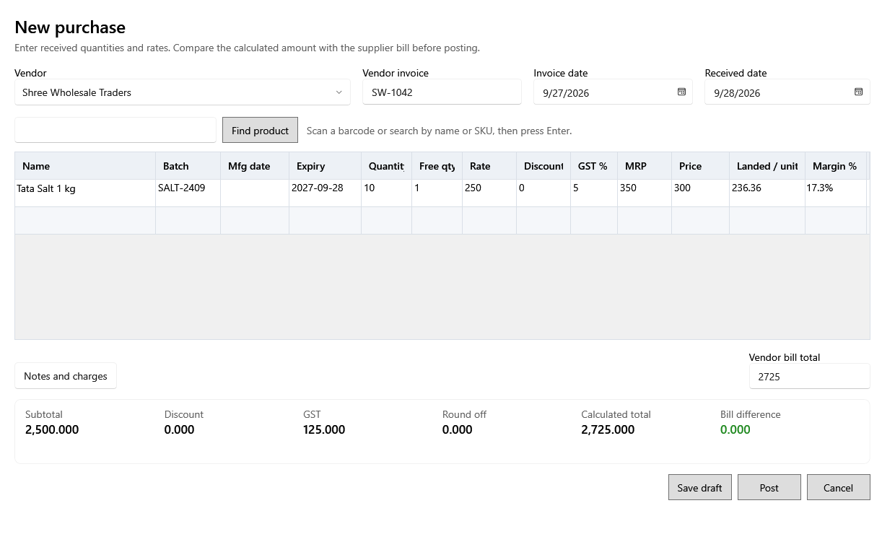

<!-- MT – needs review. Screen help for the purchase form (topic "purchase-entry"); the English file is ../en/purchase-entry.md. Bold names in a table's first column must match the Gujarati labels on screen; see ../README.md. -->
# નવી ખરીદી

સપ્લાયરનું બિલ લાઇન પ્રમાણે દાખલ કરો, તેને બિલ સાથે મેળવો, પછી ડ્રાફ્ટ તરીકે સાચવો કે પોસ્ટ કરો.

પોસ્ટ કરવાથી દરેક ઉત્પાદન લાઇન માટે બેચ બને છે, બિલ વિક્રેતાની બાકી રકમમાં ઉમેરાય છે અને દરેક ખર્ચ લાઇન ખર્ચ તરીકે નોંધાય છે. ડ્રાફ્ટ કંઈ બદલતો નથી અને ખરીદીમાંથી ફરી ખોલી શકાય છે.

## બિલ

| ખાનું | અર્થ |
|---|---|
| **વિક્રેતા** | માલ કોની પાસેથી આવ્યો. |
| **વિક્રેતા ઇન્વોઇસ** | સપ્લાયરના બિલ પરનો નંબર. |
| **ઇન્વોઇસ તારીખ** | સપ્લાયરના બિલ પરની તારીખ. તે માલ મળ્યાની તારીખ પછીની ન હોઈ શકે. |
| **માલ મળ્યાની તારીખ** | માલ આવ્યો તે દિવસ. ખરીદી અને તેની બેચ આ તારીખે ગણાય છે. |
| **બિલના દર**, **કર સહિત** | સપ્લાયરના બિલમાં દર અને ડિસ્કાઉન્ટ કર સહિત છપાયા હોય ત્યારે પસંદ કરો, અને છપાયા પ્રમાણે જ લખો: દરનો કૉલમ **કર સહિત દર** બને છે અને દરેક લાઇનનો કર તમારા માટે ગણાય છે. ખરીદી કર પહેલાંના આંકડા રાખે છે. આ વિક્રેતાનું આગલું બિલ પણ એ જ રીતે શરૂ થાય છે. |

## લાઇન ઉમેરવી

| ખાનું | અર્થ |
|---|---|
| **વસ્તુ શોધો** | બારકોડ સ્કેન કરો, અથવા નામ કે SKU લખીને Enter દબાવો. એક મેળ લાઇન ઉમેરે છે; ઘણા મળે તો ખાના નીચે યાદી દેખાય છે, જ્યાં તીર કી અને Enter, કે ક્લિક, એક પસંદ કરે છે. |

## ખરીદીની હરોળ

લખતાં જ કુલ, ખરીદ કિંમત અને માર્જિન બદલાય છે. Ctrl+D ઉપરનો ખાનો નકલ કરે છે (હરોળ પ્રકાર કે ઉત્પાદન ક્યારેય નહીં), Ctrl+Delete હરોળ કાઢે છે અને Ctrl+S ડ્રાફ્ટ સાચવે છે.

| કૉલમ | અર્થ |
|---|---|
| **પ્રકાર** | **ઉત્પાદન** (વેચાણ માટેની બેચ), **આંતરિક ઉપયોગ** (નફા-નુકસાનથી બહારની બેચ) અથવા **ખર્ચ** (બેચ નહીં; ખર્ચની શ્રેણીમાં નોંધાય છે). આંતરિક ઉપયોગનું ઉત્પાદન આંતરિક ઉપયોગ તરીકે શરૂ થાય છે. |
| **નામ** | ઉત્પાદન. |
| **ખર્ચની શ્રેણી** | ખર્ચ લાઇન માટે, જે શ્રેણીમાં તે નોંધાય છે. લાઇન ખર્ચ હોય ત્યારે જ દેખાય છે. |
| **બેચ નંબર**, **ઉત્પાદન તારીખ**, **સમાપ્તિ** | સપ્લાયરનો બેચ નંબર અને તારીખો. મુદત ટ્રૅક કરતા ઉત્પાદન માટે મુદત જરૂરી છે. માલ મળ્યાની તારીખથી તેના ચેતવણીના દિવસોમાં સમાપ્ત થતી લાઇન ટૂંકી મુદતની ચેતવણી બતાવે છે. |
| **જથ્થો**, **મફત જથ્થો** | ખરીદેલો જથ્થો અને મફત મળેલો જથ્થો. |
| **દર**, **કર સહિત દર** | સપ્લાયરના બિલ પરનો દર, કર પહેલાં, અથવા કર સહિત પસંદ હોય ત્યારે કર સહિત. |
| **ડિસ્કાઉન્ટ** | લાઇનનું ડિસ્કાઉન્ટ, બિલ પર છપાયું તેમ. |
| **કર** | કર દર, ઉત્પાદનના દરથી શરૂ. નિષ્ક્રિય દર નવી લાઇન માટે પસંદ થઈ શકતો નથી. |
| **વેચાણ કિંમત**, **MRP** | નવી બેચની કિંમતો, કર સહિત. |
| **ખરીદ કિંમત** | એક નંગની કર પહેલાંની કિંમત: ડિસ્કાઉન્ટ પછીની લાઇનની કિંમત વત્તા અન્ય ખર્ચનો ભાગ, ભાગ્યા જથ્થો વત્તા મફત જથ્થો. |
| **કર/એકમ** | એ નંગનો કર. |
| **કર સહિત ખરીદ કિંમત** | એક નંગની ખરેખર કિંમત: ખરીદ કિંમત + કર/એકમ. |
| **નફો %** | કર પહેલાંની વેચાણ કિંમત ખરીદ કિંમત સામે; કમ્પોઝિશન કે GST વગરની પદ્ધતિમાં, આખી વેચાણ કિંમત કર સહિત ખરીદ કિંમત સામે. |
| **હરોળ કાઢો** | ડબ્બાનું બટન લાઇન કાઢે છે (Ctrl+Delete, અથવા જમણા ક્લિકના મેનુમાં હરોળ કાઢો). |

## ખર્ચ અને કુલ

| ખાનું | અર્થ |
|---|---|
| **નોંધ અને વધારાના ખર્ચ** | નોંધ, અન્ય ખર્ચ અને બિલનો કુલ ખોલે છે. |
| **નોંધ** | ખરીદી સાથે રાખવા જેવી કોઈ વાત. |
| **અન્ય ખર્ચ** | ભાડું અને બીજા ખર્ચ, લાઇનોમાં કિંમત મુજબ વહેંચાય છે. તેમાં કર નથી, એટલે ટ્રાન્સપોર્ટરનો ખર્ચ તેના પરના GST સહિત લખો. |
| **વિક્રેતા બિલ કુલ** | સપ્લાયરના બિલ પર છપાયેલો કુલ. |
| **પેટા સરવાળો** | દરેક લાઇનનો દર × જથ્થો, ડિસ્કાઉન્ટ અને કર પહેલાં. |
| **ડિસ્કાઉન્ટ**, **કર** | લાઇનોનાં ડિસ્કાઉન્ટ અને કરનો કુલ. |
| **ગોળાકાર તફાવત** | કુલ પૂરી રકમનો થાય એ માટે ઉમેરેલું કે બાદ કરેલું. |
| **ગણેલી કુલ રકમ** | પેટા સરવાળો બાદ ડિસ્કાઉન્ટ, વત્તા કર, અન્ય ખર્ચ અને ગોળાકાર તફાવત. |
| **બિલનો તફાવત** | ગણેલો કુલ વિક્રેતા બિલના કુલથી કેટલો દૂર છે. શૂન્ય ન હોય ત્યારે લાઇનો તપાસો. |

## બટન

| બટન | શું કરે છે |
|---|---|
| **ડ્રાફ્ટ સાચવો** | ખરીદી પોસ્ટ કર્યા વગર સાચવે છે (Ctrl+S). |
| **પોસ્ટ કરો** | ખરીદી પોસ્ટ કરે છે: બેચ બનાવે છે, વિક્રેતાની બાકી રકમ ઉમેરે છે અને તેને GRN નંબર આપે છે. પછી નવી બેચનાં લેબલ છાપવાનું પૂછે છે. |
| **રદ કરો** | બંધ કરે છે. છેલ્લા સાચવ્યા પછીના ફેરફાર જાય છે. |
