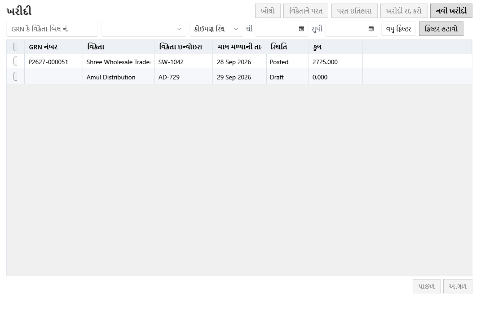

<!-- MT – needs review. Screen help for Purchases (topic "purchases"); the English file is ../en/purchases.md. Bold names in a table's first column must match the Gujarati labels on screen; see ../README.md. -->
# ખરીદી

ખરીદી (GRN) શોધો, દાખલ કરો અને નોંધો, અને માલ વિક્રેતાને પાછો મોકલો કે ભૂલથી દાખલ થયેલી ખરીદી રદ કરો.

ખરીદી નોંધવાથી દરેક ઉત્પાદન લાઇન માટે બેચ બને છે, બિલ વિક્રેતાની બાકી રકમમાં ઉમેરાય છે અને દરેક ખર્ચ લાઇન ખર્ચ તરીકે નોંધાય છે. ડ્રાફ્ટ નોંધાય નહીં ત્યાં સુધી કંઈ બદલતો નથી.

## ફિલ્ટર

ફિલ્ટર લખતાં કે પસંદ કરતાં જ લાગુ થાય છે, અને પ્રોગ્રામ બંધ ન થાય ત્યાં સુધી આ સ્ક્રીન તેમને યાદ રાખે છે.

| ખાનું | અર્થ |
|---|---|
| **GRN કે વિક્રેતા બિલ નં.** | આખો GRN નંબર, અથવા વિક્રેતાના બિલ નંબરની શરૂઆત લખો; નાના-મોટા અક્ષરનો ફરક પડતો નથી. Ctrl+F અહીં લાવે છે. |
| **વિક્રેતા** | એક વિક્રેતાની ખરીદી, અથવા **બધા વિક્રેતાઓ**. |
| **સ્થિતિ** | **કોઈપણ સ્થિતિ**, **મુસદ્દો** (હજી નોંધાયેલ નથી), **નોંધાયેલ** અથવા **રદ કરેલ**. |
| **થી**, **સુધી** | આ તારીખો વચ્ચે મળેલી ખરીદી. |
| **વધુ ફિલ્ટર** | હરોળ પ્રકાર, ઉત્પાદન અને **પરત કરવા સ્ટોક બાકી** સાથે બીજી લીટી બતાવે છે. |
| **પ્રકાર** | આ પ્રકારની ઓછામાં ઓછી એક લાઇનવાળી ખરીદી: **ઉત્પાદન**, **આંતરિક ઉપયોગ** અથવા **ખર્ચ**. |
| **ઉત્પાદન** | તમે લખો તે નામ, SKU કે ઉપનામવાળા ઉત્પાદનની લાઇનવાળી ખરીદી, કાઢી નાખેલાં ઉત્પાદનો સહિત. |
| **પરત કરવા સ્ટોક બાકી** | હજી સ્ટોક ધરાવતી બેચવાળી નોંધાયેલ ખરીદી, જે વિક્રેતાને પાછો મોકલી શકાય. |
| **ફિલ્ટર હટાવો** | દરેક ફિલ્ટર તેની મૂળ સ્થિતિમાં લાવે છે. |

## કોષ્ટક

| કૉલમ | અર્થ |
|---|---|
| **આ પાનું પસંદ કરો**, **ખરીદી પસંદ કરો** | પસંદગીનાં ખાનાં. હરોળ પસંદ કરતાં નીચેની પટ્ટીમાં પસંદગી પટ્ટી ખૂલે છે. |
| **GRN નંબર** | ખરીદીનો દુકાનનો નંબર, નોંધતી વખતે મળે છે. |
| **વિક્રેતા** | માલ કોની પાસેથી આવ્યો. |
| **વિક્રેતા ઇન્વોઇસ** | વિક્રેતાના બિલ પરનો નંબર. |
| **માલ મળ્યાની તારીખ** | માલ આવ્યો તે દિવસ. ખરીદી આ તારીખે ગણાય છે. |
| **સ્થિતિ** | મુસદ્દો, નોંધાયેલ અથવા રદ કરેલ. |
| **કુલ** | ખરીદીનો કુલ, કર સહિત, ગોળાકાર તફાવત પછી. ડ્રાફ્ટ સાચવતી વખતનો કુલ બતાવે છે; નોંધતી વખતે તે સમયના કર દર પ્રમાણે ફરી ગણાય છે. |

## બટન

| બટન | શું કરે છે |
|---|---|
| **નવી ખરીદી** | ખરીદી દાખલ કરવાનું ફોર્મ ખોલે છે (Ctrl+N). નોંધ્યા પછી નવો GRN નંબર નીચેની પટ્ટીમાં દેખાય છે. |
| **ખોલો** | પસંદ કરેલી ખરીદી ખોલે છે (Enter કે ડબલ-ક્લિક): ડ્રાફ્ટ દાખલ કરવાના ફોર્મમાં, નોંધાયેલ કે રદ કરેલ ખરીદી પૅનલમાં. |
| **વિક્રેતાને પરત** | નોંધાયેલ ખરીદીના સ્ટોકનો ભાગ ક્રેડિટ નોટ અને કારણ સાથે વિક્રેતાને પાછો મોકલે છે. |
| **ખરીદી રદ કરો** | ભૂલથી દાખલ થયેલી ખરીદી માટે: તેને સ્ટોક, વિક્રેતાની બાકી રકમ અને તેની આવક તારીખના દરેક રિપોર્ટમાંથી કાઢે છે, તેની ખર્ચ લાઇન એ તારીખના નફા-નુકસાનમાંથી પણ. તેનો કોઈ સ્ટોક વપરાયો ન હોય અને માલ મળ્યાની તારીખ બંધ થયેલા વર્ષમાં ન હોય ત્યાં સુધી જ; નહીં તો વિક્રેતાને પરત વાપરો. બટનની ટિપ કેમ ઉપલબ્ધ નથી તે કહે છે. |
| **પરત ઇતિહાસ** | ખરીદીનાં વિક્રેતા પરત બતાવે છે. કારણ સાથે પરત રદ કરવાથી જથ્થો પાછો આવે છે અને વિક્રેતાની બાકી રકમ પાછી થાય છે. |
| **વધુ ▾** | વિન્ડો સાંકડી હોય ત્યારે ન સમાતી ક્રિયાઓ રાખે છે. |

## પસંદ કરેલી ખરીદી

| ખાનું | અર્થ |
|---|---|
| **પસંદગી સાફ કરો** | દરેક ખરીદીની પસંદગી કાઢે છે. |
| **બધા મળતા પરિણામો પસંદ કરો** | બધાં પાનાં પર ફિલ્ટરને મળતી દરેક ખરીદી પસંદ કરે છે. |
| **સમૂહ ક્રિયાઓ ▾** | શું બદલાશે અને શું છોડાશે તેની તપાસ પછી, પસંદ કરેલી બધી ખરીદી એક સાથે બદલે છે. |
| **પસંદ કરેલી ખરીદીઓ રદ કરો** | પસંદ કરેલી ખરીદીમાંથી જે હજી રદ થઈ શકે તે પાંચ-પાંચ કરીને રદ કરે છે. |

## ખરીદીની પૅનલ

નોંધાયેલ કે રદ કરેલ ખરીદી પૅનલમાં ખૂલે છે, તમે બદલો નહીં ત્યાં સુધી પૂરી પહોળાઈમાં. પહેલાં તેની લાઇન, પછી નોંધ; કુલ તેની નીચે હંમેશાં દેખાતી લીટીમાં હોય છે. એ ખુલ્લી હોય ત્યારે **ખોલો**, **વિક્રેતાને પરત**, **ખરીદી રદ કરો** અને **પરત ઇતિહાસ** પૅનલમાં હોય છે.

| ખાનું | અર્થ |
|---|---|
| **પાછલી નોંધ**, **આગળની નોંધ** | યાદીમાં ઉપરની કે નીચેની ખરીદી ખોલે છે. |
| **પૂરી પહોળાઈ વાપરો**, **યાદીની બાજુમાં બતાવો** | પૅનલને આખા પાના અને યાદીની બાજુ વચ્ચે બદલે છે. સ્ક્રીન આ પસંદગી યાદ રાખે છે. |
| **બંધ કરો** | પૅનલ બંધ કરે છે (Esc). |
| **ખરીદીની હરોળ** | ખરીદીની લાઇન. કોષ્ટક બાજુમાં સરકે ત્યારે પ્રકાર, SKU અને નામ દેખાતાં રહે છે. |
| **પ્રકાર** | ઉત્પાદન (વેચાણ માટેની બેચ), આંતરિક ઉપયોગ (નફા-નુકસાનથી બહારની બેચ) અથવા ખર્ચ (બેચ નહીં). |
| **SKU**, **નામ** | ખરીદી સચવાઈ ત્યારનું ઉત્પાદન. |
| **ખર્ચની શ્રેણી** | ખર્ચ લાઇન માટે, જે શ્રેણીમાં તે નોંધાય છે. |
| **બેચ નંબર**, **ઉત્પાદન તારીખ**, **સમાપ્તિ** | સપ્લાયરનો બેચ નંબર અને તારીખો, બેચ પર છે તેમ. |
| **જથ્થો**, **મફત જથ્થો** | ખરીદેલો જથ્થો અને મફત મળેલો જથ્થો. |
| **દર** | સપ્લાયરના બિલ પરનો દર, કર પહેલાં. |
| **ડિસ્કાઉન્ટ** | લાઇનનું ડિસ્કાઉન્ટ. |
| **કર દર** | લાઇન સચવાઈ ત્યારનું કર દરનું નામ, જેમ કે "GST 5%". |
| **કર** | લાઇનનો કુલ કર. |
| **ગણેલી કુલ રકમ** | લાઇન પર, ડિસ્કાઉન્ટ પછીની કિંમત વત્તા તેનો કર. લાઇનો નીચે, ખરીદીનો કુલ: પેટા સરવાળો બાદ ડિસ્કાઉન્ટ, વત્તા કર, અન્ય ખર્ચ અને ગોળાકાર તફાવત. |
| **ખરીદ કિંમત** | એક નંગની કર પહેલાંની કિંમત: ડિસ્કાઉન્ટ પછીની લાઇનની કિંમત વત્તા અન્ય ખર્ચનો ભાગ, ભાગ્યા જથ્થો વત્તા મફત જથ્થો. |
| **કર/એકમ** | એક નંગનો કર. |
| **કર સહિત ખરીદ કિંમત** | એક નંગની ખરેખર કિંમત: ખરીદ કિંમત + કર/એકમ. |
| **MRP**, **વેચાણ કિંમત** | બેચને આપેલી કિંમતો, બંને કર સહિત. |
| **પેટા સરવાળો** | દરેક લાઇનનો દર × જથ્થો, ડિસ્કાઉન્ટ અને કર પહેલાં. |
| **અન્ય ખર્ચ** | ભાડું અને બીજા ખર્ચ, લાઇનોમાં કિંમત મુજબ વહેંચાયેલા. તેમાં કર નથી. |
| **ગોળાકાર તફાવત** | કુલ પૂરી રકમનો થાય એ માટે ઉમેરેલી કે બાદ કરેલી રકમ, બિલિંગની જેમ. |
| **કર પદ્ધતિ** | ખરીદી સચવાઈ ત્યારની દુકાનની કર પદ્ધતિ. |
| **વિક્રેતા બિલ કુલ**, **બિલનો તફાવત** | વિક્રેતાના બિલ પર છપાયેલો કુલ અને ગણેલો કુલ તેનાથી કેટલો દૂર છે. |
| **નોંધ** | ખરીદી સાથે સાચવેલી નોંધ. |

## કેવી રીતે વાપરવું

1. **નવી ખરીદી** પર ક્લિક કરો, વિક્રેતા પસંદ કરો અને બિલના નંબર અને તારીખો લખો.
2. લાઇન ઉમેરો અને દરેકને સપ્લાયરના બિલ સાથે મેળવો.
3. અટકવું પડે તો ડ્રાફ્ટ સાચવો, અને પછી આગળ વધવા તેને **ખોલો**.
4. કુલ મળી જાય ત્યારે ખરીદી નોંધો.
5. વિક્રેતાઓ સ્ક્રીનમાંથી વિક્રેતાને ચૂકવો, અથવા **વિક્રેતાને પરત** વડે સ્ટોક પાછો મોકલો.
