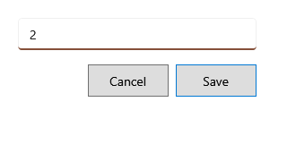

<!-- MT – needs review. Screen help for F4 Quantity (topic "quantity"); the English file is ../en/quantity.md. Bold names in a table's first column must match the Gujarati labels on screen; see ../README.md. -->
# જથ્થો

પસંદ કરેલી વસ્તુ બિલમાં કેટલી વેચાય તે બદલો.

જથ્થો એટલે આ બિલમાં વસ્તુની બધી લાઇનોનો કુલ જથ્થો. બિલ તેને ફરીથી બેચમાંથી લે છે, પહેલાં સૌથી વહેલી મુદત, દરેક બેચની કિંમતે, અને લાઇન ડિસ્કાઉન્ટ એ જ પ્રમાણમાં રાખે છે. એટલે **Ctrl+L બેચ** વડે પસંદ કરેલી બેચ કે બદલેલી કિંમત સામાન્ય પર પાછી આવે છે: પહેલાં જથ્થો બદલો.

## ખાનાં

| ખાનું | અર્થ |
|---|---|
| **જથ્થો** | બિલમાં વસ્તુનો નવો કુલ જથ્થો. 0 તેને બિલમાંથી કાઢે છે. ફક્ત પૂરી સંખ્યા, સિવાય કે વસ્તુનો એકમ અપૂર્ણાંક લે, જેમ કે kg. વેચી શકાય તેવા સ્ટોકથી વધુ ન હોઈ શકે. |

## બટન

| બટન | શું કરે છે |
|---|---|
| **સાચવો** | જથ્થો બદલે છે. Enter પણ એ જ કરે છે. |
| **રદ કરો** | ફેરફાર વગર બંધ કરે છે. Esc પણ એ જ કરે છે. |
