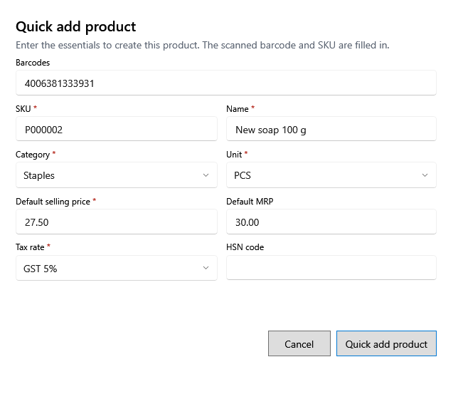

<!-- MT – needs review. Screen help for Quick add product (topic "quick-product"); the English file is ../en/quick-product.md. Bold names in a table's first column must match the Gujarati labels on screen; see ../README.md. -->
# ઉત્પાદન ઝડપથી ઉમેરો

અજાણ્યા બારકોડ પરથી ફક્ત જરૂરી વિગતો સાથે ઉત્પાદન બનાવો, જેથી બિલિંગ ચાલુ રહે. બાકીની વિગતો પછી ઉત્પાદનોમાં ભરો.

સ્કેન કરેલો બારકોડ અને SKU ભરેલા હોય છે. * વાળી વિગતો જરૂરી છે.

## ખાનાં

| ખાનું | અર્થ |
|---|---|
| **બારકોડ** | સ્કેન કરેલો બારકોડ. |
| **SKU** | ઉત્પાદન માટે દુકાનનો કોડ, તમારા માટે ભરેલો. |
| **નામ** | ઉત્પાદનનું નામ. |
| **શ્રેણી** | ઉત્પાદનની શ્રેણી. |
| **એકમ** | ઉત્પાદન કેવી રીતે ગણાય, જેમ કે PCS કે KG. |
| **મૂળ વેચાણ કિંમત** | કિંમત, કર સહિત. તે MRP થી વધુ ન હોઈ શકે. |
| **મૂળ MRP** | MRP, કર સહિત. |
| **કર દર** | ઉત્પાદન જે GST દરે વેચાય. |
| **HSN કોડ** | ઉત્પાદનનો HSN કોડ, જાણતા હો તો. |

## બટન

| બટન | શું કરે છે |
|---|---|
| **ઉત્પાદન ઝડપથી ઉમેરો** | ઉત્પાદન સાચવે છે. |
| **રદ કરો** | સાચવ્યા વગર બંધ કરે છે. |
