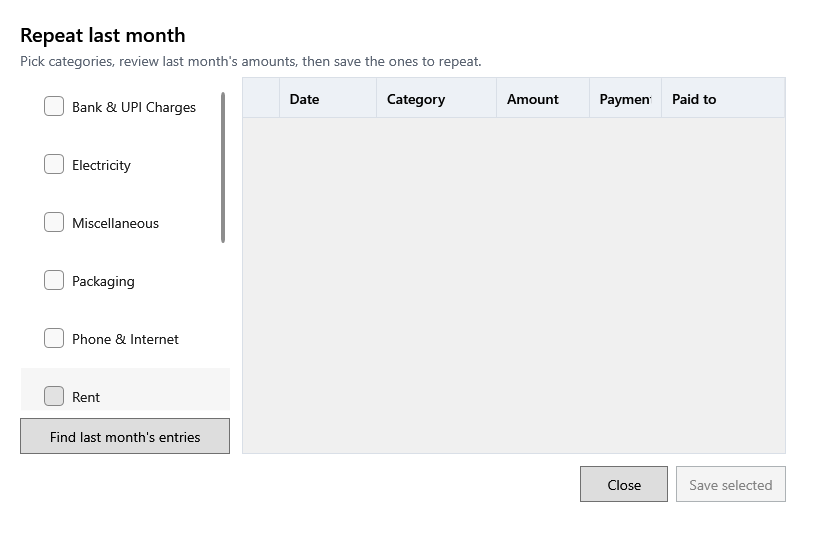

<!-- MT – needs review. Screen help for Repeat last month (topic "repeat-expenses"); the English file is ../en/repeat-expenses.md. Bold names in a table's first column must match the Gujarati labels on screen; see ../README.md. -->
# ગયા મહિનેથી દોહરાવો

ગયા મહિનાના નિયમિત ખર્ચ, જેમ કે ભાડું કે વીજળી, આ મહિનામાં નકલ કરો.

ડાબી બાજુ શ્રેણીઓ પસંદ કરો અને **ગયા મહિનાની નોંધો શોધો** દબાવો. તેમાંનો ગયા મહિનાનો દરેક ખર્ચ, જેવો હાલમાં છે તેવો, આ મહિનાના એ જ દિવસનો મુસદ્દો બને છે. **પસંદ કરેલા સાચવો** દબાવો નહીં ત્યાં સુધી કંઈ સચવાતું નથી; પહેલાં તારીખ અને રકમ તપાસો.

## ખાનાં

| ખાનું | અર્થ |
|---|---|
| **દોહરાવવાની શ્રેણીઓ** | ઓછામાં ઓછી એક શ્રેણી પસંદ કરો. |

## મુસદ્દા ખર્ચ

| કૉલમ | અર્થ |
|---|---|
| (પસંદ) | પસંદ કરેલા મુસદ્દા સચવાય છે. છોડવા માટે પસંદ કાઢો. |
| **તારીખ** | નવો ખર્ચ જે તારીખે ગણાશે, YYYY-MM-DD રૂપે લખેલી. |
| **શ્રેણી** | જે શ્રેણીમાં તે નોંધાય છે. |
| **રકમ** | કેટલું; આ મહિનાની રકમ જુદી હોય તો બદલો. |
| **ચુકવણી રીત** | ગયા મહિના પ્રમાણે, કેવી રીતે ચૂકવ્યું. |
| **ચૂકવ્યું** | કોને ચૂકવ્યું. |

## બટન

| બટન | શું કરે છે |
|---|---|
| **ગયા મહિનાની નોંધો શોધો** | પસંદ કરેલી શ્રેણીઓના ગયા મહિનાના ખર્ચ મુસદ્દા તરીકે બતાવે છે. |
| **પસંદ કરેલા સાચવો** | દરેક પસંદ કરેલો મુસદ્દો નવા ખર્ચ તરીકે સાચવે છે. |
| **બંધ કરો** | વિન્ડો બંધ કરે છે. ન સચવાયેલા મુસદ્દા છૂટી જાય છે. |
