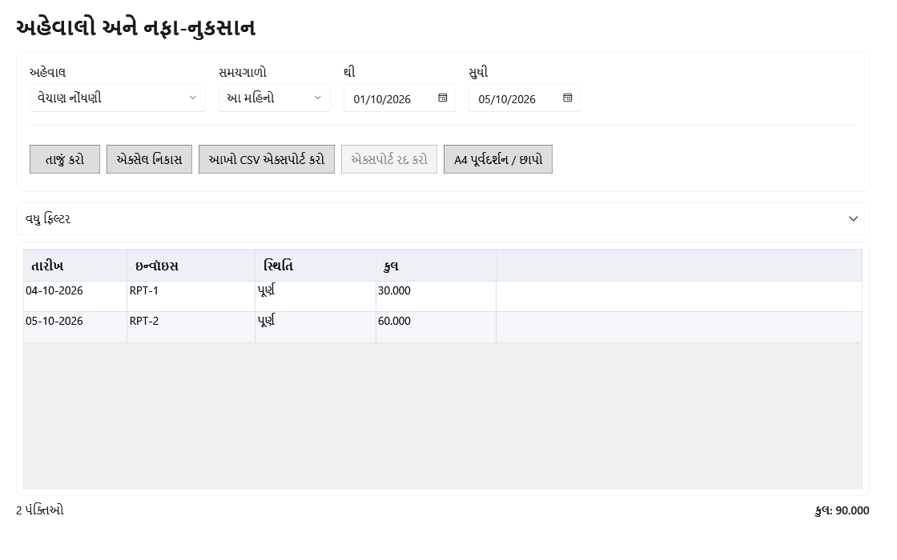

<!-- MT – needs review. Screen help for Reports (topic "reports"); the English file is ../en/reports.md. Bold names in a table's first column must match the Gujarati labels on screen; see ../README.md. -->
# અહેવાલો અને નફા-નુકસાન

સાત અહેવાલમાંથી એક પસંદ કરો, તેનો સમયગાળો અને ફિલ્ટર ગોઠવો, અને તેને વાંચો, નિકાસ કરો કે છાપો.

બીજી યાદીઓ પોતાની સ્ક્રીન પર છે: ઓછો સ્ટોક અને સમાપ્તિ ઉત્પાદનોમાં ફિલ્ટર છે, બાકી રકમ વિક્રેતાઓમાં, અને નુકસાન, ખર્ચ અને પગાર ખર્ચ સ્ક્રીનમાં. કોષ્ટક નીચે હંમેશાં દેખાતી લીટી આખા પરિણામનો કુલ બતાવે છે (નફા-નુકસાનમાં કુલ નફો અને ચોખ્ખો નફો, તેના ટકા સાથે; GST સારાંશમાં વેચાણ અને ખરીદીનું કરપાત્ર મૂલ્ય અને કર, દરેક અલગ), અને તેની નીચે અહેવાલની સ્થિતિ.

## અહેવાલ પસંદ કરવો

પસંદ કરેલો અહેવાલ જે ફિલ્ટર વાપરે તે જ દેખાય છે.

| ખાનું | અર્થ |
|---|---|
| **અહેવાલ** | કયો અહેવાલ બતાવવો. અહેવાલો નીચે આપ્યા છે. |
| **સમયગાળો** | નફા-નુકસાન સિવાયના દરેક અહેવાલ માટે: **આ મહિનો**, **ગયો મહિનો**, **આ નાણાકીય વર્ષ**, **ગયું નાણાકીય વર્ષ** અથવા **પસંદ કરેલો સમયગાળો**. નફા-નુકસાન માટે: બતાવવાનો મહિનો કે વર્ષ; જે વર્ષના આંકડા સચવાયા હોય તેની સાથે "· અંતિમ" લખેલું હોય છે. |
| **થી**, **સુધી** | અહેવાલનો પહેલો અને છેલ્લો દિવસ. તારીખ પસંદ કરવાથી સમયગાળો **પસંદ કરેલો સમયગાળો** બને છે. |
| **વધુ ફિલ્ટર** | પસંદ કરેલા અહેવાલને લાગુ પડતાં બીજાં ફિલ્ટર બતાવે છે. |
| **સ્થિતિ** | વેચાણ નોંધણી: **બધી સ્થિતિઓ**, **પૂર્ણ** અથવા **રદ**. |
| **ચુકવણી પદ્ધતિ** | વેચાણ નોંધણી: **બધી ચુકવણીઓ**, **રોકડ**, **UPI**, **કાર્ડ** અથવા **અન્ય**. |
| **વસ્તુ** | વસ્તુ મુજબ વેચાણ અને ખરીદી અને વપરાશ મેળવણી: એક ઉત્પાદન, આર્કાઇવ સહિત. તેનું નામ, SKU કે બારકોડ લખીને Enter દબાવો; ઘણાં મળે તો ખાના નીચેની યાદીમાંથી એક પસંદ કરો. પછી ખાનામાં ઉત્પાદનનું નામ દેખાય છે; તેના પર ફરી લખવાથી બધાં ઉત્પાદનો ફરી દેખાય છે. |
| **વિક્રેતા** | ખરીદી નોંધણી: એક વિક્રેતા, નિષ્ક્રિય સહિત, અથવા **બધા વિક્રેતાઓ**. |
| **સમાપ્ત થયેલો સ્ટોક સામેલ કરો** | હાલનો ન વેચાયેલો સ્ટોક: સમાપ્ત થયેલી બેચ ઉમેરે છે કે બાદ રાખે છે. કોષ્ટક નીચેની લીટી હંમેશાં સમાપ્ત બેચ, જથ્થો અને કિંમત બતાવે છે. |
| **ફક્ત તફાવત** | ખરીદી અને વપરાશ મેળવણી: ફક્ત એ બેચ જેમાં અઠવાડિક પૂરી તપાસને તફાવત મળ્યો, હમણાં ફરી તપાસેલી. |

## અહેવાલો

| અહેવાલ | શું બતાવે છે |
|---|---|
| **નફા અને નુકસાન** | વેચાણ બાદ વેચાયેલા સ્ટોકની કિંમત, પછી નુકસાન, પગાર, ઘસારો અને ખર્ચ, એક મહિના, વર્ષ કે ગાળા માટે. |
| **વેચાણ નોંધણી** | સમયગાળાનું દરેક બિલ: તેનો નંબર, સ્થિતિ, વસ્તુઓ, કર પહેલાંની કિંમત, કર, રાઉન્ડ ઓફ, કુલ અને ચુકવણી પદ્ધતિ. |
| **વસ્તુ મુજબ વેચાણ** | સમયગાળામાં દરેક ઉત્પાદનનો જથ્થો, કર પહેલાંનું વેચાણ, કિંમત અને માર્જિન. |
| **ખરીદી નોંધણી** | સમયગાળામાં મળેલી દરેક નોંધાયેલી ખરીદી: વિક્રેતા, GSTIN, બિલ નંબર, પેટા સરવાળો, ડિસ્કાઉન્ટ, કર, અન્ય ખર્ચ અને કુલ. |
| **GST સારાંશ** | HSN અને દર મુજબ વેચાણ પર વસૂલેલો કર, અને વિક્રેતાના GSTIN અને દર મુજબ ખરીદી પર ભરેલો કર. વિક્રેતાને પરત તેની તારીખે ભરેલો કર ઘટાડે છે; પરત રદ થાય તો રદ થયાના દિવસે કર પાછો ઉમેરાય છે. વેચાણ અને ખરીદી દરેક પોતાના પેટા સરવાળાથી પૂરાં થાય છે; બંને ક્યારેય સાથે ઉમેરાતાં નથી. |
| **હાલનો ન વેચાયેલો સ્ટોક** | દરેક ઉત્પાદનનો હાલનો સ્ટોક, કિંમત, વેચાણ કિંમત અને MRP પરના મૂલ્ય સાથે. |
| **ખરીદી અને વપરાશ મેળવણી** | દરેક બેચ માટે, નવી પહેલાં: મળેલો, વેચાયેલો, પરત આવેલો, નુકસાન પામેલો, દુકાનમાં વપરાયેલો, પાછો મોકલેલો અને સુધારેલો જથ્થો, અપેક્ષિત અને ખરેખરના સ્ટોક અને કોઈ તફાવત સાથે. |

## બટન

| બટન | શું કરે છે |
|---|---|
| **તાજું કરો** | પસંદ કરેલા સમયગાળા અને ફિલ્ટર સાથે અહેવાલ ફરી ચલાવે છે. |
| **ક્રિયાઓ ▾** | નિકાસ અને છાપવાની ક્રિયાઓ રાખે છે. દરેક નિકાસ અહેવાલ, સમયગાળો અને ફિલ્ટર જણાવે છે. |
| **એક્સેલ નિકાસ** | સ્ક્રીન પરની હરોળ એક્સેલ ફાઇલમાં સાચવે છે. કોષ્ટક ફક્ત પહેલી હરોળ બતાવે ત્યારે ફાઇલ જણાવે છે કે તે અધૂરી છે. |
| **નફો-નુકસાન CSV નિકાસ** | સ્ક્રીન પરનું નફા-નુકસાન બરાબર એવું જ સાચવે છે, એટલે અંતિમ વર્ષની ફાઇલ દર વખતે સરખી આવે છે. |
| **આખો CSV એક્સપોર્ટ કરો** | પરિણામની દરેક હરોળ પ્રગતિ સાથે સાચવે છે, અને કુલથી પૂરી થાય છે (GST સારાંશમાં દરેક દિશા પોતાના પેટા સરવાળાથી પૂરી થાય છે). |
| **A4 પૂર્વદર્શન / છાપો** | છાપવા માટે અહેવાલ A4 પાનાં પર બતાવે છે. તે પહેલી 100 હરોળ છાપે છે. |
| **એક્સપોર્ટ રદ કરો** | ચાલુ આખો CSV નિકાસ અટકાવે છે. |

## નફા અને નુકસાન

કોષ્ટક ઉપરનો બેજ **ખુલ્લું** બતાવે છે, સમયગાળાની નોંધો હજી કઈ છેલ્લી તારીખ સુધી બદલાઈ શકે તે સાથે, અથવા **અંતિમ**, વર્ષ, ફેરફારની છેલ્લી તારીખ, આવૃત્તિ અને ચેકસમ સાથે. અંતિમ વર્ષ હંમેશાં એ જ સચવાયેલા આંકડા બતાવે છે. ખરીદી પહેલાં સ્ટોક બને છે: વેચાયેલી વસ્તુઓની કિંમત જ નફા-નુકસાનમાં આવે છે.

| ખાનું | અર્થ |
|---|---|
| **નફો-નુકસાન સમયગાળાનો પ્રકાર** | **મહિનો**, **કેલેન્ડર વર્ષ** (જાન્યુઆરીથી ડિસેમ્બર), **નાણાકીય વર્ષ** (એપ્રિલથી માર્ચ) અથવા **પસંદગીનો ગાળો**. |
| **મહિના બતાવો** | સમયગાળાના દરેક મહિના માટે કૉલમ ઉમેરે છે. |
| **અગાઉના સમયગાળા સાથે સરખાવો** | કોષ્ટક નીચેના કુલમાં અગાઉના સમયગાળાનો ચોખ્ખો નફો ઉમેરે છે. |
| **વિગતો** | મથાળાં: વેચાણ, પરત, વેચાયેલા માલની કિંમત, નુકસાન, પગાર, ઘસારો, ખર્ચ અને બાકીનાં. તેની શ્રેણીઓ બતાવવા **ખર્ચ** પસંદ કરો. |
| **રકમ** | સમયગાળા માટે મથાળાનો કુલ. |

## કેવી રીતે વાપરવું

1. અહેવાલ પસંદ કરો.
2. સમયગાળો અને લાગુ પડતાં ફિલ્ટર ગોઠવો.
3. **તાજું કરો** પર ક્લિક કરો અને કુલ તપાસો.
4. **ક્રિયાઓ ▾** માંથી નિકાસ કરો કે છાપો.
