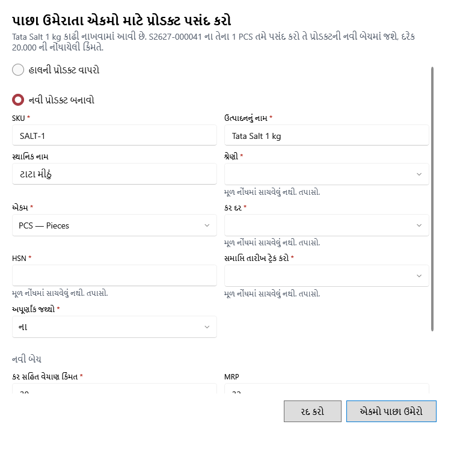

<!-- MT – needs review. Screen help for Choose a product for the restored units (topic "restore-product"); the English file is ../en/restore-product.md. Bold names in a table's first column must match the Gujarati labels on screen; see ../README.md. -->
# પાછા ઉમેરાતા એકમો માટે પ્રોડક્ટ પસંદ કરો

જે પ્રોડક્ટના એકમો છે તે કાઢી નખાઈ હોય ત્યારે એકમો ક્યાં પાછા જાય તે પસંદ કરો.

ગ્રાહક પરત, નુકસાન સુધારો કે રદ થયેલું વિક્રેતા પરત કાઢી નાખેલી પ્રોડક્ટના એકમો પાછા લાવે ત્યારે આ ખૂલે છે. શીર્ષક નીચેની લીટી કહે છે કે કયા એકમો અને કઈ કિંમતે. તે તમે પસંદ કરો તે પ્રોડક્ટની નવી બેચમાં, તેમની નોંધાયેલી કિંમતે જાય છે. પ્રોડક્ટનો એકમ એ જ હોવો જોઈએ, અથવા એવો એકમ જે એ જથ્થો લઈ શકે. એ જ વસ્તુનું પછીનું પરત પૂછ્યા વગર એ જ પ્રોડક્ટમાં જાય છે.

## હાલની પ્રોડક્ટ વાપરો

| ખાનું | અર્થ |
|---|---|
| **હાલની પ્રોડક્ટ વાપરો** | એ જ પ્રકારની સક્રિય પ્રોડક્ટ પસંદ કરો, જેમ કે તમે હાથે ફરી ઉમેરેલી. |
| **નામ અથવા SKU થી સક્રિય પ્રોડક્ટ શોધો** | યાદી ટૂંકી કરે છે. પ્રોડક્ટ પસંદ કરવાથી નવી બેચની કિંમતો તેમાંથી ભરાય છે. |
| **SKU**, **નામ**, **એકમ**, **કિંમત**, **MRP** | પ્રોડક્ટનો SKU, નામ, એકમ, વેચાણ કિંમત અને MRP. |

## નવી પ્રોડક્ટ બનાવો

| ખાનું | અર્થ |
|---|---|
| **નવી પ્રોડક્ટ બનાવો** | વેચાણે સાચવેલી વિગતોથી પ્રોડક્ટ ફરી બનાવો. ન સચવાયેલી વિગત તેના ખાના નીચે એમ કહે છે: તે તપાસો. |
| **SKU** | નવી પ્રોડક્ટનો SKU. તે વપરાશમાં ન હોવો જોઈએ. |
| **ઉત્પાદનનું નામ**, **સ્થાનિક નામ** | તેનું નામ, અને સ્થાનિક ભાષામાં તેનું નામ. |
| **શ્રેણી**, **એકમ** | તે ક્યાં દેખાય છે, અને તે શેમાં ગણાય છે. |
| **કર દર**, **HSN** | તેનો કર દર અને HSN કોડ; દુકાનની કર રીત નિયમિત GST હોય ત્યારે જરૂરી. |
| **સમાપ્તિ તારીખ ટ્રેક કરો**, **અપૂર્ણાંક જથ્થો** | હા કે ના. ન સચવાયેલું તમે પસંદ ન કરો ત્યાં સુધી ખાલી રહે છે. |

## નવી બેચ

| ખાનું | અર્થ |
|---|---|
| **કર સહિત વેચાણ કિંમત** | નવી બેચની વેચાણ કિંમત. તે MRP થી વધુ ન હોઈ શકે. |
| **MRP** | નવી બેચની MRP. |
| **બેચની સમાપ્તિ તારીખ** | નવી બેચની મુદત. પ્રોડક્ટની મુદત રખાતી હોય અને કોઈ સચવાઈ ન હોય ત્યારે પૂછાય છે. |

## બટન

| બટન | શું કરે છે |
|---|---|
| **એકમો પાછા ઉમેરો** | એકમો નવી બેચમાં મૂકે છે, અને પરત, સુધારો કે રદ કરવું આગળ વધે છે. |
| **રદ કરો** | ફેરફાર વગર બંધ કરે છે; પરત, સુધારો કે રદ કરવું થતું નથી. |
