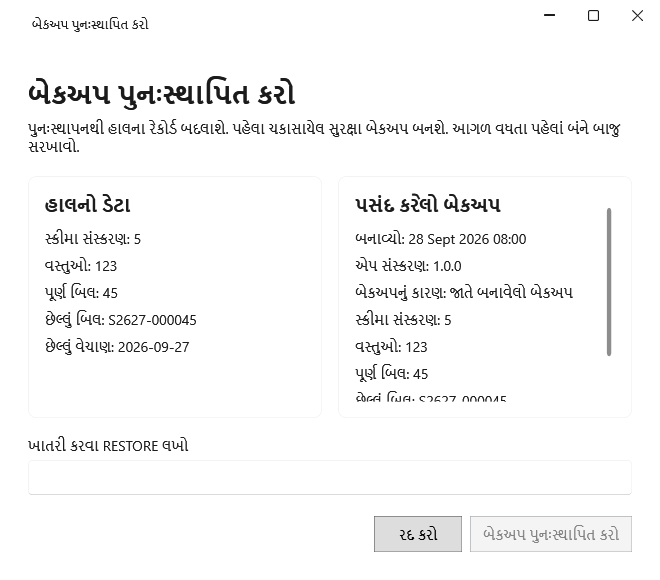

<!-- MT – needs review. Screen help for Restore a backup (topic "restore"); the English file is ../en/restore.md. Bold names in a table's first column must match the Gujarati labels on screen; see ../README.md. -->
# બેકઅપ પુનઃસ્થાપિત કરો

બંનેને સરખાવ્યા પછી, દુકાનનો ડેટા બેકઅપથી બદલો.

પુનઃસ્થાપન બેકઅપ લીધા પછી દાખલ થયેલું બધું બદલી નાખે છે. પહેલાં હાલના ડેટાનો ચકાસેલો સુરક્ષા બેકઅપ સચવાય છે, પછી એપ બંધ થાય છે; પુનઃસ્થાપિત ડેટા તપાસવા તેને ફરી ખોલો, અથવા તેને પાછું કરવા સુરક્ષા બેકઅપ પુનઃસ્થાપિત કરો.

## ખાનાં

| ખાનું | અર્થ |
|---|---|
| **હાલનો ડેટા** | અત્યારનો ડેટા: તેની આવૃત્તિ, તેમાં કેટલાં ઉત્પાદનો અને પૂર્ણ બિલ છે, અને છેલ્લું બિલ અને વેચાણ. |
| **પસંદ કરેલો બેકઅપ** | બેકઅપ માટે એ જ, તે ક્યારે અને કેમ લેવાયો તેની સાથે. પુનઃસ્થાપિત કરતાં પહેલાં બંને સરખાવો. |
| **ખાતરી કરવા RESTORE લખો** | **બેકઅપ પુનઃસ્થાપિત કરો** ચાલુ કરવા કેપિટલ અક્ષરોમાં RESTORE લખો. |

## બટન

| બટન | શું કરે છે |
|---|---|
| **બેકઅપ પુનઃસ્થાપિત કરો** | સુરક્ષા બેકઅપ સાચવે છે, પસંદ કરેલો પુનઃસ્થાપિત કરે છે અને એપ બંધ કરે છે. |
| **રદ કરો** | ફેરફાર વગર બંધ કરે છે. |
