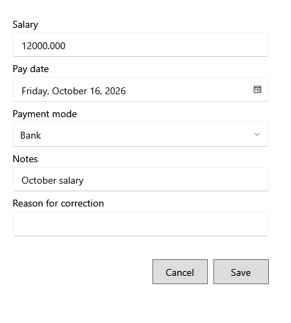

<!-- MT – needs review. Screen help for Correct salary payment and Void salary payment (topic "salary-correction"); the English file is ../en/salary-correction.md. Bold names in a table's first column must match the Gujarati labels on screen; see ../README.md. -->
# પગાર ચુકવણી સુધારો

ખોટી નોંધાયેલી પગાર ચુકવણી કારણ સાથે સુધારો, અથવા રદ કરો.

પોસ્ટ થયેલી ચુકવણી ક્યારેય ફરી લખાતી નથી: ફેરફાર તેના કારણ સાથે સુધારા તરીકે સચવાય છે. શીર્ષક નીચેની લીટી કહે છે કે ફેરફાર ક્યાં ગણાશે. **નોંધ રદ કરો** ચુકવણીને શૂન્ય કરે છે અને પાછું કરી શકાતું નથી.

## ખાનાં

| ખાનું | અર્થ |
|---|---|
| **પગાર** | સુધારેલી રકમ. |
| **ચુકવણી તારીખ** | સુધારેલી ચુકવણી તારીખ. |
| **ચુકવણી રીત** | રોકડ, UPI, બેંક કે અન્ય. |
| **નોંધ** | રાખવા જેવી બીજી કોઈ વિગત. |
| **સુધારાનું કારણ** | કેમ બદલાય છે. જરૂરી; તે સુધારા સાથે રહે છે. |

## બટન

| બટન | શું કરે છે |
|---|---|
| **સાચવો** | સુધારો સાચવે છે. |
| **નોંધ રદ કરો** | રદ કરતી વખતે દેખાય છે: ચુકવણીને શૂન્ય કરે છે. |
| **રદ કરો** | ફેરફાર વગર બંધ કરે છે. |
