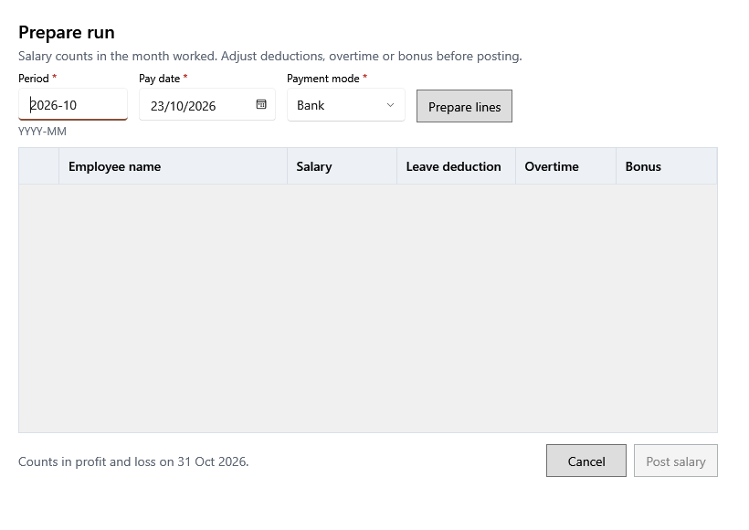

<!-- MT – needs review. Screen help for Prepare run (topic "salary-run"); the English file is ../en/salary-run.md. Bold names in a table's first column must match the Gujarati labels on screen; see ../README.md. -->
# પગાર તૈયાર કરો

એક મહિનાનો પગાર સાથે ચૂકવો: દરેક કર્મચારી માટે હરોળ તૈયાર કરો, બદલો, પછી પોસ્ટ કરો.

ચુકવણી તારીખ ગમે તે હોય, પગાર નફા-નુકસાનમાં કામ કરેલા મહિનામાં ગણાય છે. **હરોળ તૈયાર કરો** એ મહિને કામ કરનાર અને એ મહિનાનો પગાર ન મળેલો હોય એવા દરેક સક્રિય કર્મચારીને, એ મહિને લાગુ માસિક પગાર સાથે, બતાવે છે. દરેક હરોળ પગાર − રજા કપાત + વધારાનું કામ + બોનસ ચૂકવે છે, અને શૂન્યથી વધુ ચૂકવવી જોઈએ. પોસ્ટ કરતાં પહેલાં કર્મચારીઓની સંખ્યા અને કુલની પુષ્ટિ પૂછાય છે. મહિનામાં વહેલા આપેલા પૈસા એ મહિનાના પગારનો ભાગ છે: આખો મહિનો અહીં પોસ્ટ કરો અને હરોળની નોંધમાં લખો. મહિનાનો પગાર પોસ્ટ થયા પછીની ચુકવણી ખર્ચ છે.

## ખાનાં

| ખાનું | અર્થ |
|---|---|
| **સમયગાળો** | કામ કરેલો મહિનો, YYYY-MM રૂપે લખેલો. તે અંતિમ થયેલા વર્ષમાં ન હોઈ શકે. |
| **ચુકવણી તારીખ** | પગાર ચૂકવાય તે દિવસ. |
| **ચુકવણી રીત** | બધી હરોળ માટે રોકડ, UPI, બેંક કે અન્ય. |

## હરોળ

| કૉલમ | અર્થ |
|---|---|
| (પસંદ) | પસંદ કરેલી હરોળ પોસ્ટ થાય છે. પછી ચૂકવવા કર્મચારીની પસંદ કાઢો. |
| **કર્મચારીનું નામ** | કોને ચૂકવાય છે. |
| **પગાર** | મહિનાનો પગાર; જરૂર હોય તો આ મહિના માટે બદલો. |
| **રજા કપાત** | પગાર વગરની રજા માટે બાદ. તે પગારથી વધુ ન હોઈ શકે. |
| **વધારાનું કામ** | વધારાના કલાકો માટે ઉમેરો. |
| **બોનસ** | બોનસ તરીકે ઉમેરો. |

## બટન

| બટન | શું કરે છે |
|---|---|
| **હરોળ તૈયાર કરો** | સમયગાળા માટે ચૂકવવાના કર્મચારીઓ બતાવે છે. |
| **પગાર પોસ્ટ કરો** | તમે પુષ્ટિ કરો પછી પસંદ કરેલી હરોળ પોસ્ટ કરે છે. |
| **રદ કરો** | પોસ્ટ કર્યા વગર બંધ કરે છે. |
