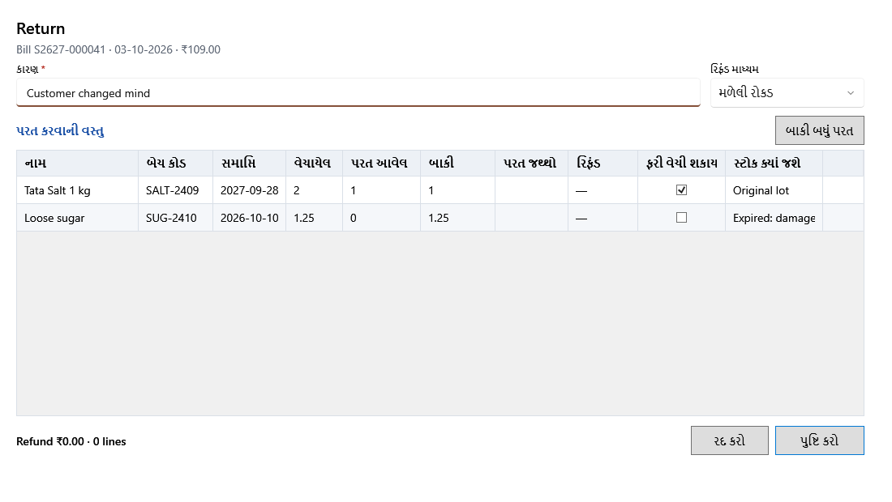

<!-- MT – needs review. Screen help for a bill's Return (topic "sale-return"); the English file is ../en/sale-return.md. Bold names in a table's first column must match the Gujarati labels on screen; see ../README.md. -->
# પરત

પૂર્ણ થયેલા બિલમાંથી વસ્તુઓ પાછી લો અને ગ્રાહકને રિફંડ આપો.

શીર્ષક નીચેની લીટી બિલ બતાવે છે. પાછી આવતી દરેક લાઇન પર પરત જથ્થો લખો, અથવા **બાકી બધું પરત** વાપરો. રિફંડ એ જથ્થાનો, ડિસ્કાઉન્ટ પછી ગ્રાહકે લાઇન માટે ચૂકવેલી રકમમાંથી ભાગ છે. પરત આજની તારીખે ગણાય છે, અને પરતની રસીદ છપાય છે. એકમ પાછો એવી વસ્તુમાં જાય જે પછી કાઢી નખાઈ હોય, ત્યારે કઈ વસ્તુ તેને લે તે પૂછવામાં આવે છે.

## ખાનાં

| ખાનું | અર્થ |
|---|---|
| **કારણ** | વસ્તુઓ કેમ પાછી આવે છે. જરૂરી. |
| **રિફંડ માધ્યમ** | રિફંડ કેવી રીતે ચૂકવાય છે: **રોકડ**, **UPI** અથવા **કાર્ડ**. રોકડ રિફંડ દિવસના અંતે અપેક્ષિત રોકડ ઘટાડે છે. |

## પરત કરવાની વસ્તુ

| કૉલમ | અર્થ |
|---|---|
| **નામ**, **બેચ કોડ**, **સમાપ્તિ** | વસ્તુ અને જે બેચમાંથી તે વેચાઈ હતી. |
| **વેચાયેલ** | બિલે કેટલું વેચ્યું. |
| **પરત આવેલ** | પહેલેથી કેટલું પાછું આવ્યું. |
| **બાકી** | હજી કેટલું પાછું આવી શકે. |
| **પરત જથ્થો** | અત્યારે કેટલું પાછું આવે છે, બાકી જેટલું સુધી. |
| **રિફંડ** | એ જથ્થાનું રિફંડ. |
| **ફરી વેચી શકાય** | વસ્તુ ફરી વેચી શકાય ત્યારે પસંદ. નુકસાનવાળી વસ્તુ માટે પસંદ કાઢો. |
| **સ્ટોક ક્યાં જશે** | વેચાયેલી બેચ વેચાણ પછી બદલાઈ ન હોય ત્યારે **મૂળ બેચ**; નહીં તો **નવી પરત બેચ**, વેચાયેલી બેચની કિંમત અને કર સાથે; ફરી વેચી ન શકાય ત્યારે **નુકસાનવાળી**; તેની બેચની મુદત વીતી હોય ત્યારે **સમાપ્ત: નુકસાન**. |

## બટન

| બટન | શું કરે છે |
|---|---|
| **બાકી બધું પરત** | દરેક લાઇનમાં પરત થઈ શકે તેટલો બધો જથ્થો ભરે છે. |
| **પુષ્ટિ કરો** | પરત નોંધે છે અને તેની રસીદ છાપે છે. |
| **રદ કરો** | ફેરફાર વગર બંધ કરે છે. |
